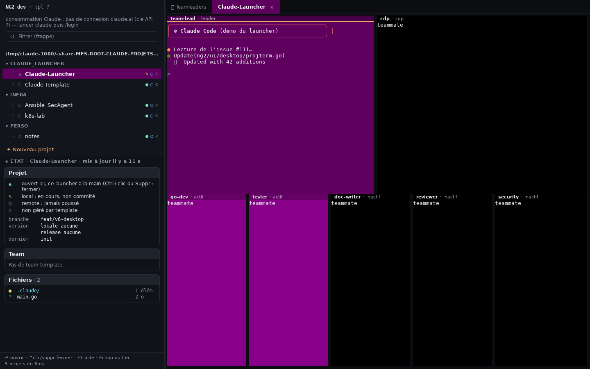

# Claude Launcher

Launcher pour piloter plusieurs projets Claude Code en parallèle : coque tmux sous Linux et macOS,
application native sous Windows. Compagnon de
[`claude_project_template`](https://github.com/CCoupel/claude_project_template) — mais utilisable
avec n'importe quel projet Claude Code.

**Site** : https://ccoupel.github.io/Claude-Launcher/

Le launcher est **Claude-Launcher-NG2** (v6) : un binaire Go, réactif, avec deux interfaces sur un
même cœur.

| Système | Interface | Les projets tournent |
|---|---|---|
| **Linux, macOS** | la **coque tmux** : navigateur de projets à gauche, tmux à droite ([ci-dessous](#linux-et-macos--la-coque-tmux)) | sur l'hôte, ou dans un conteneur local ou distant |
| **Windows** (v6) | une **application native** (`claude-launcher-ng2.exe`) : arbre des projets, cartes, un terminal par agent ([ci-dessous](#windows--lapplication-native)) | dans un conteneur **distant** (docker/podman en `tcp://` ou `ssh://`, `ssh`, Kubernetes) |

Depuis la v5, un projet peut **s'exécuter dans un conteneur** (podman, docker, podman ou docker par
ssh, Kubernetes) : il n'installe plus rien sur votre OS, choisit sa distribution (Debian, Ubuntu,
Rocky, Alpine…), peut tourner sur une autre machine, et sa session survit à l'arrêt du launcher.
Sans configuration, un projet tourne sur l'hôte comme avant (Linux et macOS). La v6 ajoute le
launcher **Windows natif** ; sous Linux, la coque tmux ne change pas.

> **v4 (Claude-Launcher-NG, `claude-launcher-ng`) est dépréciée.** Elle reste installable
> (voir [Revenir à la v4](#revenir-à-la-v4)) mais ne reçoit plus d'évolutions.
> **Passer de la v4 à la v5/v6 (ou revenir) uniquement avec tous les projets fermés.**
> Le passage de la v5 à la v6 se fait tout seul : voir [Passage à la v6](#passage-à-la-v6).

---

## Linux et macOS : la coque tmux

Un navigateur de projets à gauche, tmux à droite :

- **Navigateur** : vos projets en arbre par catégorie (les sous-dossiers de `GITHUB_DIRS`), filtre à la
  frappe, souris. Badges git **local** (`●` au repos sur main, `✎` en cours, `◆` tout commité, `!` modifié
  sur main) et **remote** (`○` jamais poussé, `↑N` non poussé, `⇡` non mergé, `✓` publié, `↓N` en retard),
  badge template (`✔` à jour, `⚠` en retard, `⊘` sans template), badge milestone GitHub (`⚑` jaune en
  cours, orange terminé mais à publier, gris aucun en cours, vert publié — même règle que le panneau
  milestone du projet), `⇄N` (violet) = N pull requests ouvertes, `↺` si une session Claude est restée
  en suspens (rouge si interrompue par un crash), **exécution** (`⬡` env.yaml / conteneur pas encore
  créé, `⬢` cyan conteneur en marche, `⬢` gris arrêté, `⚠` backend inutilisable ou configuration
  invalide), consommation du compte Claude en bas. Les dossiers ajoutés, renommés ou supprimés
  apparaissent ou disparaissent seuls ; une racine devenue inaccessible (stockage partagé démonté) est
  marquée `⚠ inaccessible` et ses projets reviennent seuls au remontage.
- **`◈ État`, sous le navigateur** : suit la sélection et détaille le projet sans l'ouvrir — légende des
  icônes de sa ligne, git, versions, template, composition de la team (version du template de chaque
  teammate, modèle, effort, version de claude), fichiers.
- **Onglet `⌗ Teamleaders`** : une vignette interactive par projet ouvert, à la couleur du projet.
- **Un onglet par projet** : le teamleader et ses teammates, rangés automatiquement (voir
  [Mise en page des teams](#mise-en-page-des-teams)) — sur l'hôte ou dans le conteneur du projet.
- **Création de projet** : double-clic sur une catégorie (ou « ✦ Nouveau projet ») — nom, type
  (**géré** : `git init`, remote facultatif, claude démarre sur `/init-project` ; **brut** : dossier et
  `CLAUDE.md` minimal), puis **exécution** (hôte ou socle de conteneur).
- **Mises à jour** : au lancement, NG2 installe la dernière release (binaire vérifié contre
  `SHA256SUMS`) ; une version sortie pendant qu'il tourne est annoncée et s'installe d'un clic. Un
  nouveau template est annoncé (masquable).
- **Connexion claude.ai surveillée** : ligne jaune 3 jours avant son expiration, rouge une fois expirée ;
  un clic ouvre `claude /login`.

| Action | Effet |
|---|---|
| `↑` `↓` `PgUp` `PgDn`, molette, clic sur un projet | sélectionner → détail sous le navigateur (un clic sur un projet ouvert bascule sur sa fenêtre) |
| `Entrée`, double-clic sur un projet | ouvrir / rejoindre le projet (un projet jamais configuré demande d'abord où il tourne) |
| `F2` sur un projet fermé | reconfigurer son exécution : hôte, socle, backend |
| clic hors projet (catégorie, zone vide, en-tête) | onglet `⌗ Teamleaders` |
| double-clic sur une catégorie ou une racine | créer un projet dans ce dossier |
| frappe | filtrer |
| `Ctrl+←` `Ctrl+→` ou glisser la bordure | redimensionner le navigateur (mémorisé) |
| `Tab`, `Alt+←/→` | passer du navigateur à tmux |
| `Ctrl+B R` dans un projet | remettre en ordre les panes de la team |
| double-clic sur un pane d'une team | plein écran (comme `Ctrl+B z`) ; à nouveau pour revenir |
| dans un projet en conteneur | `Ctrl+B` + touche agit dans le conteneur ; `Ctrl+B Ctrl+B` + touche = préfixe du hub |
| clic sur `↑ NG … cliquer pour installer` (vert) | installer la nouvelle version, déjà téléchargée et contrôlée (projets conservés) |
| clic sur `↑ NG … réessayer` (jaune) | relancer tout de suite le téléchargement de la nouvelle version |
| clic sur `↑ tpl … cliquer pour installer` (vert) | adopter la nouvelle version du template |
| `Ctrl+U`, clic sur `✕` | masquer une annonce de mise à jour |
| clic sur `⚠ connexion claude.ai …` / `✗ … expirée` | fenêtre `login` qui lance `claude /login` |
| `F5` | rechercher les mises à jour, relire la consommation et la liste des projets maintenant |
| `F1` | aide : commandes et raccourcis |
| `Esc` | effacer le filtre ; sinon quitter : `l` launcher seul (projets conservés), `t` puis `o` tout fermer |

Détails, architecture et dépannage : [`ng2/README.md`](ng2/README.md).

---

## Windows : l'application native



`claude-launcher-ng2.exe` est une **application Windows** (Wails + WebView2) : un double-clic ouvre
une fenêtre, sans terminal ni tmux sur le poste. Elle s'adresse à ceux dont le poste de travail est
sous Windows et dont les projets tournent sur des serveurs Linux (docker, podman, ssh, Kubernetes) :
même arbre, mêmes badges et mêmes règles que la coque, puisque les deux interfaces partagent le même
code (`core`).

- **À gauche** : versions et annonces de mise à jour, consommation du compte Claude, filtre, **arbre
  des projets** par racine et catégorie (rendu d'un arbre Windows 11, compact, racines et catégories
  repliables), avec la pastille d'état et tous les badges de la coque ; dessous, les **cartes
  ◈ État** du projet sélectionné (Projet et légende, Milestone, Team, Fichiers), repliables.
- **À droite** : l'onglet **⌗ Teamleaders** (une vignette interactive du leader de chaque projet
  ouvert) et **un onglet par projet ouvert**, allumé tant qu'un agent travaille. Dans un onglet,
  chaque agent (leader, teammates) est un **terminal** (xterm.js) à la place que lui donne tmux :
  même mise en page des teams que la coque (leader et `cdp` en haut, actifs éclaircis en ordre MRU,
  inactifs assombris).
- **Ouverture** par double-clic ou `Entrée` : sortie et questions de l'ouverture dans un terminal,
  puis les questions du template (`/init-project`) et de reprise dans le pane du leader, comme sous
  Linux. Fermer la fenêtre **détache** l'interface : les sessions continuent dans leur conteneur et
  sont retrouvées au lancement suivant.
- **En-tête** : thème **Auto / Jour / Nuit** (Auto suit Windows) et **`⚙ config`** (`Ctrl+,`), un
  éditeur des fichiers de configuration (`config.conf`, `backends.yaml`, `env.yaml`) qui valide à la
  frappe et refuse d'enregistrer un fichier invalide.

| Action | Effet |
|---|---|
| `↑` `↓`, clic | sélectionner un projet (cartes ◈ État) ; clic sur un projet ouvert : son onglet |
| `Entrée`, double-clic | ouvrir / rejoindre le projet |
| `Ctrl`+clic, `Suppr` | fermer le projet (question o/N, `/exit`, arrêt du conteneur) |
| double-clic sur une catégorie, `✦ Nouveau projet` | créer un projet |
| frappe | filtrer ; `Échap` efface le filtre |
| `F1` / `F2` / `F5` | aide et légende / exécution du projet / mises à jour, conso et arbre maintenant |
| `Ctrl+D` / `Ctrl+,` | diagnostic des backends / fichiers de configuration |
| double-clic sur l'en-tête d'un pane, `Ctrl+B z` | plein écran du pane (aller-retour) |
| `Ctrl+B R` | remettre en ordre la team |
| `Ctrl+Maj+W`, `×` de l'onglet | détacher l'onglet (la session continue) |
| `Échap` (filtre vide) | quitter : `l` l'interface seule, `t` puis `o` tout fermer |

**Différences avec la coque Linux** : pas de projet « sur l'hôte » ni de moteur local (`host`,
Docker Desktop, socket locale : refusés avec un message) ; pas de tmux sur le poste, le tmux de
chaque projet tourne dans son conteneur ; les commandes utiles du préfixe `Ctrl+B` ont un
équivalent ; détacher / rattacher la coque d'un autre terminal n'a pas d'objet. Tableau complet des
raccourcis et fonctionnement : [`ng2/README.md` — Interface native](ng2/README.md#interface-native-desktop).

Sous Linux, `claude-launcher-ng2 desktop` sert la même interface dans le navigateur ; la coque tmux
reste le défaut.

---

## Installation

### Linux et macOS

**1. NG2** — un binaire statique par plateforme (linux et macOS, amd64 et arm64), publié avec chaque
release, accompagné d'un `SHA256SUMS` :

```bash
os=$(uname -s | tr A-Z a-z); arch=$(uname -m)
case "$arch" in x86_64) arch=amd64 ;; aarch64) arch=arm64 ;; esac
curl -fsSL "https://github.com/CCoupel/Claude-Launcher/releases/latest/download/claude-launcher-ng2-$os-$arch" \
  -o ~/.local/bin/claude-launcher-ng2 && chmod +x ~/.local/bin/claude-launcher-ng2
```

Prérequis : `tmux`, `git`, `bash` (lecture de la config) et `claude`. Pour les projets en conteneur,
selon le backend : `podman`, le client `docker`, `kubectl` ou `ssh` (rien à préinstaller dans les
images : le launcher y installe tmux, git, claude et les paquets du projet).

**2. Configuration** — au premier lancement, NG2 crée `~/.config/claude-launcher-ng2/config.conf`
(copie de la config v4 `~/.config/claude-launcher.conf` si elle existe). Pour un launcher portable
(binaire sur un stockage partagé), la config peut être posée **à côté du binaire**, dans
`.config/claude-launcher-ng2/` : elle est alors prioritaire.

```bash
claude-launcher-ng2 configure   # crée la config si besoin et l'ouvre dans $EDITOR (nano par défaut)
claude-launcher-ng2 backends    # backends d'exécution, conteneurs, diagnostic
claude-launcher-ng2 help        # commandes et raccourcis (F1 dans le launcher)
```

**3. Lancement** :

```bash
claude-launcher-ng2
```

### Windows

Prérequis : Windows 10 à jour ou Windows 11 (amd64), au moins un backend **distant** (docker ou
podman exposé en `tcp://` ou joint par `ssh://`, machine `ssh`, ou Kubernetes), et les projets sur
un **stockage partagé** que ces backends montent (NFS, MooseFS…) et que le poste voit (partage
réseau, lecteur réseau ou `\\wsl.localhost\…`).

**1. L'exécutable** — `claude-launcher-ng2.exe` est publié avec chaque release, dans le même
`SHA256SUMS` que les binaires Linux et macOS. Le poser dans un dossier **où vous pouvez écrire**
(la mise à jour automatique remplace l'exe en place : pas `C:\Program Files`). Dans PowerShell :

```powershell
$d = "$env:LOCALAPPDATA\Programs\claude-launcher-ng2"; New-Item -ItemType Directory -Force $d | Out-Null
$u = "https://github.com/CCoupel/Claude-Launcher/releases/latest/download"
Invoke-WebRequest "$u/claude-launcher-ng2.exe" -OutFile "$d\claude-launcher-ng2.exe"
Invoke-WebRequest "$u/SHA256SUMS" -OutFile "$d\SHA256SUMS"
(Get-FileHash "$d\claude-launcher-ng2.exe").Hash.ToLower()       # même somme que la ligne ci-dessous
Select-String -Path "$d\SHA256SUMS" -Pattern "claude-launcher-ng2.exe"
```

L'exe n'est pas signé : si SmartScreen bloque le premier lancement d'un fichier téléchargé par le
navigateur, « Informations complémentaires » → « Exécuter quand même ». Variante **portable** : poser
l'exe à côté d'un dossier `.config\claude-launcher-ng2\` qui contient un `config.conf` (par exemple
sur le stockage partagé, à côté du binaire Linux) ; il prend alors cette configuration, partagée avec
le hub Linux (étape 4).

**2. Runtime WebView2** — présent sur Windows 11 et Windows 10 à jour ; sinon :
`winget install --id Microsoft.EdgeWebView2Runtime -e`.

**3. Outils externes** — non embarqués. Le launcher pilote les backends par leurs clients en ligne
de commande ; il ne demande que ceux des backends **déclarés**, et l'écran « Premier lancement —
outils requis » liste ceux qui manquent avec leur commande :

| Outil | Requis par | Installation |
|---|---|---|
| `git` | le launcher (badges, template) | `winget install --id Git.Git -e` |
| `gh` | facultatif (sinon l'API GitHub) | `winget install --id GitHub.cli -e` |
| `ssh` | backend `ssh`, docker en `ssh://` | intégré à Windows 10/11 ; sinon `Add-WindowsCapability -Online -Name OpenSSH.Client~~~~0.0.1.0` |
| `docker` | backends docker (client seul, sans Docker Desktop) | `winget install --id Docker.DockerCLI -e` |
| `podman` | backends podman | `winget install --id RedHat.Podman -e` |
| `kubectl` | backend `k8s` | `winget install --id Kubernetes.kubectl -e` |

`claude` n'est pas nécessaire sur le poste (il tourne dans les conteneurs), sauf pour lancer
`claude /login` depuis l'alerte de connexion ; sinon `/login` se tape dans le leader d'un projet.

**4. Configuration** — `config.conf`, `backends.yaml` et `projects.json` sont dans
`%AppData%\claude-launcher-ng2\` (ou le dossier portable), le cache dans
`%LocalAppData%\claude-launcher-ng2\`. Le plus simple est de **partager la configuration du hub
Linux** (mode portable) : elle reste écrite en chemins Linux, et il suffit d'ajouter au
`backends.yaml` un bloc pour la machine Windows (son nom d'hôte, que WSL reprend) :

```yaml
hubs:
  MON-PC:                                   # nom de la machine Windows (hostname)
    paths:                                  # chemin vu du poste → chemin Linux des backends
      - { local: '\\wsl.localhost\Ubuntu\share\MFS', remote: /share/MFS }
    windows:                                # réglages de cette machine pour l'exe Windows seulement
      browser_server: { listen: 127.0.0.1:8766 }       # facultatif : c'est le défaut sous Windows
      hub_cache: '\\wsl.localhost\Ubuntu\home\moi\.cache\claude-launcher-ng2'   # facultatif
```

- `paths` : le launcher lit les projets par le chemin du poste, mais transmet **toujours** le chemin
  Linux aux backends (montages, noms, labels, `CLAUDE_CONFIG_DIR`, `projects.json`) : un projet
  ouvert de Windows ou du hub Linux est le même. Une entrée de forme Windows ne vaut que sous
  Windows : le hub Linux qui lit le même fichier n'en voit rien.
- `windows:` (comme `linux:` et `darwin:`) surcharge les réglages de la machine pour un seul
  système : `browser_server` (serveur web des fichiers ouverts dans Chrome : 8765 pour le hub Linux,
  8766 pour l'exe Windows par défaut, car WSL partage le `localhost` de Windows), `hub_cache` (cache
  d'état du hub Linux, lu sans y écrire, pour afficher l'arbre plus vite à travers
  `\\wsl.localhost`), `browser_paths`, `browser_device`, `paths`, `remote_user`.
- Une clé mal tapée sous `hubs:` n'est **jamais une erreur** (le fichier est partagé avec le hub de
  production) : elle est ignorée et signalée par un bandeau au démarrage et par le diagnostic.
- Sans configuration partagée : `claude-launcher-ng2.exe configure` (Bloc-notes) ou `⚙ config` dans
  l'interface. Dans `config.conf`, écrire un chemin Windows entre **guillemets simples** :
  `GITHUB_DIRS=('\\wsl.localhost\Ubuntu\share\MFS\ROOT\CLAUDE_PROJETS')`.

**Avertissements**

- Seuls les backends **distants** sont acceptés : `host`, docker ou podman sans `host` (socket
  locale, Docker Desktop) sont refusés, avec un message dans le diagnostic et à l'ouverture.
- **kubectl** lit `%USERPROFILE%\.kube\config`, pas le `~/.kube/config` du hub Linux : le copier
  (depuis WSL : `cp ~/.kube/config /mnt/c/Users/<vous>/.kube/config`) ou définir `KUBECONFIG`.
- Le stockage partagé doit être visible **avant** le lancement : le launcher ne démarre pas WSL.
  Les projets lus par `\\wsl.localhost` (9P) ou un lecteur réseau sont relus périodiquement ; en
  cas de lenteur, joindre `%LocalAppData%\claude-launcher-ng2\desktop-perf.log` au signalement.
- Un `listen` déclaré pour les deux systèmes (`hubs.<machine>.browser_server`, `defaults`) vaut pour
  les deux : donner alors son propre port à l'exe, sous `windows:`.

**5. Lancement** — double-clic sur `claude-launcher-ng2.exe`. `Ctrl+D` (ou
`claude-launcher-ng2.exe backends` dans une invite) affiche le diagnostic : backends, outils,
correspondance des chemins, serveur web, réglages ignorés. L'exe se met à jour comme le hub Linux :
l'annonce orange → jaune → verte prépare la nouvelle version, un clic l'installe (l'ancien exe est
renommé en `.old`, supprimé au lancement suivant). Détails :
[`ng2/README.md` — Windows](ng2/README.md#windows-v6).

### Configuration (`config.conf`)

`claude-launcher-ng2 configure` crée la configuration si besoin et l'ouvre ; sous Windows, `⚙ config`
l'édite aussi dans l'interface.

**Variables disponibles dans la config :**

| Variable | Rôle |
|----------|------|
| `GITHUB_DIR` | Répertoire contenant vos projets |
| `GITHUB_DIRS` | Plusieurs dossiers racine (remplace `GITHUB_DIR`) ; les projets sont rangés par catégorie |
| `GITHUB_TOKEN` | Token GitHub (gh CLI + MCP) |
| `CLAUDE_DISABLE_MOUSE` | `1` = désactive la souris dans Claude Code |
| `CLAUDE_EXPERIMENTAL_TEAMS` | `1` = active les agent teams |
| `CLAUDE_OPTIONS` | Options passées à `claude` |
| `RESUME_MODE` | Reprise de la dernière conversation à l'ouverture d'un projet : `ask` (question, défaut), `always`, `never` |
| `RESUME_MAX_AGE_H` | Reprise proposée seulement si la conversation a moins de N heures (défaut 24) |
| `EXTRA_ENVS` | Variables d'environnement supplémentaires |
| `COLOR_PALETTE`, `PROJECT_COLORS` | Couleurs de fond des projets (indices tmux 256) |
| `PANE_ACTIVE_BRIGHTEN_STEP`, `PANE_INACTIVE_DARKEN_STEP` | Teinte des teammates actifs (éclaircis) et inactifs (assombris), 1 = léger, 5 = fort (défaut 1) |
| `LAYOUT_2ROW_LEADER_PCT` | Hauteur du teamleader (%) quand la team tient sur 2 lignes (≤ 5 teammates, défaut 50) |
| `LAYOUT_3ROW_LEADER_NUM`, `LAYOUT_3ROW_MID_NUM`, `LAYOUT_3ROW_DEN` | Au-delà de 5 teammates : fractions leader / ligne du milieu (défaut 3/7 et 2/7) |
| `CLAUDE_CONFIG_DIR` | Config de claude (`~/.claude` par défaut) pour toutes les sessions du launcher, hôte et conteneurs ; relative au dossier de la config ; une variable déjà définie au lancement l'emporte |
| `USAGE_REFRESH_SEC` | Secondes entre deux lectures de la consommation du compte (min. 60, défaut 120) ; après un échec (429…), pause de max(5 min, 2 × cette valeur) |

`EXTRA_ENVS` permet de passer n'importe quelle variable d'env à Claude Code :

```bash
EXTRA_ENVS=(
  "ANTHROPIC_API_KEY=sk-ant-..."
  "MY_API_URL=https://api.example.com"
)
```

**Comportements à l'ouverture d'un projet :**
- **Projet jamais configuré** : le launcher demande d'abord où il tourne (hôte, ou un socle de
  conteneur sur un backend) ; le choix est gardé. Un projet configuré se lance **uniquement** sur son
  backend (F2 pour le changer) ; si sa configuration n'est plus valable, il est marqué `⚠` et refusé,
  jamais lancé ailleurs.
- `init-project.md` est copié dans `.claude/commands/` du projet (depuis le cache, resynchronisé depuis
  GitHub) ; si le template du projet est en retard, `claude` démarre sur `/init-project` après
  confirmation.
- **Reprise après crash** : si le projet a une conversation de moins de `RESUME_MAX_AGE_H` heures
  restée en suspens, le launcher propose de la reprendre (`claude --resume <id>`) ; le teamleader
  repris reçoit une consigne pour respawner toute sa team. Rien n'est proposé si la conversation tourne
  encore (sur l'hôte ou dans un conteneur), ni si elle a été close par `/end-session` ou quittée
  proprement (`Ctrl+C`, `/exit`). Un projet non géré par le template reçoit un `/end-session` minimal.
- NG2 se met à jour au lancement, puis vérifie GitHub toutes les 10 minutes (ou sur `F5`).

**Consommation du compte Claude :** sous la liste des projets, les fenêtres de quota du compte
(session, semaine, limites par modèle) — même source que la page « Utilisation » de claude.ai. Le cache
`~/.cache/claude-launcher/usage.json` est **partagé avec les panneaux milestone des projets** (et monté
dans les conteneurs locaux) : le launcher est le seul à appeler l'endpoint tant que ce cache est frais.

---

## Projets en conteneur

Quatre fichiers :

| Fichier | Contenu |
|---|---|
| `<projet>/.claude-launcher/env-template.yaml` (versionné, écrit par le template) | l'environnement de la stack, réécrit par `/init-project` (v5.5.0) |
| `<projet>/.claude-launcher/env.yaml` (versionné) | ce dont le projet a besoin en plus : `image` (le socle), `packages`, `setup`, `mounts`… — fusionné après le template, son `image` l'emporte |
| `~/.config/claude-launcher-ng2/backends.yaml` (machine) | où l'on peut l'exécuter, et les **défauts** présélectionnés (`defaults: { backend, image }`, `images:`) |
| `projects.json`, à côté de `backends.yaml` (dossier de config, partagé en mode portable) | l'affectation de chaque projet (hôte ou backend), choisie à la création, à la 1re ouverture ou par F2, commune à tous les hubs depuis la v5.4.3 (l'ancien `~/.local/state/claude-launcher-ng2/projects.json` est repris une fois) |

```yaml
# backends.yaml
backends:
  podman:      { type: podman }                                     # local
  srv1-docker: { type: docker, host: tcp://srv1:2375,  shared: [/share/MFS/ROOT] }
  srv1:        { type: ssh, host: srv1, engine: podman, shared: [/share/MFS/ROOT] }
  lab:         { type: k8s, context: k8s, namespace: claude-ng2,
                 volumes: { /share/MFS/ROOT: claude-shared } }      # PVC ReadWriteMany
defaults: { backend: podman, image: docker.io/library/debian:12 }
```

- **Socles vérifiés** : Debian 12, Ubuntu 24.04, Rocky 9 (pour RHEL), Alpine 3.20. Il faut tmux ≥ 3.2
  dans les dépôts de l'image (pas UBI sans abonnement, ni RHEL 8).
- **À distance** (docker ou podman en direct, ssh, k8s) : `~/.claude` et les projets doivent être sur
  un **stockage partagé monté aux mêmes chemins** des deux côtés (NFS, MooseFS…) ; le launcher lit
  lui-même conversations, teams et projets.
- **Un backend inutilisable** est signalé `⚠`, et `claude-launcher-ng2 backends` dit quoi corriger
  (client absent, démon non exposé, ssh, podman absent, partage non monté, namespace, PVC…) ;
  elle liste aussi les outils externes (`ssh`, `git`, `docker`/`podman`, `kubectl`, `gh`) qu'exigent
  les backends déclarés.
- **Windows** : backends distants seulement ; le partage vu du poste est relié aux chemins Linux
  par `hubs.<machine>.paths` (voir [Installation — Windows](#windows)).
- **Launcher arrêté** : la session du conteneur (claude et ses teammates) continue ; au relancement,
  NG2 la retrouve et rattache sa fenêtre.
- **Plusieurs launchers sur un même projet** : un seul le pilote ; les autres peuvent le rejoindre en
  lecture seule ou en prendre la main (l'ancien propriétaire passe alors en lecture seule, et reprend
  la main par Entrée sur le projet).

Détails : [`ng2/README.md` — Projets en conteneur](ng2/README.md#projets-en-conteneur-v5).

---

## Mise en page des teams

Dans l'onglet d'un projet (sur l'hôte ou dans son conteneur), NG2 range les panes à chaque arrivée ou
départ d'un teammate et à chaque changement d'activité (d'après `~/.claude/teams/*/config.json`) :

- **en haut** : le teamleader, et les agents de type `cdp` ;
- **dessous** : les teammates, les **actifs d'abord** (le dernier à s'être mis au travail en tête),
  puis les inactifs par nom ; sur une ligne jusqu'à 5 teammates, sur deux au-delà ;
- teammates actifs **éclaircis**, inactifs **assombris**, et le titre de l'onglet s'allume tant qu'un
  agent travaille.

Pour forcer une remise en ordre : `Ctrl+B R` dans l'onglet du projet, ou
`claude-launcher-ng2 relayout <window_id>`.

---

## Passage à la v6

La v6.0.0 ajoute le launcher Windows. **Sous Linux, rien ne change** : même coque, mêmes sessions
tmux (`claude-ui-ng2`, `claude-hub-ng2`), même configuration.

1. **Hub Linux** : un NG2 v5 se met à jour seul en v6, comme pour une version mineure (au lancement,
   ou par l'annonce verte) ; les projets ouverts sont conservés. Rien à modifier dans `config.conf`
   ni dans `backends.yaml`.
2. **Poste Windows** : installer l'exe (voir [Installation — Windows](#windows)) et ajouter le bloc
   `hubs.<machine>` au `backends.yaml`. Un hub v5 qui lirait ce fichier ignore ces clés.
3. **Template** : launcher et template partagent leur version majeure. Un template v6 ne sera
   proposé qu'à un launcher v6 : mettre à jour le launcher avant d'adopter un template v6.
4. **Revenir à la v5** (Linux) : installer la v5.10.0 et la lancer avec `--no-update` (ou
   `CL_NO_UPDATE=1`), sinon elle se remet à jour en v6 :

   ```bash
   curl -fsSL "https://github.com/CCoupel/Claude-Launcher/releases/download/v5.10.0/claude-launcher-ng2-$os-$arch" \
     -o ~/.local/bin/claude-launcher-ng2 && chmod +x ~/.local/bin/claude-launcher-ng2
   claude-launcher-ng2 --no-update
   ```

---

## Passage à la v5

1. **Fermer tous les projets** du launcher v4 (`Esc`, `t` puis `o`). v4 ne connaît pas les conteneurs :
   son nettoyage des teams et sa reprise pourraient prendre une session de conteneur pour morte.
2. Installer NG2 (ci-dessus) : il s'installe **à côté** de v4 (`claude-launcher-ng2`, ses propres
   sessions tmux, sa config et son cache), sans la modifier. La config v4 est copiée au premier
   lancement.
3. Lancer `claude-launcher-ng2`. Chaque projet demande une fois, à sa première ouverture, où il tourne
   (`0 hôte` pour garder le comportement de la v4).
4. Pour les conteneurs : les sessions en conteneur utilisent `CLAUDE_CONFIG_DIR=~/.claude`, donc
   `~/.claude/.claude.json`, **copié** une fois depuis `~/.claude.json` (jamais déplacé : les sessions
   de l'hôte gardent le leur). Pour un backend distant, `~/.claude` et les projets doivent passer sur
   le stockage partagé : suivre le guide pas à pas
   [**Passer ses projets et `~/.claude` sur un stockage partagé**](ng2/MIGRATION.md) (il ne suffit pas
   de copier les projets : conversations, mémoire, réglages par projet et historique sont indexés par
   leur chemin).

Le launcher v4 encore installé continue de chercher ses mises à jour : il affichera « mise à jour
incomplète » (il ne trouve pas de binaire v4 dans les releases v5) — sans conséquence ; le supprimer
(`rm ~/.local/bin/claude-launcher-ng`) une fois la v5 adoptée.

### Revenir à la v4

Avec tous les projets fermés :

```bash
curl -fsSL "https://github.com/CCoupel/Claude-Launcher/releases/download/v4.9.0/claude-launcher-ng-$os-$arch" \
  -o ~/.local/bin/claude-launcher-ng && chmod +x ~/.local/bin/claude-launcher-ng
```

---

## Migration depuis claude_project_template

Le launcher vivait auparavant dans `claude_project_template`. Un `~/claude-launcher.sh` installé
depuis là-bas cherche encore ses mises à jour dans ce repo-là : installer NG2 (étape 1 de
l'installation) et le lancer par `claude-launcher-ng2` ; l'ancien script peut être supprimé.

---

## Utiliser un autre template

Le launcher fetche `init-project.md` depuis `claude_project_template` par défaut. Pour pointer
vers un template différent, modifier la constante `TemplateRepo` de `ng2/core/update.go` et recompiler —
ce n'est pas exposé dans la config à ce jour.

---

## Relation avec claude_project_template

Ce repo ne contenait, jusqu'à récemment, que le launcher au sein de
[`claude_project_template`](https://github.com/CCoupel/claude_project_template) — il en a été
extrait pour permettre un cycle de release indépendant (le launcher est un outil tmux générique,
le template est du contenu Markdown pur : agents, commandes, contextes). L'historique complet des
commits touchant `claude-launcher.sh` a été préservé lors de la migration (le menu bash complet
reste consultable dans l'historique git, jusqu'à la v3.0.17 ; NG v4 dans `ng/`).

`claude_project_template` reste la seule source pour `TEMPLATE_claude/` et `/init-project`.

Le launcher est lui-même développé avec ce template (`/init-project`, v5.9.1) : agents et commandes
dans `.claude/`, milestones et labels de phase sur GitHub, environnements QUALIF (binaires de test
à côté de celui du hub) et PROD (tag, release, remplacement du binaire du hub).

---

## Développement

Une seule CI, `scripts/ci.sh`, identique en local et sur GitHub Actions : `go vet`, `go test` et
compilation de l'exe Windows sous Linux ; sous Windows (Git Bash), les couches communes, système et
l'interface native, puis l'exe lancé en `version`. Elle est appelée par `ng2-tests.yml` (push et PR
vers `main`), `ci-branch.yml` (pré-validation des branches `milestone/*`, sans publier) et
`release.yml` (avant de construire les binaires d'un tag).

## Licence

Copyright (C) 2026 ccoupel

Distribué sous licence GPL-3.0-or-later — voir [LICENSE](LICENSE).
