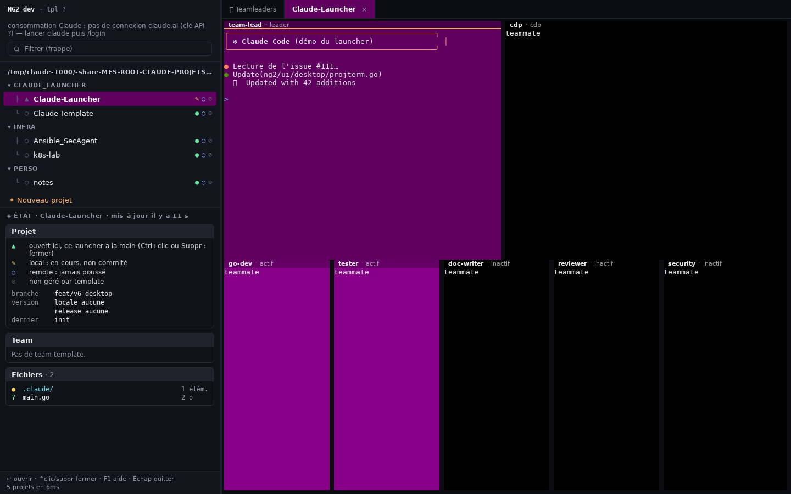
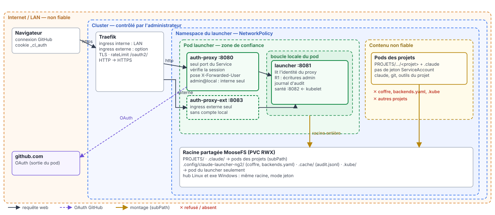

# Claude-Launcher-NG2 (v6)

Binaire Go qui pilote plusieurs projets Claude Code dans tmux : navigateur de
projets à gauche, tmux à droite, une fenêtre par projet (teamleader +
teammates). La v5 ajoute l'**exécution des projets dans des conteneurs** —
podman, docker, podman ou docker par ssh, Kubernetes — avec un tmux par
projet, imbriqué dans le hub et piloté par son canal de contrôle (`tmux -C`).
Sans configuration, un projet tourne sur l'hôte comme en v4. La v6 ajoute un
**launcher Windows natif** (`claude-launcher-ng2.exe`, voir [Windows](#windows-v6)),
qui partage tout le cœur (`core`) avec la coque tmux ; sous Linux, la coque ne
change pas.

NG2 a ses propres noms, et peut tourner à côté d'un launcher v4 : binaire
`claude-launcher-ng2`, coque `claude-ui-ng2`, serveur tmux intérieur
`claude-ng2` (session `claude-hub-ng2`), config
`~/.config/claude-launcher-ng2/`, cache `~/.cache/claude-launcher-ng2/`.
**Passer de v4 à v5/v6 (ou revenir) uniquement avec tous les projets
fermés** ; de v5 à v6, la mise à jour se fait seule (voir
[Changement de version majeure](#changement-de-version-majeure)).

Vue d'ensemble, installation et configuration : [README du repo](../README.md).
Ce document détaille le fonctionnement et le dépannage.

## Installation

### Depuis une release

Chaque tag `v5.*` (et suivants) publie un binaire par plateforme (linux/darwin,
amd64/arm64), depuis la v6 `claude-launcher-ng2.exe` (windows/amd64, interface
native), et un seul `SHA256SUMS` :

```bash
os=$(uname -s | tr A-Z a-z); arch=$(uname -m)
case "$arch" in x86_64) arch=amd64 ;; aarch64) arch=arm64 ;; esac
curl -fsSL "https://github.com/CCoupel/Claude-Launcher/releases/latest/download/claude-launcher-ng2-$os-$arch" \
  -o ~/.local/bin/claude-launcher-ng2 && chmod +x ~/.local/bin/claude-launcher-ng2
claude-launcher-ng2 version
```

Windows : télécharger `claude-launcher-ng2.exe` de la même release, dans un dossier où l'on peut
écrire ; installation pas à pas (WebView2, outils, `backends.yaml`) dans le
[README du repo — Windows](../README.md#windows).

### Depuis les sources

```bash
cd ng2
go build -o ~/.local/bin/claude-launcher-ng2 .
# version : go build -ldflags "-X claude-launcher-ng2/core.NgVersion=v6.0.0" -o ... .
```

Prérequis : `tmux`, `git`, `bash` (lecture de la config) et `claude`. Pour les projets en
conteneur, en plus : le client du moteur (`podman`, `docker`, `kubectl`) ou `ssh`, selon le
backend ; rien n'est à préinstaller dans les images. L'exe Windows : voir
[Construire l'exécutable](#interface-native-desktop).

## Lancement

```bash
claude-launcher-ng2                    # = claude-launcher-ng2 shell
claude-launcher-ng2 desktop            # interface native, dans le navigateur sous Linux (v6, voir Windows)
claude-launcher-ng2 configure          # crée/édite ~/.config/claude-launcher-ng2/config.conf ($EDITOR)
claude-launcher-ng2 relayout WIN_ID    # remet en ordre les panes d'une fenêtre projet (= Ctrl+B R)
claude-launcher-ng2 help               # commandes et raccourcis (= F1 dans le launcher)
claude-launcher-ng2 version
claude-launcher-ng2 backends          # backends, conteneurs et diagnostic
```

Au lancement, les teams mortes de `~/.claude/teams` (et leurs tâches) sont supprimées : une session
Claude coupée laisse la sienne. Une team n'est supprimée que si elle a des teammates avec un pane tmux
et qu'aucun de ces panes n'existe encore ; les teams sans teammate, ou tmux injoignable, ne sont jamais
touchées, ni celles dont la session du leader peut encore être reprise (voir ci-dessous).
Si ce nettoyage dure (stockage réseau), une barre de progression s'affiche au-delà d'une demi-seconde.

### Reprise après crash

À l'ouverture d'un projet, si sa dernière conversation
(`~/.claude/projects/<chemin encodé>/<id>.jsonl`) a moins de `RESUME_MAX_AGE_H` heures (24 par
défaut), le launcher demande s'il faut la reprendre (`RESUME_MODE=ask`, ou `always` / `never`).
Reprendre lance `claude --resume <id>` : même id de session, donc même team
(`session-<8 premiers caractères>`) et même liste de tâches, que le nettoyage ci-dessus a épargnées.
Les teammates ne sont pas restaurés par Claude Code : le teamleader repris reçoit en premier message
la liste des teammates perdus et la consigne de respawner **tout** l'effectif attendu de la team, pas
seulement les agents des tâches en cours (une correction de QA en aura besoin) ; dans un projet du template,
via `/start-session` étape 4 puis 4bis (le template reconnaît la formule « ont été perdus »). La
question n'est pas posée si la team indique un leader encore vivant (session ouverte ailleurs), ni si
la conversation a été close par `/end-session` (commande tapée, même suivie d'échanges de fin : la
team de cette session n'est alors plus épargnée), ni si elle s'est terminée par une sortie propre, et
`/init-project` n'est jamais proposé sur une reprise.

**Sortie propre** : la commande `claude` du pane est suivie d'une commande bash qui pose
`~/.claude/claude-launcher-ng2/clean-exit/<chemin encodé>` (la date seule compte) si claude a rendu la main au
shell de lui-même ou sur `Ctrl+C` (statut < 128 ou 130). Un crash qui emporte le terminal (fenêtre fermée,
WSL tué) ou claude tué par un autre signal (OOM, segfault) ne pose rien. Une conversation qui n'a
pas bougé depuis ce marqueur est close comme par `/end-session` ; reprise ensuite, elle redevient en
suspens. Un **projet non géré** (sans template) reçoit en plus, à l'ouverture, un
`.claude/commands/end-session.md` minimal s'il n'en a pas (résumé de fin, sans rien modifier) : `/end-session`
s'y tape comme ailleurs ; une commande existante n'est jamais écrasée.

**Config portable** : si un `config.conf` se trouve dans `.config/claude-launcher-ng2/` **à côté du
binaire** (liens symboliques résolus), c'est ce dossier qui est utilisé (`config.conf` et
`backends.yaml`) ; sinon `~/.config/claude-launcher-ng2/`. Exemple, launcher posé sur un stockage
partagé et utilisable de toutes les machines :

```
/share/MFS/ROOT/CLAUDE_PROJETS/
├── claude-launcher-ng2
└── .config/claude-launcher-ng2/
    ├── config.conf
    └── backends.yaml
```

Les affectations des projets (hôte ou backend) sont dans `projects.json`, dans ce même dossier
(depuis la v5.4.3) : en mode portable, tous les hubs, sur toutes les machines, savent où vit chaque
projet. L'ancien `~/.local/state/claude-launcher-ng2/projects.json`, propre à la machine, est repris
une fois et laissé en place.

**Config de claude** : `CLAUDE_CONFIG_DIR` dans `config.conf` l'impose à toutes les sessions du
launcher (hôte et conteneurs) ; un chemin relatif l'est par rapport au dossier de `config.conf`, ce
qui garde l'ensemble portable. Une variable `CLAUDE_CONFIG_DIR` déjà définie au lancement l'emporte.

```bash
# /share/MFS/ROOT/CLAUDE_PROJETS/.config/claude-launcher-ng2/config.conf   (exemple de racine)
PROJECT_BASE="/share/MFS/ROOT/CLAUDE_PROJETS/PROJETS/"
GITHUB_DIRS=("$PROJECT_BASE")
CLAUDE_CONFIG_DIR="../../.claude"          # = /share/MFS/ROOT/CLAUDE_PROJETS/.claude
```

**Racine de base** (v6.3.0, #165). `/share/MFS/ROOT/CLAUDE_PROJETS` n'est qu'un exemple : aucun chemin n'est supposé.
Pour une autre racine, on passe `--root-base <dossier>` (ou `CL_ROOT_BASE=<dossier>`) ; l'option l'emporte sur la
variable. Elle est reportée dans `CL_ROOT_BASE` du processus, donc conservée à chaque relance, et transmise aux
sous-commandes lancées par tmux (`nav`, `state`, `mirror`…).

Dossier de configuration, par ordre de priorité :

1. `CL_CONFIG_DIR` ;
2. `<racine>/.config/claude-launcher-ng2`, retenu même si `config.conf` n'y existe pas encore ;
3. `.config/claude-launcher-ng2` à côté du binaire, s'il contient un `config.conf` (portable, inchangé) ;
4. le dossier personnel (inchangé).

Sous la racine, le launcher place donc sa configuration (`.config/claude-launcher-ng2` : `config.conf`,
`backends.yaml`, `projects.json`), la config de claude (`.claude`) et les projets (`PROJETS`, proposé à la création de
`config.conf`). `CLAUDE_CONFIG_DIR` vaut `<racine>/.claude` tant que `config.conf` ne le pose pas, et une valeur déjà
définie au lancement l'emporte.

- Racine absente, qui n'est pas un dossier ou qui est illisible : erreur qui nomme le chemin et sa source (`CL_ROOT_BASE`
  ou `--root-base`), code de sortie non nul, rien n'est créé.
- Option sans valeur (`--root-base`, `--root-base=`) : erreur explicite, la variable n'est pas effacée en silence.
- `claude-launcher-ng2 backends` affiche en tête la section « Racine de base » : racine et sa source, configuration,
  cache, config de claude, projets.
- Avec `--root-base` seul, le cache (jeton, état, journaux) reste sous le dossier personnel `~/.cache/claude-launcher-ng2`
  (`$XDG_CACHE_HOME` ou `~/.cache`). C'est un état propre à chaque launcher, jamais partagé : seul `CL_CACHE_DIR` le
  déplace. La ligne « cache » de la section « Racine de base » indique sa source (`CL_CACHE_DIR` ou « défaut »).

**Identité et cache d'un launcher** (v6.3.0, #169) :

- `CL_HUB_NAME` donne au launcher un nom à la place de celui de la machine. Ce nom sert de clé `hubs.<nom>` dans
  `backends.yaml`, d'identité de propriétaire des sessions (`LauncherID`) et d'hôte admis des serveurs web. Il doit
  respecter `^[A-Za-z0-9][A-Za-z0-9._-]{0,62}$` ; une valeur invalide arrête le démarrage, rien n'est créé.
- Le nom réel de la machine reste celui des espaces de PID des teams, écrits par Claude Code : `CL_HUB_NAME` ne change
  que l'identité du launcher.
- `CL_CACHE_DIR` est le dossier de cache, utilisé tel quel, et il est créé s'il manque. Il contient les jetons, les
  préférences, le navigateur apparié, l'état par projet, le cache des milestones (`milestones-v2.json`) et le témoin de
  présence. Convention du chart : `CL_CACHE_DIR=<rootBase>/.cache/claude-launcher-ng2/<hubName>`.

**Plusieurs launchers sur une même racine** (v6.3.0, #176). Ce qui est **commun** : la racine, `projects.json`, le
`settings.json` de `CLAUDE_CONFIG_DIR`, l'`env.yaml` des projets. Ce qui est **propre** à chaque launcher : le cache,
le témoin de présence et l'identité.

- **Garde de nom** : avec `CL_HUB_NAME` posé, un témoin `hub-<nom>.presence` est tenu dans `CL_CACHE_DIR`, renouvelé
  toutes les 3 s. Un second launcher de même nom refuse de démarrer (`desktop`), avec un message qui nomme le launcher
  déjà actif, code 1. Le témoin est repris après 10 s, ou tout de suite si son processus est mort sur la même machine.
  Sans `CL_HUB_NAME`, aucun contrôle : deux launchers sans nom sur le même état démarrent tous deux, comme en v6.2.0.
  Deux launchers qui partagent une racine doivent donc porter des noms différents.
- **Un seul pilote** : les écritures partagées (`projects.json`, `settings.json`, `env.yaml`) se font sous un verrou
  court (`<fichier>.lock`, création exclusive, repris après 20 s), puis en écriture atomique (fichier temporaire puis
  renommage). Un verrou périmé (60 s) est repris sous un second verrou (`<fichier>.reclaim`). Les écarts d'horloge entre
  launchers doivent rester très inférieurs à 60 s, car la péremption se mesure sur la date du fichier.
- **`settings.json`** : chaque launcher tient la liste des clés qu'il a posées dans son propre fichier
  (`claude-launcher/settings-env-<nom>.json` avec `CL_HUB_NAME`, `settings-env.json` sans). Il ne retire que ses clés.
  Si deux launchers posent la même clé avec des valeurs différentes, **le dernier écrivain gagne**.

**Variables de cluster** (v6.3.0, #168, #169) : `CL_IN_CLUSTER=1` ou `0` force la détection du cluster (absente :
automatique, d'après `KUBERNETES_SERVICE_HOST` et le jeton du ServiceAccount). `CL_ALLOW_HOST_BACKEND=1` autorise le
backend `host` dans un launcher en cluster, où il est refusé par défaut (claude n'y est pas installé). Les tests fixent
`CL_IN_CLUSTER=0`, car le conteneur de développement est lui-même un pod. Le détail est dans `contracts/launcher-env.md`.

La configuration est `config.conf` (relue par bash : `GITHUB_DIRS`,
`CLAUDE_OPTIONS`, `RESUME_MODE`, `CTR_STOP_ON_EXIT`, `TEAM_HIDE_IDLE`, `COLOR_PALETTE`, `USAGE_REFRESH_SEC`, `LAYOUT_*`, `PANE_*_STEP`…), créée au
premier lancement : **copie de la config v4** (`~/.config/claude-launcher.conf`) si elle existe, sinon les
valeurs par défaut. Les backends d'exécution sont dans `~/.config/claude-launcher-ng2/backends.yaml`
(voir [Projets en conteneur](#projets-en-conteneur-v5)).

**Variables d'environnement de toutes les sessions claude (v5.7.0)** : `GITHUB_TOKEN` (exporté en
`GH_TOKEN` et `GITHUB_PERSONAL_ACCESS_TOKEN`), `CLAUDE_DISABLE_MOUSE`, `CLAUDE_EXPERIMENTAL_TEAMS` et
**toutes les entrées de `EXTRA_ENVS`** (`"NOM=valeur"`, une paire de guillemets autour de la valeur
ôtée) sont recopiées par le launcher dans le bloc `env` du **`settings.json` utilisateur**
(`$CLAUDE_CONFIG_DIR/settings.json`), au démarrage du hub et à chaque ouverture de projet. Claude
lit ce fichier quel que soit son dossier de lancement : projets sur l'hôte ou en conteneur,
worktrees, et **teammates** — créés par claude dans de nouveaux panes tmux, ils n'héritent pas du
shell du premier pane, et ceux démarrés dans un sous-dossier (`.claude/agents`…) ne voient pas le
`.claude/settings.local.json` du projet. Rien à faire par projet.
- Seules les clés du launcher sont touchées, le reste du fichier est gardé ; une variable retirée de
  `config.conf` est ôtée (liste tenue dans `$CLAUDE_CONFIG_DIR/claude-launcher/settings-env.json`) ;
  rien n'est réécrit sans changement ; un `settings.json` illisible (JSON invalide) est laissé tel quel.
- Une variable secrète (nom contenant `TOKEN`, `KEY`, `SECRET`, `PASSWORD`, `CREDENTIAL`) passe le
  fichier en `0600` et n'est plus tapée dans le shell du projet (ni historique ni scrollback tmux) ;
  les autres y sont toujours exportées. Si la recopie échoue, tout est tapé comme avant.
- Un `env` du `.claude/settings.local.json` d'un projet l'emporte pour ce projet.
- Ces variables valent aussi pour un claude lancé hors du launcher avec le même `CLAUDE_CONFIG_DIR`.

```bash
EXTRA_ENVS=(
  "MY_API_URL=https://api.example.com"
  "SENTRY_AUTH_TOKEN=sntrys_..."      # secret : settings.json seulement
)
```

Sous-commandes internes, lancées par tmux : `nav`, `state`, `fixwidth` (coque), `mirror WIN NOM`
(vignette Teamleaders), `layout-watch WIN LEADER DOSSIER` (mise en page d'une fenêtre projet).

## Projets en conteneur (v5)

Un projet peut tourner dans **son propre conteneur** au lieu de l'OS hôte : les
outils, bibliothèques et paquets qu'il installe restent dans le conteneur, et
chaque projet choisit sa distribution (Debian, Rocky, Alpine…). Sans
déclaration, rien ne change : le projet tourne sur l'hôte comme en v4.

### Déclarer l'environnement : `<projet>/.claude-launcher/env.yaml`

Versionné avec le projet :

```yaml
image: docker.io/library/debian:12   # obligatoire ; image « vanilla », rien à préinstaller
packages: [python3-venv, libpq-dev]  # en plus de tmux git bash sudo curl (implicites)
packages_by_manager:                 # noms qui diffèrent selon la distribution
  dnf: [libpq-devel]
setup:                               # exécuté une fois, en utilisateur, dans le projet
  - "[ -d .venv/bin ] || python3 -m venv .venv"
  - .venv/bin/pip install -r requirements.txt
watch: [requirements.txt]            # contenu modifié → setup rejoué (seul) à l'ouverture
on_start:                            # à chaque démarrage du projet (pas au rattachement)
  - .venv/bin/python manage.py migrate --check
local: [.venv]                       # dossiers privés au conteneur (voir ci-dessous)
mounts:                              # dossiers en plus (lecture seule par défaut)
  - path: ../claude_project_template
prefer: podman                       # backend proposé par défaut (facultatif)
```

Le conteneur ne monte que **le dossier du projet** (au même chemin que sur
l'hôte) et `~/.claude` (conversations, teams, réglages, connexion : partagés).

**Éditer le projet** (v6.1.0, #148) : clic droit sur un projet de l'arbre, puis **Ouvrir**, **Fermer** (grisé si
fermé), **⚙ Réglages du projet…**, **Changer de backend…** (F2), **Environnement du conteneur…**, **Couleur…**,
**Éditer env.yaml en YAML**. Les réglages ouvrent la rubrique **Projet** de la fenêtre Réglages
(`⚙ config`) ; « Changer de backend… », « Environnement du conteneur… » et « Couleur… » y placent le curseur sur
leur champ. « Éditer env.yaml en YAML » ouvre l'éditeur de texte sur le fichier du projet.

La rubrique **Projet** contient :

- **Exécution** : le backend (`host` ou backend conteneur) et l'image de base, modifiables **projet fermé
  seulement** (ouvert ici, ou par l'autre launcher qui le tient, ils sont désactivés avec un message) ; le backend
  préféré ; la couleur du projet (pastilles de la palette `COLOR_PALETTE`, ou automatique).
- **Environnement du conteneur** : image, paquets (par gestionnaire, `apt: git jq`), `setup`, `on_start`, `watch`,
  `local`, montages (`chemin[:rw]`). Un montage sans `:rw` est **en lecture seule**. Un backend `host` n'a pas
  d'image : le champ est ignoré.
- **Aperçu fusionné** : l'environnement tel qu'il sera lancé, ligne par ligne, avec la provenance de chaque élément
  (`template` en violet, `launcher` en bleu, sinon le projet) ; il se rafraîchit pendant la saisie.

**Enregistrer** contrôle d'abord le fichier `env.yaml` (validation, conflit, copie `.bak`) : une erreur ou un conflit
(**recharger** ou **écraser**) arrête tout, rien n'est écrit. Le backend, l'image et la couleur sont écrits ensuite.
Si une étape échoue après l'écriture de `env.yaml`, la fenêtre indique ce qui a été enregistré et ce qui ne l'a pas
été. Seule la couleur du projet est écrite dans `config.conf` (les autres lignes, commentaires compris, sont
conservées). Le pied de la rubrique propose « Éditer env.yaml en YAML », Annuler et Enregistrer.

Limites : la couleur d'un projet déjà ouvert n'est prise qu'à sa prochaine ouverture ; la liste des montages est
réécrite en bloc (ses commentaires internes sont perdus) ; `env.yaml` est reformaté à l'enregistrement, sans diff
minimal.

#### Environnement fourni par le template : `env-template.yaml` (v5.5.0)

Deux fichiers versionnés, chacun avec **un seul propriétaire** :

| Fichier | Propriétaire | Écriture |
|---|---|---|
| `.claude-launcher/env-template.yaml` | le template (`/init-project`), selon la stack | réécrit entièrement à chaque passage : ne pas le modifier |
| `.claude-launcher/env.yaml` | le projet | à la main ; le launcher n'y touche que pour `image:` (F2) |

L'un des deux suffit. NG2 les fusionne (après le bootstrap du launcher, ci-dessous) :

- `image`, `prefer` : ceux d'`env.yaml` l'emportent ; `prefer` est refusé dans
  `env-template.yaml` (choix du backend, propre au projet) ;
- `packages`, `packages_by_manager`, `watch`, `local` : réunis ;
- `setup`, `on_start` : étapes du template, puis celles du projet ;
- `mounts` : réunis par `path`, le `ro` d'`env.yaml` l'emporte.

Un projet n'enlève rien au template. Toute modification de l'un ou l'autre fichier
rejoue le bootstrap : les étapes doivent pouvoir être rejouées. Le bootstrap est
**additif** : un paquet retiré d'un fichier reste installé dans le conteneur
existant (rien n'est désinstallé, le conteneur n'est pas recréé pour cela) ; il
disparaît à la prochaine recréation (changement d'`image` ou des dossiers `local`). Un `env.yaml` seul
se lit exactement comme avant (empreinte inchangée, conteneur non recréé).

#### Bootstrap du launcher : `env.yaml` à côté de `backends.yaml`

Ce qui sert à **vous** plutôt qu'à un projet (statusline, hooks, outils de
votre `settings.json`) se déclare une fois pour tous vos conteneurs dans
`<config>/env.yaml`, à côté de `backends.yaml` (ex.
`/share/MFS/ROOT/CLAUDE_PROJETS/.config/claude-launcher-ng2/env.yaml`) :

```yaml
# bootstrap du launcher : ajouté à celui de chaque projet
packages: [python3, jq]          # ex. statusline en python
setup:
  - pip install --user --break-system-packages rich
```

Clés admises : `packages`, `packages_by_manager`, `setup`, `on_start` (les
autres, comme `image` ou `local`, regardent un projet et sont refusées avec un
message clair). Les paquets sont réunis à ceux du projet, les étapes du launcher
passent **avant** celles du projet. Modifier ce fichier rejoue le bootstrap de
chaque conteneur à sa prochaine ouverture ; sans lui, rien ne change.

Exemple vécu : une statusline `bash … statusline-command.sh` qui lit son JSON
avec `python3` reste vide dans un conteneur `ubuntu:24.04`, qui n'a pas python :
`packages: [python3]` ici la répare partout.

#### Ce qui est construit reste dans le conteneur

Le dossier du projet est partagé (hôte, autres conteneurs, autres machines) : il
ne devrait contenir que les sources, les verrous de dépendances et `env.yaml`.
Ce que `setup` construit dépend de l'image (glibc ou musl, chemins des
interpréteurs) :

- **`local:`** — chemins relatifs au projet (`node_modules`,
  `web/node_modules`, `.venv`…) **privés au conteneur** : un volume du conteneur
  (volume anonyme podman/docker, `emptyDir` en k8s) est monté par-dessus et
  **masque** le dossier du projet. Les outils les trouvent à leur place
  habituelle ; l'hôte garde son propre `node_modules` sans conflit. Ils
  appartiennent à l'utilisateur et vivent autant que le conteneur : recréé
  (image changée, liste `local` modifiée, pod perdu), il repart de volumes
  neufs, reconstruits par `setup`. Le moteur crée au besoin, dans le projet, le
  dossier vide servant de point de montage.
- **Caches** (pip, npm, go, uv…) : rien à faire, ils sont sous `$HOME`
  (`~/.cache`, `~/.npm`, `~/go`), qui est déjà propre au conteneur (seul
  `~/.claude` est partagé).
- **`watch:`** — fichiers dont le **contenu** est comparé à chaque ouverture :
  s'il a changé depuis le dernier `setup` (verrou de dépendances modifié), les
  étapes `setup` sont rejouées, seules, sans réinstaller les paquets système.
- **`on_start:`** — étapes rejouées à chaque démarrage d'une session du projet
  (jamais au rattachement à une session vivante) ; à l'auteur de les garder
  rapides (`[ -d node_modules/.bin ] || npm ci`).

Les étapes `setup` et `on_start` tournent en utilisateur, dans le projet, avec
`bash -e` : une erreur arrête l'ouverture (et `setup` sera retenté à la suivante).

### Configurer l'exécution d'un projet

Le formulaire **Exécution** propose `0 hôte` puis les socles (`↑↓` ou un
chiffre), et le backend conteneur (`←→`). Choisir un socle écrit un
`env.yaml` minimal et commenté (ou change sa ligne `image:` s'il existe ; rien
n'est écrit si `env-template.yaml` fournit déjà ce socle) et
affecte le projet à ce backend ; `0 hôte` le remet sur l'OS (l'`env.yaml` est
gardé). Il s'ouvre :

- à la **création** (« ✦ Nouveau projet »), après le type de projet ;
- à la **première ouverture** d'un projet jamais configuré : le choix est fait
  une fois, puis ↵ ouvre le projet (s'il n'existe aucun backend conteneur, rien
  n'est demandé) ;
- par **F2** sur un projet fermé, **prérempli avec son état** (socle et backend
  actuels, ou « hôte ») : c'est la reconfiguration.

Un projet configuré se lance **uniquement** sur son backend : pour le lancer
ailleurs, le reconfigurer par F2. Si sa configuration n'est plus valable
(backend retiré de `backends.yaml`, `env.yaml` et `env-template.yaml` absents,
ou l'un d'eux illisible), il est
marqué `⚠` et son ouverture est refusée — jamais de repli sur l'hôte.

Le mode et le socle **présélectionnés** se règlent dans `backends.yaml` :

```yaml
defaults:
  backend: podman                         # host : « hôte » présélectionné
  image: docker.io/library/debian:12
images:                                   # socles proposés (facultatif)
  - docker.io/library/debian:12
  - docker.io/library/ubuntu:24.04
  - docker.io/library/rockylinux:9
  - docker.io/library/alpine:3.20
```

Sans `images`, ce sont ces quatre-là (bootstrap vérifié sur chacun). Un
`defaults.image` hors de la liste y est ajouté en tête.

#### Organisation des panes : `top` ou `left` (v6.2.0, #153)

La fenêtre d'un projet (coque tmux et interface native) a deux organisations :

- **`top`** (défaut, inchangé) : leader et `cdp` en haut ; les teammates sur une ligne jusqu'à 5, le haut sur 50 % ;
  au-delà, 3 lignes 3/7, 2/7 et le reste.
- **`left`** : leader et `cdp` empilés à gauche, teammates à droite ; une colonne jusqu'à 4 teammates, deux colonnes à
  partir de 5 (la première reçoit ⌈n/2⌉).

Réglages :

- **Global** : `LAYOUT_MODE` (`top` | `left`, défaut `top`) et la largeur du leader `LAYOUT_LEFT_LEADER_PCT` (20 à 80,
  défaut 46). Dans `config.conf`, ou dans Réglages › Launcher, boîte « Mise en page des panes » en tête de la rubrique.
- **Par projet** : `PROJECT_LAYOUTS`, champ « Mise en page » de **⚙ Réglages du projet…**, placé avant « Exécution »
  (« Comme le réglage global » retire l'exception).
- **Bouton de bascule** (interface native) : tout à droite de la barre d'onglets, il fait passer le projet affiché de
  « leader en haut » à « leader à gauche », et inversement. Le choix est enregistré comme exception du projet. Il est
  grisé sur l'onglet Teamleaders. La clé est le **nom du dossier** du projet, comme `PROJECT_COLORS` : deux projets de même nom
  partagent l'exception. Priorité : `PROJECT_LAYOUTS` > `LAYOUT_MODE` > `top`.

```bash
# ~/.config/claude-launcher-ng2/config.conf
LAYOUT_MODE=left
LAYOUT_LEFT_LEADER_PCT=45
declare -A PROJECT_LAYOUTS=(
  ["mon-projet"]="top"
)
```

Le changement s'applique aux projets ouverts sans relance : la coque et l'interface native relisent `config.conf`, et
la fenêtre est remise en page quand son organisation effective change. Dans l'interface native, ce changement (bouton de
bascule, Réglages, ou `config.conf` modifié à la main) est appliqué **immédiatement** : pour la bascule, la disposition
change dès le clic, avant l'enregistrement de `config.conf` qui suit en arrière-plan. Si l'écriture échoue, le projet
revient à l'organisation précédente avec un message. Plusieurs clics rapides : le dernier l'emporte. Dans la coque Linux,
la réaction prend 1 à 2 s.
Seuls les panes visibles sont disposés. Si tmux
refuse la disposition `left` (fenêtre trop petite), le projet revient à `top` avec un message ; `Ctrl+B R` remet en
ordre dans les deux cas.

### Backends : `backends.yaml`

Sans `~/.config/claude-launcher-ng2/backends.yaml`, les backends conteneur sont podman et docker
**s'ils répondent** (un `docker` de Docker Desktop sans intégration WSL est
ignoré). Pour les nommer ou viser un contexte docker :

```yaml
backends:
  podman: { type: podman }
  docker: { type: docker, context: default }
```

#### Réglages : fenêtre `⚙ config` (v6.1.0, #118)

`⚙ config` dans l'en-tête, ou `Ctrl+,`, ouvre la fenêtre **Réglages** : `backends.yaml` s'édite par formulaires,
sans passer par le texte. Rubriques :

- **Backends** : la liste avec son état (joignable, ou diagnostic en attente) ; un formulaire par type (`host`,
  `podman`, `docker`, `ssh`, `k8s`) avec ses serveurs (adresse, groupe, pool) ; ajouter, dupliquer, supprimer,
  renommer, choisir le défaut. **Tester** lance les étapes du backend sans rien enregistrer : outil requis, moteur
  joignable, stockage partagé ; pour `k8s`, namespace, droits, PVC. Délai global de 45 s ; une étape en échec
  propose son correctif.
- **Pools** : les machines d'un pool, le drain, la charge commune (conteneurs en marche par machine). Renommer un
  pool le renomme aussi dans les backends qui le citent.
- **Défauts** : backend et image par défaut, images proposées. Le serveur web et les chemins navigateur s'affichent
  en lecture seule.
- **Launcher, Conteneurs, Projet** : renvoi à « Éditer en YAML » pour l'instant. **Ce poste** : tailles de texte
  de l'arbre, des cartes et des terminaux (rubrique Affichage, voir ci-dessous), le reste renvoie à « Éditer en YAML ».

**Enregistrer** : le brouillon est validé comme au chargement réel. Une erreur **bloque** l'enregistrement (les
problèmes s'affichent en pied, rien n'est écrit). Si le fichier a changé sur le disque depuis son ouverture, la
fenêtre propose de **recharger** ou d'**écraser**. La version précédente est gardée en `.bak`. Un backend par défaut
supprimé ou renommé est mis à jour dans le même enregistrement ; une référence restante à un backend ou un pool
inconnu est refusée. Une adresse ou un contexte commençant par `-` est refusé. L'application se fait à chaud quand
c'est possible, et une note le précise.

Les commentaires et les clés inconnues sont conservés, mais **le fichier est reformaté** à l'enregistrement : lignes
vides entre entrées retirées, alignement et guillemets normalisés. Ne pas attendre un diff minimal.

Limites : le `host` du backend implicite Windows n'est pas éditable ; les volumes `k8s` s'écrivent une ligne
`racine=PVC` par volume.

#### Backends distants

Quatre façons d'atteindre un moteur de conteneurs, plus Kubernetes :

```yaml
backends:
  srv1-docker: { type: docker, host: tcp://192.168.1.211:2375,  shared: [/share/MFS/ROOT] }
  srv2-podman: { type: podman, host: tcp://192.168.1.212:8888,  shared: [/share/MFS/ROOT] }
  srv1-sshd:   { type: ssh, host: srv1, engine: docker,          shared: [/share/MFS/ROOT] }
  srv2-sshp:   { type: ssh, host: srv2, engine: podman,          shared: [/share/MFS/ROOT] }
```

| Type | Accès | Côté machine distante |
|---|---|---|
| `docker` + `host` | **direct** au démon (`docker -H`, ou `context`) | démon exposé (`daemon.json` → `"hosts": [… "tcp://0.0.0.0:2375"]`, TLS : 2376) |
| `podman` + `host` | **direct** au service podman (`podman --url`) | `podman system service --time=0 tcp://0.0.0.0:8888` (API non authentifiée ni chiffrée : réseau de confiance) |
| `ssh`, `engine: docker` | `ssh <host> docker …` | docker dans le PATH d'une commande ssh, utilisateur dans le groupe `docker` |
| `ssh`, `engine: podman` (défaut) | `ssh <host> podman …` | podman dans le PATH d'une commande ssh |

#### Groupe de serveurs (docker, podman, ssh)

Un backend docker, podman ou ssh peut viser **plusieurs serveurs** (`hosts:`
à la place de `host:`). Le projet est affecté au groupe (F2 propose son nom),
et **le launcher choisit le serveur** :

```yaml
backends:
  docker-pool: { type: docker, shared: [/share/MFS/ROOT],
                 hosts: [tcp://192.168.1.211:2375, tcp://192.168.1.212:2375, tcp://192.168.1.213:2375] }
  ssh-pool:    { type: ssh, engine: podman, shared: [/share/MFS/ROOT], hosts: [srv1, srv2] }
```

- **Aucun registre** : les conteneurs eux-mêmes font foi (labels
  `cl.launcher`, `cl.project`, `cl.backend`) ; le serveur d'un projet est celui
  où l'on trouve son conteneur. Rien à perdre ni à resynchroniser.
- **À l'ouverture**, tous les serveurs du groupe sont interrogés (en
  parallèle) : le projet garde le serveur de son conteneur, même arrêté (son
  bootstrap, son `$HOME` et ses dossiers `local:` y sont) ; sans conteneur, il
  va sur le serveur qui a **le moins de conteneurs NG2 en marche**. Un verrou
  (`.claude-launcher/.lock`, le temps de la création) empêche deux launchers de
  le créer sur deux serveurs.
- **Entre deux launchers**, le scan régulier du navigateur (10 s) parcourt
  tous les serveurs : un projet ouvert par l'autre apparaît en 10 s au plus,
  avec son point (`■` orange piloté ailleurs…).
- **Serveur injoignable** : le groupe reste utilisable tant qu'un serveur
  répond ; à l'ouverture d'un projet introuvable, le launcher demande s'il faut
  démarrer ailleurs (son conteneur est peut-être sur le serveur muet). Chaque
  commande de listing est bornée à 8 s.
- **Doublon** (le même projet sur deux serveurs) : point `✕` ; Entrée demande
  lequel garder, les autres sont supprimés.
- **Rééquilibrer** : supprimer le conteneur d'un projet ; il est replacé à la
  prochaine ouverture.
- `claude-launcher-ng2 backends` détaille chaque serveur : état, conteneurs,
  problèmes. En ssh, une connexion persistante (`ControlMaster`) sert toutes les
  commandes vers un même serveur.

#### Pools de machines nommés

Quand plusieurs backends visent les mêmes machines (docker **et** ssh, par
exemple), la liste se déclare **une fois** dans `pools:` ; chaque backend la
cite par `pool:` (à la place de `hosts:`) :

```yaml
pools:
  dev:
    hosts: [192.168.1.211, 192.168.1.212, 192.168.1.213]
  gros:
    hosts: [srv6, srv7, srv8]
    drain: [srv7]                # maintenance : plus de nouveaux projets

backends:
  docker-dev:  { type: docker, pool: dev,  host: "tcp://{}:2375", shared: [/share/MFS/ROOT] }
  ssh-dev:     { type: ssh,    pool: dev,  host: "cyril@{}", engine: podman, shared: [/share/MFS/ROOT] }
  docker-gros: { type: docker, pool: gros, host: "tcp://{}:2375", shared: [/share/MFS/ROOT] }
```

- Un pool est **toujours un objet** : `hosts:` (obligatoire) et `drain:`
  (facultatif). Mettre une machine de côté, c'est ajouter une ligne `drain:`,
  sans réécrire la liste ; une liste simple (`dev: [a, b]`) est refusée.
- Avec `pool:`, `host:` est un **modèle d'adresse** : `{}` y est remplacé par la
  machine (`tcp://{}:2375`, `cyril@{}`). Sans `host:`, chaque entrée du pool est
  prise telle quelle (adresses complètes).
- **`drain:`** : la machine ne reçoit plus de **nouveaux** projets ; elle reste
  interrogée, ses projets restent visibles et s'ouvrent normalement (pour la
  vider : supprimer leurs conteneurs, ils sont replacés ailleurs à la
  prochaine ouverture). Si toutes les machines sont en drain, un nouveau projet
  est refusé (« aucun serveur disponible (tous en drain) »).
- **Charge commune** : la charge d'une machine additionne les conteneurs NG2 en
  marche de **tous les backends du pool** (ici docker-dev et ssh-dev) ; le
  choix du serveur interroge donc aussi les autres backends du pool.
- Refusés au chargement : pool inconnu ou vide, machine en double, entrée de
  `drain:` absente de `hosts:`, `pool:` avec `hosts:`, `host:` sans `{}`.
- Retirer une machine du pool alors que des projets y tournent les rend
  invisibles : la passer d'abord en `drain:`, puis la vider.
- `claude-launcher-ng2 backends` affiche le pool, les machines en drain et la
  charge venue des autres backends du pool.

#### Kubernetes

```yaml
backends:
  lab: { type: k8s, context: k8s, namespace: claude-ng2,
         volumes: { /share/MFS/ROOT: claude-shared } }   # racine partagée → PVC ReadWriteMany
```

Un projet = un **StatefulSet** (1 réplique) `<catégorie>-<projet>` ; son pod
`<catégorie>-<projet>-0` (aussi son hostname, imposé par le StatefulSet) monte chaque PVC de `volumes` **au chemin de sa racine**, donc aux mêmes
chemins que sur la machine du launcher (les racines de `volumes` tiennent lieu
de `shared`). Le pod tourne en root pour le bootstrap ; les commandes
utilisateur passent par `su` (`kubectl exec` n'a pas de `-u`). Le chemin du
projet est en annotation (`cl.project`), le listing par labels
(`cl.launcher=ng2`, `cl.backend`).

Prérequis : `kubectl` et son contexte, un namespace où l'on peut créer des
StatefulSets, des PVC ReadWriteMany liés (ex. MooseFS : PV `csi.moosefs.com`
avec `volumeAttributes.mfsSubDir`), et un namespace qui autorise les pods root.
`claude-launcher-ng2 backends` signale ce qui manque, commande à l'appui.
Droits minimaux dans le namespace : StatefulSets (et `statefulsets/scale`),
pods, `pods/exec`, events et PVC en lecture, plus `get` sur le namespace
lui-même (exemple complet : `.claude-launcher/k8s-acces-pod.sh` de ce dépôt).

**Placement des pods** (#60) : par défaut, les pods NG2 d'un backend sont
**répartis sur les nodes**. NG2 ajoute une contrainte `topologySpreadConstraints`
par node (`maxSkew: 1`, `whenUnsatisfiable: ScheduleAnyway`) : un projet de plus
que de nodes ne reste jamais bloqué en `Pending`, et la répartition reste
équilibrée (2-2-1 plutôt que 3-1-1). Le reste se règle sous `pod:`, ajouté au
spec du pod :

```yaml
backends:
  lab:
    type: k8s
    context: k8s
    namespace: claude-ng2
    volumes: { /share/MFS/ROOT: claude-shared }
    spread: true                 # défaut ; false : placement laissé au scheduler
    pod:                         # facultatif
      nodeSelector: { node-role/claude: "true" }
      tolerations: [{ key: dedie, operator: Exists }]
      resources: { limits: { memory: 4Gi } }       # appliqué au conteneur
      # affinity: …  anti-affinité stricte, si on la veut vraiment
```

Clés admises sous `pod` : `nodeSelector`, `affinity`, `tolerations`,
`topologySpreadConstraints` (ajoutées à celle de `spread`), `resources`,
`priorityClassName`, `serviceAccountName`, `automountServiceAccountToken`,
`runtimeClassName`, `schedulerName`, `nodeName`, `imagePullSecrets`, `dnsPolicy`,
`dnsConfig`, `hostAliases`, `terminationGracePeriodSeconds`, `securityContext`.
Conteneurs et volumes restent gérés par NG2 : `backends.yaml` est refusé s'il
les mentionne. `claude-launcher-ng2 backends` affiche le placement et le node
de chaque pod.

Un placement modifié **n'est jamais appliqué à un pod en marche** (le recréer
couperait sa session) : son empreinte (annotation `cl.sched`) est comparée, et
il prend effet au **prochain démarrage du pod**. Pour rééquilibrer un projet,
le fermer (Ctrl+clic) puis le rouvrir.

Pod perdu (nœud, éviction) : le StatefulSet le recrée, la fenêtre se ferme ;
à la réouverture, le bootstrap est refait et la reprise de la conversation est
proposée (le launcher constate que le pod n'a plus de session : le leader est
mort, même si son PID n'est pas vérifiable d'ici).

Le client du moteur doit être installé sur la machine du launcher pour les
accès directs (le client podman ne pilote pas un démon docker). En ssh,
`engine_host` donne l'adresse du démon côté machine distante (docker rootless :
`unix:///run/user/<uid>/docker.sock`, service podman…). Accès ssh par clé, sans
mot de passe.

Pour passer une installation locale sur le stockage partagé (projets, `~/.claude`,
conversations, mémoire, réglages par projet), suivre le guide pas à pas
[MIGRATION.md](MIGRATION.md), avec exemples et retour arrière : copier les projets ne
suffit pas.

**`shared`** : racines du stockage partagé (NFS, MooseFS…), montées **aux mêmes
chemins** sur la machine du launcher et sur la machine distante. `~/.claude`
(ou `CLAUDE_CONFIG_DIR`) et le projet doivent s'y trouver : le launcher lit
lui-même conversations, teams et marqueurs, et trouve les projets dans son
navigateur. Les dossiers sont montés avec `--mount` : s'ils manquent de l'autre
côté, la création échoue (au lieu d'y créer un dossier vide).

Un backend inutilisable est signalé `⚠` dans le navigateur, et
`claude-launcher-ng2 backends` détaille chaque problème avec la façon d'y
remédier : client ou moteur absent, accès au socket docker refusé, démon
distant non exposé, accès ssh, podman absent de la machine distante, stockage
partagé non monté ou non déclaré, `~/.claude` hors du partage.

L'affectation (y compris « hôte ») est mémorisée dans `projects.json`, à côté de `backends.yaml`
(partagée en mode portable), pas dans le projet.

| Icône | Signification |
|---|---|
| `⬡` gris | `env.yaml` ou `env-template.yaml` présent, projet sur l'hôte (ou conteneur pas encore créé) |
| `⬢` cyan | conteneur en marche |
| `⬢` gris | conteneur arrêté (redémarré à l'ouverture) |

Le point devant le nom dit, lui, où en est **la session claude** (voir
[Fermer un projet](#fermer-un-projet)).

### À l'ouverture

1. Le conteneur `<catégorie>-<projet>` (hostname : `<projet>`) est créé (ou démarré), avec les
   labels `cl.launcher=ng2`, `cl.project`, `cl.backend`, `cl.image`, `cl.local` (empreinte des dossiers `local`).

   **Noms (v5.6.0)** : catégorie et projet réduits à des minuscules, chiffres et
   `-` (20 et 30 caractères au plus), par exemple `CLAUDE_LAUNCHER/Claude-Launcher`
   → conteneur ou StatefulSet `claude-launcher-claude-launcher`. Le chemin complet,
   posé à la création (label `cl.project`, annotation `cl.project` sous k8s),
   départage deux projets de même catégorie et même nom sous des racines
   différentes : le second est refusé avec un message clair (renommer la
   catégorie ou le projet). **Migration** des noms d'avant v5.6.0
   (`cl-<projet>-<empreinte>`, `clx-…`), à l'ouverture du projet : un conteneur
   en marche est renommé sans coupure, et son hostname est corrigé à sa prochaine
   ouverture une fois arrêté (recréé, les dossiers `local` repartent à vide) ; un
   StatefulSet en marche est conservé tel quel, puis recréé sous le nouveau nom à
   la première ouverture après sa fermeture.
2. **Bootstrap** (idempotent, rejoué seulement si `env.yaml` ou `env-template.yaml` change) : paquets
   système (`apt`, `dnf`, `apk`, `zypper`), utilisateur aux uid/gid de l'hôte
   avec sudo, **installation de claude**, étapes `setup`. Compter ~20 s la
   première fois (image en cache), une fraction de seconde ensuite. Si seul un
   fichier `watch` a changé : étapes `setup` seulement. Puis, pour une nouvelle
   session, les étapes `on_start`.
3. Le démarrage habituel (questions `/init-project` et reprise, claude, marqueur
   de sortie propre) s'exécute **dans le tmux du conteneur**, attaché dans la
   fenêtre du projet. Les teammates y sont créés et mis en page comme en local.

Prérequis de l'image : un gestionnaire de paquets connu et **tmux ≥ 3.2** dans
ses dépôts (Debian 12, Rocky/Alma 9, Alpine 3.16+ ; pas UBI sans abonnement
RHEL, ni RHEL 8 et ses dérivés).

### Fichiers ouverts dans le navigateur : serveur web du launcher (v5.10.0)

Le template ouvre dans Chrome (`claude-in-chrome`) des fichiers du projet : maquettes, procédures de
test, aperçus. L'extension refuse les URL `file://`. Le hub sert donc ces fichiers en HTTP, en lecture
seule, et **le chemin de l'URL est le chemin interne** :

```
Claude (session ou conteneur) : /share/MFS/ROOT/x/maquette.html
URL donnée à Chrome           : http://localhost:8765/share/MFS/ROOT/x/maquette.html
```

- Chrome tourne sur la machine du launcher. Sous WSL2, le `localhost` de Windows est redirigé vers
  WSL : il n'y a pas de `\\wsl.localhost\…` à configurer. Les projets en conteneur (podman, docker,
  k8s) sont couverts aussi, puisque le stockage partagé y est monté au même chemin que sur le hub.
- **Ne sont servies que les racines connues** : racines de projets, `shared` des backends, et
  `allow`. Le reste renvoie 404, y compris les `..` et les liens symboliques qui sortent de ces
  racines. L'en-tête `Host` est contrôlé (une page piégée qui ferait pointer son nom vers
  `127.0.0.1` est refusée), il n'y a pas de CORS, et les réponses portent `Cache-Control: no-store`
  pour qu'une maquette modifiée se recharge. Un dossier affiche son `index.html` ou, à défaut, la
  liste de ses fichiers ; `.md` et `.yaml` sont affichés en texte.
- Le serveur tourne dans le pane des cartes du hub, qui est relancé s'il s'arrête (sous Windows :
  dans l'application, sur son propre port, voir [Windows](#windows-v6)). Le réglage est
  relu toutes les 10 s, et un port occupé est réessayé.
  `claude-launcher-ng2 backends` affiche l'adresse, l'état (`actif : Claude-Launcher-NG2 v…`) et les
  racines servies.

```yaml
# ~/.config/claude-launcher-ng2/backends.yaml — tout est facultatif
defaults:
  browser_server:
    listen: 127.0.0.1:8765        # défaut (exe Windows : 127.0.0.1:8766) ; « 9000 » = 127.0.0.1:9000 ; off = désactivé
    allow: [/data/maquettes]      # dossiers servis en plus des racines connues
hubs:
  serveur:                        # par machine du launcher : l'emporte champ par champ
    browser_server: { listen: "0.0.0.0:8765", url: "http://serveur.maison.lan:8765" }
    windows:                      # par système de cette machine (windows, linux, darwin) :
      browser_server: { listen: "8081" }   # l'emporte champ par champ sur hubs.serveur
```

Ordre de priorité, champ par champ (`listen`, `url`, `allow`) :
`hubs.<machine>.<système>.browser_server` > `hubs.<machine>.browser_server` >
`defaults.browser_server` > défaut (`127.0.0.1:8765`, ou `127.0.0.1:8766` pour l'exe Windows,
voir la section Windows).

Dans Réglages › Ce poste, la rubrique « Serveur de maquettes » affiche la **valeur effective** pour ce poste et ce
système, avec sa provenance : `defaults`, `hubs.<machine>`, le nom du système (`windows`, `linux`, `darwin`) quand une
surcharge le pose, ou rien si aucune couche ne le pose. Modifier un champ l'écrit sur la couche qui gagne ; « retour au
défaut » le retire de toutes les couches qui le posent, sans laisser réapparaître une valeur masquée.

`url` est la base annoncée au template. Elle est déduite de `listen` par défaut : `localhost` en
boucle locale, le nom de la machine si le serveur écoute sur toutes les interfaces. Attention :
écouter ailleurs que sur `127.0.0.1` expose les racines à tout le réseau.

La correspondance est donnée à chaque session claude dans la variable **`CL_BROWSER_PATH_MAP`**,
que le template lit (`/init-project` ne pose plus la question). Avec le serveur, elle vaut
`[{"container":"/","host":"http://localhost:8765","os":"url"}]`. Pour une entrée `os: "url"`, l'URL
est `host` + `/` + le chemin relatif au `container`, chaque segment encodé.

#### Le bon navigateur : appariement (v5.10.0)

L'extension peut être connectée à plusieurs Chrome (autres PC du même compte) ; les sessions
doivent piloter celui de la machine du launcher. Les noms affichés (« Browser 1 », « Browser 2 »)
sont renumérotés selon les connexions ; le **`deviceId`** est stable d'un lancement de Chrome à
l'autre (une 2e fenêtre du même profil garde le même ; un autre profil ou une réinstallation de
l'extension en donne un autre).

- **Détection** : seul le Chrome de la machine du launcher atteint le serveur web (`127.0.0.1`).
  La première session claude qui a besoin de Chrome essaie chaque navigateur connecté sur
  `http://localhost:8765/__claude-launcher__/pair?device=<deviceId>&token=<jeton du hub>` ; la page
  `✓ navigateur du hub <machine>` désigne le bon, et le serveur enregistre son `deviceId`
  (`~/.cache/claude-launcher-ng2/browser-device`). Le jeton, tiré une fois par hub, écarte un autre
  launcher qui écouterait sur le même port d'un autre PC. Plusieurs `✓` (plusieurs profils Chrome) :
  claude vous demande lequel, une fois.
- **Ensuite** : chaque session sélectionne directement ce `deviceId`. S'il n'est pas connecté
  (Chrome fermé), claude le signale au lieu de prendre un autre navigateur.
- **Imposer un navigateur** : `hubs.<machine>.browser_device: <deviceId>` dans `backends.yaml`.
  Refaire la détection : supprimer `~/.cache/claude-launcher-ng2/browser-device`.
- **Rien à faire côté template** : la consigne est donnée par le launcher dans `CL_BROWSER_HINT`
  (posée avec `CL_BROWSER_PATH_MAP`, dans le tmux du hub et celui des conteneurs), qu'un hook
  `SessionStart` ajouté au `settings.json` utilisateur affiche au démarrage de chaque session, et
  après `/clear` ou une compaction. Le hook est en `sh` pur (aucun binaire requis dans les
  conteneurs), n'affiche rien hors launcher, et vos autres hooks sont conservés.
- `claude-launcher-ng2 backends` affiche le `deviceId` retenu et sa source.

#### Option avancée : `browser_paths` (v5.9.0)

Pour ouvrir les fichiers par un autre chemin (partage réseau en `file://`, autre serveur web), on
déclare la correspondance ; elle l'emporte alors sur le serveur. Chrome voit ce dossier ailleurs
que Claude (`\\nas\MFS\ROOT\…`, `C:\…`, `http://…`) :

```yaml
# ~/.config/claude-launcher-ng2/backends.yaml
defaults:
  browser_paths:
    - { container: /share/MFS/ROOT, host: '\\nas\MFS\ROOT' }   # NAS vu depuis Windows
hubs:                                     # facultatif : par machine du launcher (hostname)
  portable:
    browser_paths:
      - { container: /share/MFS/ROOT, host: /mnt/mfs/ROOT }     # portable Linux
```

- `container` : préfixe absolu vu par claude. `host` : le même dossier vu par le navigateur,
  sous la forme `C:\…`, `\\serveur\partage\…` (dont `\\wsl.localhost\<distro>\…`), `/…` ou une base
  `http(s)://…`. `os` (`windows`, `linux` — macOS = `linux` — ou `url`) est facultatif : il est
  déduit de la forme de `host`.
- **Global, surchargeable par poste, pas par backend** : NG2 monte le stockage partagé au même chemin
  dans tous les backends, seul le poste où tourne Chrome change le côté `host`. `backends.yaml` étant
  commun à tous vos hubs, `hubs.<machine>` (nom de la machine du launcher, nom court accepté)
  l'emporte sur `defaults`. `browser_paths: []` : aucun navigateur ne peut ouvrir ces fichiers,
  le template affiche seulement leur chemin.
- **Sans `browser_paths`** : le serveur web ci-dessus. Avec `browser_server: { listen: off }` :
  même chemin des deux côtés pour chaque racine de projets et chaque racine partagée des backends ;
  sous WSL, `host` = `wslpath -w <racine>` et `os: windows`.
- Entrée invalide (`container` relatif, `host` d'une autre forme, `os` inconnu) : ignorée et signalée
  par `claude-launcher-ng2 backends`, qui affiche aussi la correspondance effective et sa source.
- Valeur : tableau JSON compact, préfixe `container` le plus long d'abord, sans séparateur final :
  `CL_BROWSER_PATH_MAP=[{"container":"/share/MFS/ROOT","host":"\\\\nas\\MFS\\ROOT","os":"windows"}]`.
  Elle est toujours posée par un launcher v5.9.0 ou plus récent ; son absence signale un launcher
  plus ancien.
- **Où elle est posée** : dans l'environnement du tmux du hub pour les projets sur l'hôte, et dans
  celui de la session tmux du conteneur pour les autres, dès sa création puis à chaque ouverture ou
  rattachement. Le teamleader et les teammates (panes créés dans ce tmux) en héritent. Elle ne passe
  ni par le `settings.json` commun à tous les hubs, ni par le spec du conteneur ou du pod : une
  config modifiée s'applique à la prochaine ouverture du projet, sans recréer le conteneur. Un claude
  déjà en marche garde l'ancienne valeur jusqu'à sa relance.

### Clavier dans un projet en conteneur

| Touche | Effet |
|---|---|
| `Ctrl+B` + touche | agit dans le conteneur (`z` zoom, flèches, `[` copie, `R` remise en ordre…) |
| `Ctrl+B Ctrl+B` + touche | préfixe du hub (`n` / `p` : fenêtre suivante / précédente…) |
| double-clic | zoom du pane, comme en local |

### Launcher arrêté, hub fermé

La session du conteneur (claude **et** ses teammates) continue de tourner. Au
prochain lancement, NG2 retrouve les conteneurs par leurs labels et recrée la
fenêtre de chaque projet dont la session est vivante : on retrouve la session
telle quelle. Fermer la fenêtre d'un projet en conteneur ne l'arrête pas non
plus : le point passe à `●` orange et Entrée dans le navigateur s'y rattache. Pour
l'arrêter : **Ctrl+clic** sur le projet (voir ci-dessous).

### Fermer un projet

Le point devant le nom du projet dit où en sont son conteneur et sa session
claude, et qui la pilote ; l'icône `⬡`/`⬢` reste l'état du conteneur.

| Point | État | Entrée | Ctrl+clic / Suppr |
|---|---|---|---|
| `○` gris | rien ne tourne : projet sur l'hôte non lancé, pas de conteneur, ou conteneur arrêté | démarre le projet | rien à fermer |
| `●` bleu | conteneur en marche **sans claude** : pas de tmux, ou tmux resté seul après un `/exit` | claude démarre aussitôt, sans attendre de pod (un tmux resté seul est recréé) | arrête le conteneur, sans question |
| `▲` vert | ouvert dans ce hub, **ce launcher a la main** | va à sa fenêtre | ferme, après confirmation |
| `●` vert | ouvert dans ce hub **en lecture seule** (un autre launcher a pris la main) | rejoindre en lecture seule ou prendre la main | refusé : prendre la main d'abord |
| `■` orange | claude tourne, **piloté par un autre hub** | rejoindre en lecture seule ou prendre la main | refusé : prendre la main d'abord |
| `●` orange | claude tourne, **aucun launcher ne le pilote** (hub fermé, launcher arrêté, propriétaire silencieux depuis 20 s) | s'y rattache et en prend le contrôle | ferme, après confirmation |
| `✕` rouge | problème : backend `⚠`, configuration invalide, pod en échec, session interrompue `↺` | comme avant (reprise proposée, erreur expliquée) | abandonne la reprise et arrête le conteneur, après confirmation |

Un projet sur l'hôte ne connaît que `○`, `▲` et `✕` (sa session vit dans le
hub). Le navigateur relit toutes les 10 s chaque conteneur en marche, en une
seule commande : propriétaire de la session et commande du leader (claude ou
son shell).

La question tient dans le pied du navigateur (`Fermer web-shop ? claude + 2
teammate(s) · pod k8s arrêté (rien n'est perdu) · o/N`) ; toute autre touche
qu'`o` annule. La fermeture, ensuite :

1. `/exit` est envoyé à claude (après un Échap qui interrompt une réponse en
   cours) : sortie propre, marqueur posé, pas de `↺` ensuite ;
2. attente de la fin de claude (30 s), puis fermeture de la session tmux,
   teammates compris, cachés compris (voir [Interface](#interface)) — forcée si claude ne répond pas ;
3. arrêt du conteneur : `podman`/`docker stop` ; k8s : StatefulSet à **0
   réplique** (le pod est libéré, tout est sur le stockage partagé). L'ouverture
   suivante le redémarre (k8s : remise à 1 réplique, ~20 s).

Un projet sur l'hôte s'arrête aux étapes 1 et 2. Un projet piloté par un autre
launcher n'est jamais fermé d'ici, ce qui couperait le travail de quelqu'un
d'autre : Entrée pour prendre la main, puis Ctrl+clic.

`CTR_STOP_ON_EXIT=1` dans `config.conf` (désactivé par défaut) arrête aussi le
conteneur quand claude se termine proprement **de lui-même** (`/exit` tapé dans
le projet) : la session du conteneur se termine et la fenêtre se ferme. Un
simple détachement, lui, n'arrête rien. Sans cette option, le projet passe au
`●` bleu.

### Rafraîchir et forcer la fermeture (v6.2.0, #158)

Le menu du projet (fenêtre native et navigateur) propose deux actions. « Fermer » est disponible dès que la ligne
est ouverte ou que sa pastille n'est pas `○`.

- **⟳ Rafraîchir** (`F5` sur le projet sélectionné dans l'interface native ; `F5` dans la coque Linux) : relit tout le projet
  sans les caches — conteneur ou pod, session, git, GitHub, template, consommation (le délai minimal de l'API après un
  échec est conservé). Un bandeau d'étapes en tête des cartes montre l'avancement (`✓` fait, `⟳` en cours, `✕` erreur,
  `·` en attente). Une erreur reste affichée jusqu'à `×` ou au rafraîchissement suivant. L'étape GitHub relit le
  milestone **sans attendre** la relecture de masse des projets. Si `gh` est absent, non connecté, ou si le dépôt n'a
  pas de remote GitHub, l'étape est **verte** avec la raison affichée (cas sans objet, pas une panne) ; une vraie panne
  est **rouge** et affiche la cause renvoyée par `gh` (authentification, réseau, dépôt introuvable, limite d'API…). Rafraîchir ne retire pas
  l'onglet d'un projet ouvert.
- **Forcer la fermeture…** : proposée quand le projet est affiché ouvert ou en erreur **et** qu'il n'a plus de conteneur,
  de pod ni de session (cas typique : un pod k8s disparu). Une boîte de confirmation indique la raison et liste ce qui
  sera nettoyé. Le nettoyage est local : marque de sortie, verrou périmé, fichier d'ordre, panes cachés orphelins.
  `projects.json` n'est jamais modifié. La fermeture est refusée si un autre launcher pilote le projet, ou si le projet
  revit entre la question et la confirmation (la question expire au bout de 2 min).
- **Backend injoignable** : la fermeture forcée est proposée avec l'avertissement « le projet tourne peut-être encore ».
  Seul le nettoyage local est fait : aucun arrêt du conteneur n'est demandé au backend.
- **« dubious ownership » (Windows, dépôt sur un partage)** : git refuse les dépôts dont le propriétaire est un autre
  compte (typiquement le compte Linux qui a créé le dépôt sur le partage). Le launcher n'autorise alors ce dépôt que pour
  ses propres appels `git` et `gh`, et seulement pour le dossier du projet : `safe.directory` est passé à chaque appel,
  la configuration globale n'est jamais modifiée. **Risque accepté** : lever cette protection laisse git appliquer la
  configuration du dépôt (`core.fsmonitor`, `core.sshCommand`…). À réserver à vos propres projets. Si git refuse encore
  (git < 2.31, lecteur mappé), l'étape affiche la commande `git config --global --add safe.directory '<projet>'` : ne
  l'exécutez que pour vos propres dépôts.

Dans la coque Linux, `Suppr` sur un projet propose la fermeture forcée (`o/N`) quand elle est possible ; `F1` la décrit.

### Plusieurs launchers sur un même projet

Un projet en conteneur (surtout distant) peut être atteint par plusieurs
launchers, sur plusieurs machines ; **un seul le pilote** : son propriétaire,
noté dans la session tmux du conteneur et entretenu par son launcher (battement
de cœur toutes les 5 s, parti au-delà de 20 s). Un autre launcher qui l'ouvre
pendant ce temps demande :

| Choix | Effet |
|---|---|
| `l` | **rejoindre en lecture seule** : on voit la session (partage d'écran), sans pouvoir taper ni la réarranger |
| `p` | **prendre la main** : l'autre launcher passe en **lecture seule** (sa fenêtre reste ouverte et l'indique) et ce launcher devient propriétaire |
| `a` | annuler |

Le launcher qui a perdu la main reprend la sienne par **Entrée** sur le
projet : sa fenêtre en lecture seule est rouverte et la même question est
posée. Au démarrage, un launcher ne rattache que les sessions dont il est
propriétaire. Et un projet qui tourne dans un conteneur piloté par un autre
launcher ne peut pas être lancé sur l'hôte (deux claude dans le même dossier
partagé).

### Config de claude dans les conteneurs

Les sessions en conteneur utilisent `CLAUDE_CONFIG_DIR=~/.claude`, donc
`~/.claude/.claude.json` (un fichier monté seul se détacherait : claude le
réécrit par remplacement). Au premier conteneur, ce fichier est **copié** depuis
`~/.claude.json`, jamais déplacé : les sessions de l'hôte gardent le leur.

### Consommation du compte : un seul cache pour tous

Le cache de la consommation du compte est dans `<config claude>/claude-launcher-cache/`
(la config claude, `CLAUDE_CONFIG_DIR`, est montée au même chemin dans tous les
conteneurs, locaux ou distants, et l'endpoint est propre au compte) :

- le **hub** y lit et écrit directement ;
- le **panneau milestone** des projets lit `~/.cache/claude-launcher/usage.json` :
  - sur la machine du hub, `usage.json` et `usage.json.err` de ce dossier sont des
    **liens** vers le cache commun (le reste du dossier n'est pas touché) ; ils sont
    posés au démarrage et rétablis à chaque relevé ;
  - dans un conteneur, le dossier entier est un lien, posé à chaque ouverture du projet.

Hubs et conteneurs partagent ainsi le cache **et** les échecs : l'endpoint n'est appelé
qu'une fois par intervalle (`USAGE_REFRESH_SEC`, 120 s par défaut) pour tout le monde.
Un projet en conteneur ouvert avant la v5.4 garde son propre cache jusqu'à sa
réouverture (détacher puis Entrée).

Après un refus pour excès d'appels (HTTP 429), plus personne n'appelle avant la fin
de l'attente : `Retry-After` s'il est donné, sinon 5 min, puis 10, 20 et 30 au plus
tant que les refus se suivent (retour à la normale au premier succès). L'heure du
prochain essai est affichée (`⚠ … trop d'appels à l'endpoint, nouvel essai vers 10:52`).
Un renouvellement du jeton par claude ne lève pas cette attente ; `F5` force un appel.
Au lancement du hub, l'échec noté et l'attente sont effacés (les dernières données restent
affichées) : le premier relevé interroge l'endpoint sans attendre, même si l'échec venait d'un
autre launcher arrêté depuis.

Le jeton est lu dans la config claude (`$CLAUDE_CONFIG_DIR/.credentials.json`), le même que
celui des sessions claude ; jusqu'à la v5.4.2, `~/.claude/.credentials.json`, qui pouvait garder
un ancien jeton refusé en 429. **Un launcher v4 encore actif** lit toujours cet ancien fichier
et écrit ses échecs dans le cache commun : l'arrêter.


- Le copier-coller OSC 52 à travers les deux niveaux de tmux n'est pas vérifié.
- La carte Team lit la version de claude du leader dans le conteneur (une fois
  par minute) ; celles des teammates viennent du nom de leur processus.

### Changement de version majeure

v4 ne connaît pas les conteneurs : son nettoyage des teams et sa reprise
peuvent prendre la session d'un conteneur pour morte. **Passer de v4 à v5/v6 (ou
revenir) uniquement avec tous les projets fermés.**

**v5 → v6** : la coque Linux, ses sessions tmux, ses fichiers et sa
configuration sont les mêmes. Un hub v5 se met à jour en v6 comme pour une
version mineure (au lancement ou par l'annonce verte), projets conservés. Les
nouvelles clés de `backends.yaml` (`hubs.<machine>.paths`, `windows:`,
`hub_cache`…) sont ignorées par un hub v5. Revenir à la v5 : installer la
v5.10.0 et la lancer avec `--no-update` (sinon elle se remet à jour en v6). Un
template v6 n'est proposé qu'à un launcher v6
([Versions](#versions-mises-à-jour-et-template)). Pas à pas :
[README du repo — Passage à la v6](../README.md#passage-à-la-v6).

## Windows (v6)

La v6 porte le launcher en application Windows native (epic #114) : un seul `.exe`, qui ouvre
l'**interface native** (Wails + xterm.js, #111) lancé sans argument. En ligne de commande,
`backends`, `configure` (Bloc-notes), `help` et `version` fonctionnent comme sous Linux ; les
sous-commandes de la coque tmux (`shell`, `nav`…) répondent par un message.

**Installation** : pas à pas dans le [README du repo — Windows](../README.md#windows) (exe de la
release, WebView2, outils `winget`, `backends.yaml` partagé). En résumé : le runtime **WebView2**
(présent sur Windows 10 à jour et Windows 11 ; sinon `winget install --id
Microsoft.EdgeWebView2Runtime -e`), les [outils externes](#prérequis--outils-externes) des
backends déclarés (l'écran « Premier lancement » liste ceux qui manquent, avec leur commande
`winget`), le partage visible du poste et sa [correspondance de chemins](#correspondance-de-chemins--hubsmachinepaths).
L'exécutable est une application graphique : en ligne de commande, sa sortie va dans la console de
l'invite ; les outils qu'il lance (`git`, `docker`, `kubectl`, `ssh`) n'ouvrent pas de fenêtre.

### Ce qui tourne où

Les projets tournent **toujours dans un conteneur distant** : docker/podman en `tcp://` ou
`ssh://` (ou contexte docker), backend `ssh`, `k8s`. `host` et les moteurs locaux (socket par
défaut, `unix://`, `npipe://` de Docker Desktop) sont **refusés**, avec un message explicite dans
`claude-launcher-ng2 backends` et à l'ouverture d'un projet.

Le stockage partagé doit être visible du poste (par exemple `\\wsl.localhost\Ubuntu\share\MFS\…`) :
c'est à l'utilisateur de le rendre accessible avant de lancer le launcher, qui ne démarre pas WSL.


### Interface native (`desktop`)



*Capture du mode web sous Linux (`desktop --web`, faux claude) : même interface que la fenêtre Windows.*

**Lancement**

| Système | Commande | Interface |
|---|---|---|
| Windows | `claude-launcher-ng2.exe` (double-clic, ou sans argument) | fenêtre native (WebView2) |
| Windows | `claude-launcher-ng2.exe desktop --web` | la même interface dans le navigateur |
| Linux | `claude-launcher-ng2 desktop` | dans le navigateur (binaire de la release, sans cgo) ; fenêtre native si compilé avec `-tags wails,desktop,production` (WebKitGTK) |
| Linux | `claude-launcher-ng2` | la coque tmux, **inchangée** (défaut) |

`desktop --web` sert l'interface sur `127.0.0.1` (port libre, `--addr HÔTE:PORT` pour le
fixer), protégée par un jeton aléatoire dans l'URL affichée (puis un cookie de session) ; `--no-open`
n'ouvre pas le navigateur. Fermer la fenêtre ou arrêter le serveur **détache** l'interface :
les sessions des projets continuent dans leur tmux (conteneur, ou tmux local de l'hôte), et sont
retrouvées au lancement suivant (comme la coque après un arrêt du hub).

**Sécurité du mode `--web`** (v6.1.0, #149) : le jeton de l'URL n'est accepté que par la page d'amorçage, qui pose
ensuite un cookie ; `/api/call` et `/api/events` n'acceptent que le cookie. Quand le serveur écoute sur la boucle
locale, l'en-tête `Host` doit désigner la boucle locale et le port d'écoute. `/api/call` exige du JSON
(`Content-Type: application/json`) et une origine égale à `http://<Host>` : une autre page ouverte sur la machine,
même via `127.0.0.1`, ne peut pas émettre d'appel avec le cookie. Les réponses portent `Referrer-Policy: no-referrer`,
`X-Content-Type-Options`, `X-Frame-Options` et `Content-Security-Policy: frame-ancestors 'none'`.

**Interface web dans la fenêtre native** (v6.2.0, #163) : la fenêtre Windows peut aussi servir son interface dans un
navigateur. Réglage `desktop_web` (Réglages › Ce poste › Navigateur, ou `backends.yaml`), **désactivé par défaut**,
appliqué sans relance. Un port seul (`8770`) écoute sur la boucle locale. Une adresse hors boucle locale
(`0.0.0.0:8770`) est **refusée sans `allow_lan: true`** (case « Autoriser l'accès depuis le réseau »), puis signalée par
une bannière orange tant qu'elle est active. Le même port que le serveur des fichiers (`browser_server`, 8765 par défaut)
est refusé. Le bouton « Ouvrir dans le navigateur » ouvre l'URL d'amorçage (fenêtre native seulement).

- **Accès** : `127.0.0.1` ou `localhost` sur le port ; hors boucle locale, le **nom de la machine**. L'adresse IP brute
  est refusée sur une écoute `0.0.0.0` / `::` (contrôle de `Host`). En HTTP, le jeton circule en clair : préférer un
  tunnel SSH ou TLS.
- **Sessions** : le jeton d'URL n'est accepté que par la page d'amorçage, qui l'échange contre une session (cookie
  `cl_session_<port>`, jamais le jeton). 64 sessions au plus ; une session expire après 8 h sans appel, donc un onglet
  resté ouvert sans appel repasse par l'URL d'amorçage. Le jeton est conservé par poste ; il est renouvelé quand
  l'adresse d'écoute change. « Régénérer le jeton » (fenêtre native seulement) révoque les sessions et les flux SSE.
- **Client web** : il n'a pas le presse-papiers du poste, `quit`, le thème du poste, l'ouverture du navigateur, la
  régénération du jeton, ni la modification de `desktop_web` et `browser_server`. Le reste (terminaux, autres réglages,
  mise à jour) lui est permis : **le jeton donne accès aux terminaux, il faut le garder secret**.
- **Taille des terminaux** : fixée par le client qui a le focus ; un client sans clavier ne renvoie pas la sienne.
- `desktop --web` sans `--addr` prend `desktop_web.listen` s'il est fixé ; `--addr` vers le réseau sans `allow_lan`
  affiche un avertissement sur stderr.

**Ce qu'on y retrouve de la coque** (mêmes sources dans `core`) :

- à gauche, l'en-tête (versions, annonces de mise à jour orange/jaune/vert, consommation,
  alerte de connexion claude.ai), le filtre, l'**arbre des projets** par racine et catégorie, avec
  la pastille et tous les badges de la ligne (`core/legend.go` : même icône, même couleur, même
  signification au survol), la release GitHub, le bandeau à la couleur du projet ouvert, puis
  `✦ Nouveau projet` et les **cartes ◈ État** du projet sélectionné (Projet et légende, Milestone,
  Team, Fichiers) ;
- **carte Team** : mêmes lignes, surbrillance et règles que la coque Linux (voir [Interface](#interface)) :
  double-clic sur un inactif = visible ↔ caché, refus en pied de volet pour un teammate actif ou un projet en
  lecture seule ; même état sous Linux et Windows (option tmux `@cl_panevis`) : ce qui est caché d'un côté l'est
  de l'autre ; même état du template (`●` vert à jour, `○` non démarré, `⚠` orange sur un écart de version, `+` devant le nom
  si compagnon) ; son titre porte « TEAM · N · TPL vX · CLAUDE Y » (versions une seule fois), les lignes n'ont plus de
  colonne de version, la carte est plus étroite (#151) ; **infobulle** de la ligne : actif / inactif, version du template,
  version cible (ou « version cible inconnue »), écart tpl / claude, compagnon (oui, avec son fichier, ou non) ;
- à droite, l'onglet **⌗ Teamleaders** (une vignette interactive du leader de chaque projet
  ouvert, plus petit `%id`) et **un onglet par projet ouvert**, allumé tant qu'un agent travaille. L'onglet Teamleaders
  est isolé : épinglé à gauche, séparé des onglets de projets (qui défilent sans lui), sans `×`. Quand les onglets de
  projets débordent, il se réduit à son icône (infobulle « Teamleaders ») ; `Ctrl+Tab` est inchangé (#162). La barre
  d'état du hub Linux n'est pas modifiée ;
- dans l'onglet d'un projet, **un terminal par pane** de sa session tmux (leader, teammates),
  avec un en-tête « nom · état » (bandeau vert si actif, gris si inactif, neutre pour le leader, suit l'état sans relance ; #152) :
  la mise en page est celle de la coque (`core/layout.go`, organisation `top` par défaut, ou `left` :
  voir [Organisation des panes](#organisation-des-panes--top-ou-left-v620-153)) :
  leader et `cdp` en haut ; jusqu'à 5 teammates, le haut sur 50 % et les teammates sur une ligne ;
  au-delà, 3 lignes 3/7, 2/7 et le reste, la ligne du milieu recevant ⌈n/2⌉ ; actifs en ordre MRU
  puis inactifs par nom ; actifs éclaircis, inactifs assombris sur la couleur du projet) ;
- **Ctrl+molette** : trois tailles de texte indépendantes, chacune bornée à 8–28 et mémorisée **par poste** (clé
  `desktop-ui.json`, défauts : terminaux `termFontSize` 13, arbre `treeFontSize` 13, cartes `cardsFontSize` 12). Un cran
  par encoche de molette, le pavé tactile cumule ses petits déplacements ; la page ne zoome pas.
  - sur la **zone des terminaux** : taille de tous les terminaux (projets, ouverture, vignettes Teamleaders) ; la taille
    est renvoyée à tmux (`refresh-client -C`). Aucune touche n'est retirée aux terminaux ;
  - sur l'**arbre** des projets, ou sur les **cartes** ◈ État : taille de cette zone seule, l'autre garde la sienne.
    Le message bref « Taille de l'arbre : N » / « Taille des cartes : N » confirme le cran.
  - les mêmes réglages sont dans **Réglages › Ce poste › Affichage** (une ligne −/champ/+ par zone).
- l'**ouverture** passe par le même code que `ctr-attach` (`core.OpenCtr`) : sa sortie (conteneur,
  bootstrap) et ses questions (serveur d'un groupe, autre launcher propriétaire) s'affichent dans
  un terminal d'ouverture où l'on répond ; les questions `/init-project` (template en retard ou
  absent, versions projet → disponible) et de **reprise** sont posées par le script de démarrage
  **dans le pane du leader**, comme sous Linux ;
- fermeture (Ctrl+clic, Suppr : même plan et même question o/N, `/exit`, arrêt du conteneur),
  reprise abandonnée, création de projet (géré / brut, remote, exécution), choix de l'exécution
  (F2), lecture seule et prise de main (#48), diagnostic des backends, aide et légende.

**Raccourcis**

| Touche | Effet |
|---|---|
| `↑` `↓` `PgUp` `PgDn`, clic | sélectionner (clic sur un projet ouvert : son onglet) |
| `Entrée`, double-clic | ouvrir / rejoindre le projet |
| `Ctrl`+clic, `Suppr` | fermer le projet (question o/N) ; sur un projet sans conteneur, pod ni session, `Suppr` propose la fermeture forcée ([détail](#rafraîchir-et-forcer-la-fermeture-v620-158)) |
| frappe, `Retour arrière` | filtrer ; `Échap` efface le filtre |
| clic hors projet | onglet ⌗ Teamleaders |
| double-clic sur une catégorie ou une racine, `✦ Nouveau projet` | créer un projet |
| `F1` / `F2` / `F5` | aide et légende / exécution du projet / mises à jour, conso, arbre maintenant ; `F5` relit aussi le projet sélectionné ([Rafraîchir](#rafraîchir-et-forcer-la-fermeture-v620-158)) |
| `Ctrl+R` / `Ctrl+U` / `Ctrl+D` / `Ctrl+,` | rescanner / masquer les annonces / diagnostic des backends / fenêtre Réglages (`⚙ config`) |
| `Ctrl`+molette sur l'arbre, les cartes ou les terminaux | taille du texte de la zone, 8–28, mémorisée par poste (`Réglages › Ce poste › Affichage`) |
| `Ctrl+←` `Ctrl+→`, bordure | largeur du navigateur (mémorisée) |
| `←` `→`, clic sur le chevron ou la ligne d'une racine / catégorie | replier / déplier (mémorisé) ; `←` sur un projet : sa catégorie |
| séparateur arbre / cartes ; clic sur le bandeau d'une carte ou sur « ◈ ÉTAT » | hauteur de l'arbre ; replier une carte ou toute la zone (mémorisé) |
| `Tab` (navigateur) ; `Alt+←` (terminal) | aller aux terminaux ; revenir au navigateur |
| `Ctrl+Tab`, `Ctrl+Maj+Tab` | onglet suivant / précédent |
| clic sur un pane ; double-clic sur son en-tête | focus clavier ; plein écran (aller-retour) |
| souris dans un pane ; molette | transmise à l'agent s'il la suit (panneau de Claude Code redimensionnable) ; sinon la molette fait défiler l'historique de tmux |
| glisser une bordure (colonne entre panes, en-tête du pane du dessous) | redimensionner le pane (`resize-pane`) |
| glisser dans un pane (`Maj`+glisser si l'agent suit la souris) | sélectionner du texte ; au relâcher, il est copié dans le presse-papiers (#155) |
| `Ctrl+Maj+C` | recopier la sélection (`Ctrl+C` reste l'interruption de l'agent) |
| `Ctrl+V`, `Ctrl+Maj+V`, `Maj+Inser`, clic droit (`Maj`+clic droit si l'agent suit la souris) | coller dans le pane actif ; refusé en lecture seule, avec un message |
| `Ctrl+B` puis `Ctrl+V` | envoyer `^V` brut au programme du pane (collage d'image de Claude Code, vim, nano) |
| `Ctrl+B z` / `Ctrl+B R` / `Ctrl+B Ctrl+B` | plein écran / remettre en ordre la team / envoyer `Ctrl+B` à l'agent |
| `Ctrl+Maj+W`, `×` de l'onglet | détacher l'onglet (la session continue) |
| `Échap` | quitter : `l` l'interface seule (projets gardés), `t` puis `o` tout fermer |

**Copier / coller dans les terminaux** (#155) :

- la sélection reste dans un pane ; elle est copiée au relâchement de la souris, même hors du terminal, et
  `Ctrl+Maj+C` la recopie. `Ctrl+C` n'est pas une copie : il envoie l'interruption à l'agent ;
- coller se fait par `Ctrl+V`, `Ctrl+Maj+V`, `Maj+Inser` ou clic droit, dans le pane actif. Le texte arrive en un
  bloc (plusieurs lignes d'un coup, sans perte) ;
- **`Ctrl+V` colle le presse-papiers du poste, il n'est pas envoyé au programme du pane.** Pour envoyer un `^V` brut
  (collage d'image de Claude Code, vim, nano), taper **`Ctrl+B` puis `Ctrl+V`** : le programme du pane reçoit `^V`
  (`Ctrl+B Ctrl+B` n'envoie que `Ctrl+B`) ;
- lecture seule (projet piloté par un autre launcher) et vignettes Teamleaders : **copier reste permis**, **coller
  est refusé** avec un message en pied de volet ; le presse-papiers n'est pas lu dans ce cas ;
- texte seulement ; un collage est limité à **4 Mo** et une copie à **8 Mo** (au-delà, refus avec message) ;
- fenêtre Windows (Wails) : le presse-papiers du poste est lu et écrit côté Go, sans invite de WebView2 ;
- mode `--web` : le presse-papiers du **navigateur** est utilisé, dans un contexte sécurisé (`localhost` convient ;
  en `http` sur une autre adresse, il est indisponible et le message le dit). Le presse-papiers de la machine qui
  héberge le serveur n'est **jamais** lu ni écrit pour un client web.

**Apparence et disposition** (#122, #123, #124) : l'arbre reprend le rendu d'un arbre natif de
Windows 11 (Explorateur) : hauteur de ligne et indentation, chevrons, survol et sélection Fluent
(barre d'accent), Segoe UI Variable, badges alignés en colonnes (local, remote, template,
conteneur, milestone, PR, reprise) avec les icônes et couleurs de la coque ; thème clair si le
système est en clair. Racines et catégories se replient ; largeur du navigateur, hauteur de
l'arbre, cartes repliées et zone des cartes masquée sont gardées dans `desktop-ui.json` du cache
du launcher. L'arbre est compact, à la densité de la coque (#132) : lignes de 17 px, décalage de 9 px par
niveau, la pastille d'un projet à la place du chevron.

**Projets lus par `\\wsl.localhost` (9P)** (#125) : chaque appel de fichier traverse WSL, et un
`git status` par projet coûte cher. L'arbre et les badges du lancement précédent
(`desktop-tree.json`, `desktop-git.json` et le cache d'état) s'affichent tout de suite et sont
complétés en tâche de fond ; git ne tourne que pour les projets sans état en cache (ouverts et
sélectionné d'abord, 4 à la fois sur un disque réseau). Le cache d'état du hub Linux peut être lu
sans y écrire, s'il est plus frais : déclarer son dossier vu du poste ; c'est un chemin Windows,
sa place est la surcharge `windows` de la machine (config partagée avec le hub Linux du même
poste, #127) :

```yaml
hubs:
  MON-PC:
    windows:
      hub_cache: '\\wsl.localhost\Ubuntu\home\moi\.cache\claude-launcher-ng2'
```

Les clés inconnues de `hubs:` (faute de frappe) sont ignorées et annoncées au démarrage par un
bandeau jaune (un clic ouvre le diagnostic, qui les liste toutes) ; le serveur web du navigateur
prend le réglage de son système (`hubs.<machine>.windows.browser_server`, 127.0.0.1:8766 par
défaut sous Windows, #121).

Les durées de chaque étape (parcours, caches, git, conso, milestones, conteneurs) sont résumées au
survol du pied et ajoutées à `desktop-perf.log` du cache (à joindre à un signalement de lenteur) :
une ligne par lecture de plus de 20 ms, « heure étape durée chemin · détail » (démarrage, git
d'un projet, calcul d'état, team, cache du hub, sessions de `~/.claude`, conso, `gh`, conteneurs,
cartes au clic). Rien de ce qui peut passer par 9P n'est lu avant l'affichage ni au clic (#130) :
le cache du hub est lu en tâche de fond et gardé en mémoire, les réglages de `CLAUDE_CONFIG_DIR`
aussi ; sur un disque réseau, les projets ni ouverts ni sélectionnés sont relus toutes les 30 min
et les sessions en suspens toutes les 30 s.

**Redimensionnement** (#126) : la taille de la zone des terminaux est transmise au tmux du projet
(`refresh-client -C L,H`) ; après la dernière taille d'une rafale (fenêtre glissée, maximiser /
restaurer), chaque pane est recapturé et la team est remise en page à la nouvelle taille.

**Différences avec la coque tmux**

- pas de tmux local sous Windows : les projets tournent dans un conteneur distant (voir
  ci-dessous) ; sous Linux, un projet sur l'hôte ouvert par `desktop` vit dans un tmux dédié
  (`tmux -L claude-desk-ng2`, une session par projet), distinct du hub de la coque ;
- les terminaux sont des widgets : le préfixe `Ctrl+B` du tmux du conteneur n'existe pas, ses
  commandes utiles ont un équivalent (tableau ci-dessus) ;
- la vignette ⌗ Teamleaders est le terminal du leader réduit à la taille de la tuile ;
- notifications (agents passés en attente, nouvelle version prête) par l'API Notification du
  web, seulement quand la fenêtre est en arrière-plan ; dans la fenêtre WebView2, leur affichage
  dépend de l'autorisation accordée par WebView2 ;
- connexion claude.ai : l'alerte ouvre un onglet `login` qui lance `claude /login` **sur ce
  poste** (claude doit y être installé) ; sinon, `/login` se tape dans le leader d'un projet ouvert.

**Fichiers de configuration** (#117) : « Éditer en YAML » (pied de la fenêtre Réglages, #118) et `⚙ env.yaml` dans les cartes d'un projet ouvrent un éditeur en **texte brut** (commentaires et mise en forme gardés) ; sa liste donne les fichiers du launcher, `config.conf` compris ;
« ← Réglages » y ramène à la fenêtre Réglages, sur la rubrique d'origine, avec une proposition d'enregistrer si le
texte a changé :

| Fichier | Emplacement | Validé par |
|---|---|---|
| `config.conf` | dossier de config (`Ng2ConfigDir`) | Linux/macOS : `bash -n`, puis le fichier sourcé comme au chargement (ses messages : avertissements) ; Windows : le lecteur Go (guillemets, parenthèses) ; puis le chargement lui-même (racine introuvable, chemin Linux sans correspondance : avertissements) |
| `backends.yaml` | dossier de config | le contrôle de `LoadBackends` (YAML, types, `hosts`, pools, `pod`), plus en avertissement les backends refusés sous Windows et les `hubs.<machine>.paths` ignorés ; `browser_server` invalide : erreur |
| `env.yaml` (outillage) | dossier de config | le lecteur de `env.yaml` (`local`, `watch` dans le projet…) |
| `env.yaml` du projet | `<projet>/.claude-launcher/` | le lecteur de `env.yaml` et la fusion avec `env-template.yaml` (`image` requise au total) ; l'environnement fusionné et le `env-template.yaml` du template s'affichent en lecture seule |

La liste donne le chemin complet, la présence et la date de chaque fichier ; un fichier absent
s'ouvre sur un modèle commenté (celui de `configure` pour `config.conf`), créé à l'enregistrement.
La validation tourne à la frappe : les erreurs s'affichent avec leur ligne (un clic y mène) et
**bloquent l'enregistrement** (le brouillon reste dans l'éditeur) ; les avertissements, non.
L'enregistrement (`Ctrl+S`) garde la version précédente en `.bak`, écrit un fichier temporaire puis
le renomme ; si le fichier a changé sur le disque depuis son ouverture, l'éditeur propose de
**recharger** ou d'**écraser**. Ensuite, `config.conf` est relu sans redémarrer (options de claude,
couleurs, mise en page, consommation, reprise ; racines et `CLAUDE_CONFIG_DIR` au prochain
lancement) et `backends.yaml` aussi (backends, pools, correspondance de chemins, outils requis) ;
un `env.yaml` sert à la prochaine ouverture du projet. `projects.json` et les caches sont des
états : pas dans la liste. API de `core` (reprise par l'interface structurée, v6.1.0) :
`ConfigFiles(projet)`, `ValidateConfig(type, contenu)`, `SaveConfig(type, chemin, contenu,
date d'ouverture)`. Sous Linux, `claude-launcher-ng2 configure` ouvre toujours `config.conf`
dans `$EDITOR`.

**Comment ça marche** : l'interface parle à `core` par un seul point d'entrée (`Dispatch`), lié à
Wails (`window.go.desktop.Bridge.Call`) ou servi en HTTP (`/api/call`), et reçoit l'état par
événements (Wails, ou flux SSE `/api/events`). Les terminaux passent par **tmux en mode
contrôle** : un client `tmux -C attach-session` dans le conteneur (`docker`/`podman`/`kubectl
exec -i`, `ssh`), de simples tuyaux sans pseudo-terminal ; il reçoit la sortie de chaque pane
(`%output`, décodée de l'octal), les changements de mise en page (`%layout-change`, géométrie lue
dans `window_visible_layout`) et envoie la frappe (`send-keys -H`) et la taille de la zone
(`refresh-client -C`). Un pane qui apparaît, change de taille ou est recapturé est amorcé
depuis la grille de tmux : écran par `capture-pane -e -N` (les fins de ligne colorées comprises,
comme le panneau latéral de Claude Code), historique au-dessus (molette), position du curseur et
modes de l'application (suivi de la souris, curseur, clavier, écran alternatif ; collage entre crochets, que tmux ne publie pas : suivi dans la sortie du pane, actif pour `claude` à défaut). Plein écran (double-clic sur l'en-tête, `Ctrl+B z`) : bascule immédiate dans l'interface, puis seul le pane concerné est recapturé (écran seul, sans l'historique) ; la team n'est relue que par le tour lent (toutes les secondes), jamais sur le chemin d'un plein écran. La mise en page est appliquée au tmux du projet par `core.ArrangeTeam`, comme le
`layout-watch` de la coque, et l'interface place chaque terminal à la géométrie de tmux.

**Construire l'exécutable** (depuis Linux ou Windows, sans cgo ni npm : xterm.js est embarqué) :

```bash
cd ng2
GOOS=windows GOARCH=amd64 CGO_ENABLED=0 go build -tags desktop,production -trimpath \
  -ldflags "-s -w -H windowsgui -X claude-launcher-ng2/core.NgVersion=v6.0.0" \
  -o claude-launcher-ng2.exe .
```

Les balises `desktop,production` sont celles qu'exige Wails (sans elles, l'exe ne s'ouvre pas et
le dit) ; la CLI `wails` n'est pas nécessaire. Versions embarquées : Wails v2.17.0, xterm.js 6.0.0,
`@xterm/addon-unicode11` 0.9.0 (`ui/desktop/frontend/vendor/VERSIONS.txt`).

### Correspondance de chemins : `hubs.<machine>.paths`

Le launcher lit les projets à leur chemin Windows et transmet **toujours** aux backends le chemin
Linux : montages, workdir, labels `cl.project`, nom `<catégorie>-<projet>`, `CLAUDE_CONFIG_DIR`,
`HOME`, clés de `projects.json`, contrôle du stockage partagé. Un projet a donc les mêmes nom et
labels, qu'il soit ouvert de Windows ou d'un hub Linux : pas de doublon. Déclaration par machine
dans `backends.yaml` (commun à tous les hubs en mode portable) :

```yaml
hubs:
  MON-PC:                                  # nom de la machine Windows (hostname)
    paths:
      - { local: '\\wsl.localhost\Ubuntu\share\MFS', remote: /share/MFS }
    remote_user: { uid: 1000, gid: 1000, name: moi }   # facultatif, voir plus bas
```

- `local` : préfixe Windows (`\\serveur\…`, `C:\…`), comparé sans tenir compte de la casse ni du
  séparateur ; `remote` : préfixe Linux absolu. Le préfixe le plus long l'emporte.
- **Chaque entrée vaut pour un système, d'après la forme de `local`** : forme Windows (`\\…`,
  `C:\…`) → seulement sous Windows ; forme Linux (`/…`) → seulement hors Windows. Une
  configuration portable peut ainsi être partagée par un hub Linux sous WSL et l'exe Windows du
  même poste, qui portent **le même nom de machine** (WSL reprend le hostname Windows) : l'entrée
  `\\wsl.localhost\…` ne change rien pour le hub Linux.
- `claude-launcher-ng2 backends` affiche la correspondance ; un projet ou un `CLAUDE_CONFIG_DIR`
  hors correspondance est signalé (`aucune correspondance Linux`).
- **Identité dans les conteneurs** : Windows n'a pas d'uid. Par défaut `1000:1000`,
  `HOME=/home/<nom Windows en minuscules>` ; `remote_user` (`uid`, `gid`, `name`, `home`) les fixe
  pour qu'ils correspondent au propriétaire des fichiers sur le partage.
- Sous Linux sans déclaration, rien ne change. Un hub Linux peut aussi déclarer
  `hubs.<machine>.paths` (partage monté ailleurs qu'aux chemins des conteneurs).
- Le serveur web du navigateur sert les fichiers via cette correspondance (URL = chemin Linux,
  fichier lu à son chemin Windows) ; avec `browser_server: { listen: off }`, les `browser_paths`
  par défaut en sont déduits.

### Config, cache et `config.conf`

| | Linux | Windows |
|---|---|---|
| config (`config.conf`, `backends.yaml`, `projects.json`) | `~/.config/claude-launcher-ng2/` | `%AppData%\claude-launcher-ng2\` |
| cache | `~/.cache/claude-launcher-ng2/` | `%LocalAppData%\claude-launcher-ng2\` |

Le mode portable (`<dossier du binaire>\.config\claude-launcher-ng2\config.conf`) et
`CL_CONFIG_DIR` restent prioritaires. Sous Windows, `config.conf` n'est pas lu par bash (celui de
`System32` démarrerait WSL) mais par un lecteur intégré du même format (`NOM=valeur`, tableaux
`( … )`, `declare -A`, guillemets, `$HOME`). Comme en bash, écrire les chemins UNC entre
**guillemets simples** : `GITHUB_DIRS=('\\wsl.localhost\Ubuntu\share\MFS\ROOT\CLAUDE_PROJETS')`.
`CL_ROOTS` sépare les racines par `;`.

**Fenêtre Réglages : rubriques Launcher, Conteneurs, Ce poste** (v6.1.0, #149). `⚙ config` dans l'en-tête (ou
`Ctrl+,`) ouvre les réglages en formulaires, avec les rubriques Backends, Pools et Défauts décrites plus haut
([Réglages](#réglages--fenêtre--config-v610-118)) et :

- **Launcher** : `config.conf`, réglages groupés, avec aide et valeur par défaut (dont l'organisation des panes,
  `LAYOUT_MODE` et `LAYOUT_LEFT_LEADER_PCT`) ; « ↺ défaut » retire la clé. Le
  jeton GitHub est un champ masqué : il n'est jamais affiché ni renvoyé à l'interface (« Retirer » le supprime).
- **Conteneurs** : l'`env.yaml` du launcher (paquets par gestionnaire, `setup`, `on_start`), ajouté à tous les
  conteneurs.
- **Ce poste** : `hubs.<machine>` de `backends.yaml` (chemins « local => distant », chemins navigateur « conteneur
  => hôte [| os] », serveur web, appariement du navigateur, utilisateur distant, cache du hub) et les tailles de texte
  de l'arbre, des cartes et des terminaux (Affichage). Les surcharges propres à un autre système sont signalées (bandeau ⚠) et restent en
  lecture seule.

Ce qui n'a pas de formulaire (une clé d'une forme bash non reconnue, une clé inconnue, `unrecognized`) reste dans
« Éditer en YAML ».

**Enregistrement** : même validation que le chargement réel ; une erreur bloque l'enregistrement. Un fichier modifié
sur le disque depuis son ouverture ouvre le conflit (recharger ou écraser). La version précédente est gardée en
`.bak`. `config.conf` et son `.bak` sont écrits en `0600` : un `config.conf.bak` préexistant plus ouvert est resserré,
et un `.bak` qui est un lien est remplacé. Dans `config.conf`, seule la ligne de la clé change : commentaires et
autres lignes sont conservés ; une clé absente est ajoutée sous son exemple commenté, sinon en fin de fichier.
**`env.yaml` et `backends.yaml` sont en revanche reformatés** à l'enregistrement (commentaires et ordre conservés,
lignes vides entre entrées retirées, alignement et guillemets normalisés) : ne pas attendre un diff minimal.

**Jeton GitHub dans « Éditer en YAML »** : il est masqué (`GITHUB_TOKEN="__GARDER__"`, y compris dans un commentaire
ou un tableau). À l'enregistrement, le marqueur conserve le jeton actuel, une autre valeur le remplace, et `""` le
retire. Le marqueur n'a de sens que dans `GITHUB_TOKEN` : ailleurs, l'enregistrement est refusé. Sans jeton actuel,
le marqueur n'est jamais écrit. Les messages d'erreur ne contiennent jamais le jeton.

**`EXTRA_ENVS` en saisie structurée** : les variables qui font charger du code au lancement, ou qui modifient
l'outillage ou la sortie, sont refusées : `LD_*`, `DYLD_*`, `PATH`, `BASH_ENV`, `IFS`, `PROMPT_COMMAND`,
`NODE_OPTIONS`, `PYTHONPATH`, `GIT_SSH*`, `GIT_CONFIG*`, `GIT_PROXY*`, `*_ASKPASS`, les proxys (`*_PROXY`), les
éditeurs, pagers, shells et `HOME`, `ANTHROPIC_*`, et d'autres encore (liste dans le code). Une variable déjà écrite
telle quelle dans le fichier reste et peut être retirée ; un ajout passe par « Éditer en YAML ». Cette liste n'est pas
une barrière complète : l'éditeur de texte accepte toutes les variables, `ANTHROPIC_API_KEY` comprise.

**Substitution dans `config.conf`** : `$NOM` et `${NOM}` ne développent que `HOME`, `USER`, `LOGNAME`, `PWD`, `XDG_*`,
`GITHUB_DIR` et `CLAUDE_CONFIG_DIR` ; un secret n'entre jamais par là. Une valeur ne peut contenir ni `"`, ni `\`, ni
guillemet inverse, ni `$(`, ni retour à la ligne.

### Configuration partagée entre un hub Linux (WSL) et Windows

Avec le mode portable, le hub Linux sous WSL et l'exe Windows peuvent lire **le même**
dossier de config (`/share/…/.config/claude-launcher-ng2/` vu de Linux,
`\\wsl.localhost\Ubuntu\share\…\.config\claude-launcher-ng2\` vu de Windows). Elle reste écrite
en chemins Linux :

```bash
PROJECT_BASE="/share/MFS/ROOT/CLAUDE_PROJETS/PROJETS/"
GITHUB_DIRS=("$PROJECT_BASE")
CLAUDE_CONFIG_DIR="$PROJECT_BASE/../.claude"
```

- Sous Windows, un réglage-chemin de `config.conf` qui commence par `/` (`GITHUB_DIR(S)`,
  `CLAUDE_CONFIG_DIR`) est un **chemin vu des backends** : variables développées, `.`/`..`
  résolus en style Linux, puis converti par `hubs.<machine>.paths` pour tout accès local
  (parcours des projets, lecture de la config de claude) ; les backends reçoivent le chemin Linux
  d'origine. Il en va de même des chemins de `backends.yaml` (`shared`, clés de `volumes`,
  `browser_server.allow`).
- Il suffit donc d'ajouter **une ligne** au `backends.yaml` partagé, sans rien changer pour le hub
  Linux :

  ```yaml
  hubs:
    MSI:                                   # nom commun au poste Windows et à WSL
      paths:
        - { local: '\\wsl.localhost\Ubuntu\share\MFS', remote: /share/MFS }
  ```

- Sans cette correspondance, `backends` le dit **une fois** (section « Chemins poste →
  backends »), avec la liste des chemins Linux concernés et l'entrée à déclarer.
- `host` n'est pas affiché sous Windows s'il n'est pas déclaré (il y serait refusé) ; déclaré
  explicitement, il reste affiché avec son refus.
- **kubectl** : sous Windows il lit `%USERPROFILE%\.kube\config`, pas le `~/.kube/config` du hub.
  `context "k8s" does not exist` → copier le fichier du hub (depuis WSL :
  `cp ~/.kube/config /mnt/c/Users/<vous>/.kube/config`) ou définir `KUBECONFIG` vers lui.
- **Serveur web du navigateur : un port par système**. WSL partage le localhost de Windows : le
  hub Linux et l'exe Windows ne peuvent pas écouter sur le même port.
  - **Sans réglage**, ils cohabitent : le hub Linux écoute sur `127.0.0.1:8765` (inchangé), l'exe
    Windows sur `127.0.0.1:8766`.
  - **Surcharge par système** : `hubs.<machine>.windows`, `.linux` et `.darwin` reprennent les
    réglages de `hubs.<machine>` pour ce système seulement, clé par clé : `browser_server` (champ
    par champ : `listen`, `url`, `allow`), `browser_paths`, `browser_device`, `paths` et
    `remote_user`. Un `listen` fixé dans `hubs.MSI.browser_server` vaut pour les deux systèmes :
    il faut alors donner son port à Windows.
  - **Fautes de frappe : avertissement, jamais d'erreur** (le fichier est partagé avec le hub de
    production). Une clé inconnue sous `hubs.<machine>` ou dans un bloc de système est ignorée, le
    reste du bloc et du fichier s'applique. `backends` la signale avec sa ligne, et une suggestion
    si elle ressemble à une clé connue :
    `hubs.MSI : ligne 4 : clé "window" inconnue, ignorée — vouliez-vous dire windows ?`. Le
    menu du hub (pane de navigation) affiche le premier avertissement au démarrage.

    ```yaml
    hubs:
      MSI:
        browser_server: { listen: 127.0.0.1:8080 }      # hub Linux (WSL)
        windows:
          browser_server: { listen: 127.0.0.1:8081 }    # exe Windows
        paths:
          - { local: '\\wsl.localhost\Ubuntu\share\MFS', remote: /share/MFS }
    ```

  - Chaque launcher donne à ses sessions l'URL de **son** serveur (`CL_BROWSER_PATH_MAP` =
    `http://localhost:8081` pour une session lancée depuis l'exe Windows, `http://localhost:8080`
    depuis le hub Linux) et son propre jeton d'appariement : la page
    `/__claude-launcher__/pair` de l'autre launcher refuse ce jeton (« autre launcher »).
  - `backends` affiche, sous Windows ou avec une surcharge, l'origine du port
    (« réglage pour windows : listen de hubs.MSI.windows.browser_server.listen », ou
    « défaut Windows »).
  - Le serveur indique son système (en-tête `X-Claude-Launcher-OS`). Si le port est malgré tout tenu
    par le launcher de l'autre système (même `listen` pour les deux), `backends` l'affiche (« port
    tenu par le hub linux ») avec la clé à déclarer, et le launcher Windows ne cherche pas à le lui
    disputer.
- **Interface web de la fenêtre native (`desktop_web`)** (v6.2.0, #163) : désactivée par défaut. Comme `browser_server`,
  elle se déclare dans `defaults`, `hubs.<machine>` et se surcharge par système (`.windows`, `.linux`, `.darwin`), champ par
  champ. Une écoute hors boucle locale exige `allow_lan: true` ; le même port que `browser_server` du même système est refusé.

  Le commutateur `enabled` (v6.3.0, #183) allume ou éteint l'interface sans toucher à `listen` : `enabled: false` garde
  l'adresse, `enabled: true` exige une adresse d'écoute (sinon erreur « interface web activée sans adresse d'écoute »).
  Absent, l'interface est allumée si `listen` est renseigné, comme en v6.2.0. Le changement s'applique à l'enregistrement,
  sans relance, et n'affecte pas le serveur des maquettes. Dans Réglages › Ce poste, la rubrique « Interface web » affiche
  la valeur effective pour ce poste et ce système, avec sa provenance comme pour le serveur de maquettes ; le commutateur
  propose `127.0.0.1:8787` quand on l'allume sans adresse saisie. En mode serveur (`desktop --web`), `enabled` est
  ignoré. Depuis un client web, `desktop_web` et `browser_server` sont en lecture seule.

  ```yaml
  defaults:
    desktop_web: { enabled: true, listen: "8770" }  # port seul = boucle locale (127.0.0.1:8770)
  hubs:
    MSI:
      desktop_web: { listen: "0.0.0.0:8770", allow_lan: true }   # réseau : accès par le nom de la machine
      windows:
        desktop_web: { listen: "127.0.0.1:8771" }   # ce système seulement
  ```

  Une écoute `":8770"` (sans hôte) n'est pas reconnue comme boucle locale : elle est refusée sans `allow_lan: true`.

#### Adresse publique derrière un proxy inverse (v6.3.0, #171)

Quand l'interface web est servie derrière un proxy HTTPS (Ingress, Traefik, nginx, Caddy), le navigateur ne voit pas
l'adresse d'écoute. Le réglage `url` donne l'adresse publique :

```yaml
defaults:
  desktop_web: { enabled: true, listen: "0.0.0.0:8770", allow_lan: true, url: "https://launcher.exemple" }
```

- **Forme** : `http://hôte[:port]` ou `https://hôte[:port]`, sans chemin, sans paramètres, sans identifiants. Toute
  autre forme éteint l'interface et affiche la raison dans l'état (`webUI.msg`).
- **Sources**, par priorité : option `--url` > variable `CL_WEB_URL` > `desktop_web.url`.
- **Hôte** : un nom RFC 1123 (lettres, chiffres, `-`, `.`) ou une adresse IP. Un nom internationalisé est converti en
  punycode. `%`, `_`, espaces et autre ponctuation sont refusés.
- **Port** : le port par défaut du schéma est retiré (`https://h:443` ≡ `https://h`), comme le font `Host` et `Origin`
  du navigateur.
- L'interface est toujours servie à la racine du nom : pas de préfixe de chemin.
- **En-têtes** : aucun `X-Forwarded-*`, `Forwarded` ni `X-Real-IP` n'est lu. Le schéma et l'hôte publics viennent
  seulement de `url`.

Effets : le `Host` admis est celui de `url` (sur son port) en plus de la boucle locale et de la machine. L'origine admise
est exactement celle de `url`. Le cookie de session prend `Secure` quand `url` est en `https`, et son nom devient
`__Host-cl_session_<port>` (ou `__Host-cl_session`). Un accès direct au port d'écoute en HTTP ne garde donc pas de session.

**Amorçage** : `GET /?t=<jeton>` ne sert jamais la page. Un jeton valide pose le cookie et répond `303` vers `/`, sans
`t`. Un jeton invalide sans session répond `403` ; avec une session valide, `303` sans nouveau cookie. Le jeton
reste réutilisable jusqu'à sa régénération : il apparaît donc dans les journaux du proxy à la première requête, à
masquer côté proxy.

**Refus `403`** : l'en-tête `X-Launcher-Refusal` indique la cause. `host` : hôte non admis. `origin` : origine non admise.
`session` : cookie absent, expiré ou révoqué. `method` : méthode non permise sur `/api/call`. Seul `session` signifie
« session perdue » ; l'interface n'affiche la bannière d'expiration que dans ce cas.

**Sondes** : `GET /healthz` répond `200 ok` dès que le serveur vit. `GET /readyz` répond `200 ok` quand le chargement
initial est fini, `503` avant. Les deux sont sans session et hors contrôle de `Host`, et ne révèlent rien (ni version,
ni état des projets). Elles servent aux sondes de Kubernetes.

**Exemples de proxy** (à valider en QUALIF) :

```nginx
# nginx : le Host public est transmis ; le flux SSE n'est pas tamponné
location / {
    proxy_pass http://127.0.0.1:8770;
    proxy_set_header Host $http_host;          # port public inclus
    proxy_http_version 1.1;
    proxy_set_header Connection "";
}
location /api/events {
    proxy_pass http://127.0.0.1:8770;
    proxy_set_header Host $http_host;
    proxy_buffering off;
    proxy_read_timeout 300s;                   # > battement de 20 s
}
```

```caddyfile
# Caddy : Host transmis par défaut ; flush immédiat pour le flux SSE
launcher.exemple {
    reverse_proxy 127.0.0.1:8770 {
        flush_interval -1
    }
}
```

```yaml
# Traefik : pas de middleware buffering sur la route ; le délai de lecture de l'entrypoint doit dépasser 20 s
entryPoints:
  websecure:
    transport:
      respondingTimeouts:
        readTimeout: 300s
```

**Rappel** : derrière le proxy, ne publiez pas le port d'écoute autrement (Service, `hostPort`, pare-feu ouvert) : le
jeton est alors la seule barrière. Sur Kubernetes, gardez un `ClusterIP` et le proxy de l'Ingress.

### Prérequis : outils externes

Ils ne sont pas embarqués ; `claude-launcher-ng2 backends` liste ceux qu'exigent **les backends
déclarés**, et pour chaque outil manquant la commande à lancer :

| Outil | Requis par | Installation (Windows) |
|---|---|---|
| `ssh` | backend `ssh`, docker en `ssh://` | intégré à Windows 10/11 ; sinon `Add-WindowsCapability -Online -Name OpenSSH.Client~~~~0.0.1.0` |
| `git` | le launcher (badges, template) | `winget install --id Git.Git -e` |
| `docker` | backends docker distants (client seul, sans Docker Desktop) | `winget install --id Docker.DockerCLI -e` |
| `podman` | backends podman distants | `winget install --id RedHat.Podman -e` |
| `kubectl` | backend `k8s` | `winget install --id Kubernetes.kubectl -e` |
| `gh` | facultatif (repli par l'API GitHub) | `winget install --id GitHub.cli -e` |

### Surveillance des projets

Sous `\\wsl.localhost\…` (9P) et sur tout chemin UNC ou lecteur réseau, les notifications de
Windows ne remontent pas : les projets y sont **relus périodiquement**, comme sous Linux sur
9p/FUSE/NFS (voir [Détection des changements](#détection-des-changements-dun-projet)).

### Mise à jour automatique

La release publie le binaire Windows sous le nom `claude-launcher-ng2.exe` (windows/amd64,
interface native comprise), avec les binaires Linux et macOS (noms inchangés) et un seul
`SHA256SUMS` (#112) ; chaque système y prend son fichier. Un `.exe` en cours
d'exécution ne peut pas être remplacé : il est renommé `claude-launcher-ng2.exe.old`, le nouveau
est posé à sa place et lancé, puis l'ancien processus se termine ; le `.old` est supprimé au
démarrage suivant. Linux et macOS : inchangé (rename atomique, puis `execve`).

## Launcher dans un cluster (v6.3.0)

Le launcher peut tourner dans un pod Kubernetes, comme **serveur** de l'interface web (`desktop --web`), à côté des
projets qu'il ouvre. Il se pilote depuis un navigateur, derrière un Ingress (adresse publique : réglage `desktop_web.url`,
voir « Interface web de la fenêtre native » plus haut).

**L'image** (#167) : `ghcr.io/ccoupel/claude-launcher` (paquet public), tags `vX.Y.Z` et `vX.Y.Z.a`. Elle contient le
binaire statique, `bash`, `git`, `gh` et `kubectl` (version fixée, somme vérifiée à la construction). **Ni `claude` ni
`tmux`** : les sessions des projets tournent dans leurs conteneurs ou leurs pods.

- Construction : `deploy/image/build.sh <vX.Y.Z[.a]>` (buildah). Le binaire est compilé avec la même commande que
  `release.yml`, puis mis dans l'image. `OCI_ARCHIVE=1` produit aussi une archive OCI et son `SHA256SUMS`.
- Utilisateur non root, uid:gid `1000:1000` (remplaçables par le chart). `HOME=/home/launcher` n'est **pas** persistant.
- Port `8080`. `CL_UPDATE_MODE=notify` : la nouvelle version est annoncée, mais le pod ne se met pas à jour seul, c'est
  l'image qui change.
- **`CL_ROOT_BASE` est obligatoire** : le point d'entrée (`entrypoint.sh`) refuse de démarrer sans elle (code `64`), et
  aussi si elle ne désigne pas un dossier, par exemple un volume non monté (code `66`). Le chart la pose (`rootBase`).
- Le point d'entrée lance `desktop --web --addr 0.0.0.0:8080 --no-open`, avec `--url` si `CL_WEB_URL` est posée. Il
  laisse passer `version`, `backends` et `help` pour le diagnostic.

**Config au démarrage** : si `config.conf` n'existe pas sous la racine, il est créé dans
`<racine>/.config/claude-launcher-ng2`, avec `GITHUB_DIR="${CL_ROOT_BASE}/PROJETS"` et
`CLAUDE_CONFIG_DIR="${CL_ROOT_BASE}/.claude"` (aucun chemin absolu écrit). Le fichier est partagé par le hub Linux, l'exe
Windows et le pod, chacun développe `${CL_ROOT_BASE}` avec sa propre forme de la racine. Si `CL_ROOT_BASE` n'est pas
dans l'environnement (exe Windows, mode portable), la racine est déduite de l'emplacement du fichier, pour cette lecture
seulement. Si elle ne correspond pas, les chemins qui en dérivent sont écartés et `backends` affiche « ⚠ config.conf
utilise ${CL_ROOT_BASE}, non résolue… », sans jamais retomber sur un `/PROJETS` silencieux.

**Détection et identité** :

- Le launcher se croit dans un cluster quand `KUBERNETES_SERVICE_HOST` est posé et que le jeton du ServiceAccount
  (`/var/run/secrets/kubernetes.io/serviceaccount/token`) est lisible. `CL_IN_CLUSTER=1` ou `0` force le choix.
- Un backend k8s **sans `context`** utilise le ServiceAccount du pod (`kubectl` sans `--context` ni `KUBECONFIG`). Un
  backend **sans `namespace`** prend celui du pod.
- En cluster, le `context` d'un backend k8s est **ignoré** (#168) : le pod n'agit que sur le cluster de son
  ServiceAccount. Un backend copié depuis un autre poste, qui vise un autre cluster, agirait donc sur celui du pod :
  retirez-le du `backends.yaml` du pod.
- Sans `backends.yaml`, un backend k8s implicite est proposé, avec les volumes de `CL_K8S_VOLUMES` au format
  `<racine>=<pvc>[,<racine>=<pvc>…]`.
- Le backend `host` est refusé dans le pod (claude n'y est pas installé), sauf `CL_ALLOW_HOST_BACKEND=1`.

**« Tester » un backend k8s** : les droits sont vérifiés un par un (`kubectl auth can-i`) : `statefulsets`, `pods`,
`pods/exec`, `events`, `persistentvolumeclaims`. Un droit absent affiche « droit manquant : verbe ressource » avec le
conseil de mettre à jour le Role du chart (`helm upgrade`). Si la vérification elle-même échoue, l'étape affiche
« droit non vérifiable » avec la cause renvoyée par `kubectl`. Les volumes déclarés doivent être présents, `Bound`,
`ReadWriteMany`, et montés dans le pod du launcher au chemin prévu.

**Jeton de l'interface** : en cluster, le jeton n'est **jamais imprimé** dans les journaux du pod. Le journal indique
seulement le fichier où le lire : `<cache>/desktop-web-token` (0600), créé au premier démarrage et conservé d'un
redémarrage à l'autre. `CL_DESKTOP_TOKEN` le remplace s'il est posé. Pour le lire, passer par `kubectl exec` sur le
pod, et placer `CL_CACHE_DIR` sur le volume de la racine (convention du chart) : sans cela, le jeton est perdu au
redémarrage du pod.

**Connexion claude.ai et GitHub** (#175) : le pod n'a pas `claude`. La connexion claude.ai ne se fait donc pas dans le
pod : elle se fait dans un projet ouvert depuis le launcher, en lançant `/login` dans son leader. Elle est partagée
par la config de claude commune (`CLAUDE_CONFIG_DIR`). Le pod doit pouvoir joindre `claude.ai` et GitHub : si une
sortie réseau est bloquée (NetworkPolicy, proxy, DNS du cluster), le launcher le signale dans le message d'erreur,
au lieu d'un simple « injoignable ».

**Arrêt** : `SIGTERM` (envoyé par le kubelet) et `SIGINT` ferment le serveur proprement, détachent les terminaux et
sortent avec le code 0. Les projets restent ouverts dans leurs pods.

**Mode d'accès `none`** (#192) : `desktop_web.access` (ou `CL_WEB_ACCESS`) vaut `token` par défaut, avec jeton. `none`
supprime le jeton : l'interface s'ouvre sans lien d'amorçage. Il n'est accepté qu'en boucle locale, ou avec une adresse
publique en `https` (`url`) ; une adresse en `http` est refusée, même en boucle locale. Au passage en `none`, le fichier
de jeton précédent est supprimé. **Risque accepté** : en `none` hors cluster, tout utilisateur ou processus de la
machine pilote le launcher ; en cluster, l'Ingress et sa liste d'adresses sont la seule barrière. Le chart pose
`web.access: none` par défaut et refuse `none` sans Ingress.

**Installer par Helm** (#170, #173) : le chart `deploy/helm/claude-launcher` déploie le launcher dans le namespace. Il crée
un StatefulSet à une réplique (la mise à jour supprime l'ancien pod avant de créer le nouveau), un Service `ClusterIP`
seul, un ServiceAccount avec un Role limité au namespace (aucun ClusterRole), et un Ingress interne Traefik ou nginx.
Les valeurs obligatoires (`rootBase`, `volume.existingClaim`, `ingress.controller`, `ingress.className`,
`ingress.host`, `ingress.allowedSourceRanges`, un moyen de TLS) font échouer `helm install` avec un message qui les
nomme. Le détail des valeurs et des objets est dans `contracts/helm-values.md` ; le guide d'installation complet viendra
avec #185.

- **Ingress** : une liste d'adresses admises, non vide (un `/0` est refusé), et HTTPS obligatoire, HTTP redirigé.
- **Racine** : le chart ne crée ni ne supprime le PVC des projets. Le pod a un système de fichiers racine en lecture
  seule : il n'écrit que dans `/home/launcher`, `/tmp` (emptyDir) et la racine partagée.
- **Variables du pod** : `CL_ROOT_BASE`, `CL_HUB_NAME`, `CL_CACHE_DIR`, `CL_K8S_VOLUMES`, `CL_WEB_URL` et
  `CL_ALLOW_HOST_BACKEND` sont posées par le chart. Les valeurs réservées ne peuvent pas être redéfinies par `extraEnv`.
- **Désinstallation** : `helm uninstall` retire les objets du chart, mais ne touche ni au PVC, ni aux StatefulSets des
  projets, ni aux fichiers de la racine.

### Installer le launcher dans Kubernetes par Helm (accès interne)

Ce guide installe le launcher dans un namespace Kubernetes, accessible **seulement depuis le réseau interne**, avec le
chart `deploy/helm/claude-launcher`. Les valeurs complètes sont dans `contracts/helm-values.md`. Le guide couvre l'état
livré en **v6.4.0** : **aucune authentification** (elle arrive en v7.0.0, #172). La liste d'adresses de l'Ingress
interne est la seule barrière d'accès.

Le schéma ci-dessous montre les zones de confiance : le poste et le LAN, le cluster, et ce qui reste hors cluster.
Les flèches qui franchissent une frontière portent ce qui les protège. Le launcher du cluster ne remplace pas les
versions natives : le hub Linux et l'exe Windows peuvent tourner **en même temps** sur la même racine partagée.

<p align="center">
  
</p>

*Légende : bleu, launchers, cluster et pods ; vert, protection et arbitrage (NetworkPolicy, coffre, témoin de présence) ; ocre, hors cluster ; pointillé gris, v7.0.0 (préparé, refusé).*

#### 1. Prérequis

- Un cluster RKE2 (ou équivalent) avec un Ingress Traefik ou nginx, et cert-manager. Un namespace dédié : le Role du chart
  est limité à ce namespace, mais il équivaut à administrer le namespace. N'y mettez que le launcher et ses projets.
- Un volume RWX pour la racine des projets, sous l'une de ces formes : un PVC existant (`volume.existingClaim`) ; un PVC
  créé par le chart (`volume.create.enabled: true`) lié à un PV fourni par l'administrateur (`volume.create.persistentVolume.name`) ;
  ou un PV créé aussi par le chart (`volume.create.persistentVolume.enabled: true`, droits d'administrateur). Une
  StorageClass RWX convient pour un dossier neuf (`volume.create.storageClassName`).
- Un nom d'accès en `.local` (mDNS), par exemple `launcher.local`. Les pods ne résolvent pas les noms `.local`.
- Une CA interne pour cert-manager, avec des contraintes de noms (`nameConstraints`) sur `launcher.local`. Le certificat
  **public** de cette CA s'installe une fois sur chaque poste qui y accède. La clé ne sort jamais du cluster.
- Une image publiée : l'empreinte est jointe à la release, dans `claude-launcher-image-vX.Y.Z.digest`, sous la forme
  `dépôt:tag@sha256:…`. Pour n'en garder que `sha256:…` : `sed -nE 's/.*@(sha256:[0-9a-f]+).*/\1/p' claude-launcher-image-vX.Y.Z.digest`.
- Le namespace doit exister avant l'installation (le guide n'utilise pas `--create-namespace`) : `kubectl create namespace claude-ng2`,
  avec le niveau de Pod Security que fixe l'administrateur (le pod ne demande aucun privilège).

#### 2. Valeurs

```yaml
# values.yaml — exemple, à adapter
rootBase: /data/projets                        # chemin absolu de la racine des projets, dans le pod
hubName: cluster                               # unique parmi les launchers de cette racine
volume:
  existingClaim: projets
ingress:
  controller: traefik                          # ou nginx
  className: traefik
  host: launcher.local
  allowedSourceRanges: ["192.0.2.0/24"]      # seules adresses admises, non vide ; minimum /8 (IPv4), /16 (IPv6)
  tls:
    clusterIssuer: claude-launcher-ca          # ou secretName, un des deux
web:
  access: none                                 # défaut du chart : pas de jeton, l'Ingress est la barrière
networkPolicy:
  enabled: true                                # défaut : entrée au pod seulement depuis les pods Traefik
  ingressNamespaces: [traefik]
  ingressPodSelector: {app.kubernetes.io/name: traefik}
  ingressCIDRs: []                             # Traefik en réseau d'hôte : adresses des nœuds
secrets:
  persistence:
    size: 10Mi                                 # PVC RWO <release>-secrets (coffre des clés ssh et kubeconfig)
rbac:
  extraNamespaces: []                          # autres namespaces du même cluster (Role + RoleBinding, pas de ClusterRole)
backends:
  kubeconfigs: []                              # [{name, secretName, key}] : kubeconfig d'un autre cluster, en lecture seule
  docker:
    secretName: ""                             # Secret TLS docker/podman (ca.pem, cert.pem, key.pem)
terminationGracePeriodSeconds: 30              # minimum 30 : le launcher attend jusqu'à 20 s les ouvertures en cours
externalIngress:
  enabled: false                               # true est refusé au rendu tant qu'il n'y a pas d'authentification (v7.0.0)
```

Valeurs obligatoires : `rootBase`, `volume.existingClaim`, `ingress.controller`, `ingress.className`, `ingress.host`,
`ingress.allowedSourceRanges`, et l'un de `ingress.tls.secretName` ou `ingress.tls.clusterIssuer`. Une absente fait échouer
`helm install` avec un message qui la nomme. `allowedSourceRanges` refuse tout `/0` et tout préfixe plus large.
`terminationGracePeriodSeconds` en dessous de 30 est refusé par le schéma. `externalIngress.enabled: true` fait échouer le rendu.

**Droits** : un Role et un RoleBinding limités au namespace (et à chaque namespace de `rbac.extraNamespaces`), jamais de
ClusterRole. Le launcher n'a aucun droit sur les Secrets Kubernetes : son coffre est un PVC.

#### 3. Installation

Installez l'image **par son empreinte** : le chart la référence `dépôt:tag@sha256:…`, telle qu'elle a été publiée.

```bash
VERSION=X.Y.Z                                  # version du chart et du launcher
TAG=v$VERSION
DIGEST=$(sed -nE 's/.*@(sha256:[0-9a-f]+).*/\1/p' claude-launcher-image-$TAG.digest)   # empreinte jointe à la release
[ -n "$DIGEST" ] || { echo "empreinte absente : arrêter" >&2; exit 1; }
CHART=oci://ghcr.io/ccoupel/charts/claude-launcher

helm template claude-launcher "$CHART" --version "$VERSION" -n claude-ng2 \
  -f values.yaml --set image.tag="$TAG" --set image.digest="$DIGEST" | grep 'image:'
# contrôle : ghcr.io/ccoupel/claude-launcher:$TAG@$DIGEST — sinon arrêter

helm upgrade --install claude-launcher "$CHART" --version "$VERSION" -n claude-ng2 \
  -f values.yaml --set image.tag="$TAG" --set image.digest="$DIGEST"
kubectl -n claude-ng2 rollout status statefulset/claude-launcher --timeout=5m
kubectl -n claude-ng2 get certificate                  # READY True
```

Le chart ne crée ni ne supprime aucun PVC existant. Les pods de projets sont créés par le launcher, pas par le chart.

#### 4. Accès

- **`web.access: none`** (défaut) : ouvrez `https://launcher.local/` depuis une adresse de la liste. Il n'y a pas de jeton
  ni de lien d'amorçage. Contrôle : `kubectl -n claude-ng2 exec statefulset/claude-launcher -- printenv CL_WEB_ACCESS` → `none`.
- **`web.access: token`** : le jeton ne s'affiche jamais dans les journaux du pod. Lisez-le dans le fichier
  `<rootBase>/.cache/claude-launcher-ng2/<hubName>/desktop-web-token` du pod, par `kubectl exec`, puis donnez-le à l'utilisateur
  par un canal sûr. Ne l'écrivez pas sur un partage.
- **Fichiers des projets** : `https://launcher.local/files/<projet>/<chemin relatif>`. Les sessions du cluster utilisent
  `CL_WEB_URL/files` ; le chemin interne du pod n'apparaît jamais. Les fichiers sont servis avec une CSP `sandbox` (origine
  opaque) et les fichiers sensibles sont exclus (voir §9).
- La CA doit être installée sur le poste, sinon le navigateur refuse le certificat.

#### 5. Vérifications obligatoires

Avant de déclarer l'accès « réservé au réseau interne », vérifiez la liste d'adresses :

1. Traefik doit garder l'adresse du client : `kubectl -n kube-system get svc -o custom-columns=NOM:.metadata.name,POLITIQUE:.spec.externalTrafficPolicy`
   → `Local` pour Traefik. Avec `Cluster`, Traefik voit l'adresse d'un nœud, la liste ne sert à rien : ne pas valider.
2. Depuis une adresse de la liste : `curl -sk -o /dev/null -w '%{http_code}' https://launcher.local/healthz` → `200`.
3. Depuis une adresse hors liste (autre réseau, VPN) : même commande → `403`.
4. Depuis un pod du cluster qui passe par l'Ingress → `403`. Les pods ne résolvent pas `.local` : passez `--resolve`.
   ```bash
   IP_TRAEFIK=$(kubectl -n kube-system get svc traefik -o jsonpath='{.status.loadBalancer.ingress[0].ip}')
   kubectl -n claude-ng2 run curl-test --rm -it --restart=Never --image=curlimages/curl -- \
     curl -sk -o /dev/null -w '%{http_code}\n' --resolve "launcher.local:443:$IP_TRAEFIK" https://launcher.local/healthz
   ```
   Le nom du service Traefik et l'adresse exposée dépendent de l'installation : adaptez `IP_TRAEFIK` (`kubectl -n kube-system get svc`).
5. Un en-tête `X-Forwarded-For` ne change rien : le contrôle porte sur l'adresse de la connexion. Depuis une adresse
   hors liste, contrôlez-le ainsi :
   ```bash
   curl -sk -o /dev/null -w '%{http_code}\n' -H 'X-Forwarded-For: 192.0.2.10' https://launcher.local/healthz   # → 403
   ```
6. **NetworkPolicy** : un pod qui n'est pas Traefik ne joint pas le launcher, même dans le namespace du launcher. Depuis un pod de test :
   `kubectl -n claude-ng2 run np-test --rm -it --restart=Never --image=curlimages/curl -- curl -s -m 5 http://claude-launcher.claude-ng2.svc:8080/healthz`
   → échec (délai). Une entrée par l'Ingress reste admise.

#### 6. Mise à jour et retour arrière

- **Mise à jour** : relancez `helm upgrade --install` avec le nouveau `image.tag` et le nouveau `image.digest`. Ne réutilisez
  jamais un tag déjà publié.
- **Jamais `--reuse-values` seul** : il ne reprend que les valeurs enregistrées et n'applique pas les défauts du chart de la
  nouvelle version (une clé ajoutée, comme `networkPolicy.*`, resterait absente). Utilisez `-f values.yaml` complet, comme
  à l'installation, ou `--reset-then-reuse-values` (même règle que `deploy.*.md`).
- **Retour arrière** : `helm rollback claude-launcher <révision> -n claude-ng2`. Les projets restent dans leurs pods.
- **Désinstallation** : `helm uninstall` retire les objets du chart. Il ne touche ni au PVC ni au PV créés par le chart
  (`keep`), ni au PVC du coffre (`<release>-secrets`, `keep`), ni aux StatefulSets des projets, ni aux fichiers de la racine.
- **Essai sur une autre racine** : avant toute bascule, testez sur une racine dédiée au test (un autre `rootBase`, un autre
  `hubName` et un namespace de test, par exemple `claude-qualif`). N'ouvrez jamais un essai sur la racine de production.

#### 7. Cohabitation : cluster, hub Linux et exe Windows sur la même racine

Trois launchers peuvent partager la même racine : celui du cluster (interface web, `web.access: none`), le hub Linux (coque
tmux) et l'exe Windows (fenêtre native). Chacun a son cache et son nom (`hubName` ; `CL_HUB_NAME` sur le poste). Deux
launchers de même nom sont refusés.

- **Un seul launcher pilote un projet à la fois** : un témoin de présence indique qui pilote. Les autres affichent le projet
  « ouvert ailleurs » et proposent la **prise de main**.
- **Serveur de maquettes local** (hub et exe, pas le cluster) : `127.0.0.1:8765` par défaut pour le hub Linux, `127.0.0.1:8766`
  par défaut pour l'exe Windows. Le port se règle par `browser_server.listen` (par système : `hubs.<machine>.<système>.browser_server.listen`).
  Ce n'est pas « seul sur le poste » qui décide : l'exe reste sur 8766 tant qu'il n'a pas été réglé autrement.
- **`config.conf` créé par v6.3.0 sous une racine de base** : ses chemins sont écrits `${CL_ROOT_BASE}`, que chaque launcher
  développe avec sa propre forme de la racine. Un `config.conf` **existant** (la racine de PROD, par exemple) garde ses
  chemins tels quels : il n'est pas réécrit.
- **Limite** : ne partagez pas une racine **neuve** créée par v6.3.0 avec un launcher antérieur à v6.3.0. Il ne développe
  pas `${CL_ROOT_BASE}` et ne trouve donc pas ses projets.

#### 8. Backends distants depuis le pod

- **`k8s`** : fonctionne par défaut (ServiceAccount du pod, cluster du pod).
- **kubeconfig par backend** (`backends.<nom>.kubeconfig`) : un autre cluster se déclare avec son kubeconfig, déposé dans le
  coffre depuis les Réglages (`kubeconfig: true`) ou monté par le chart (`backends.kubeconfigs`, `kubeconfig: /chemin`). Sans
  repli sur le ServiceAccount si le fichier est illisible. Le launcher refuse les kubeconfigs qui exécutent une commande
  (`exec`, `auth-provider`) ou lisent un fichier du poste (`client-certificate`, `client-key`, `tokenFile`,
  `certificate-authority`). Il signale `insecure-skip-tls-verify` et `proxy-url`. Les contextes sont listés, le contenu jamais
  affiché.
- **ssh** : les clés et les empreintes se saisissent dans les Réglages du backend, par adresse **IP** plutôt que par nom
  court. Clé privée jamais relue ni affichée, phrase de passe refusée, empreinte confirmée explicitement, écritures journalisées
  sans contenu (`<CacheDir>/secrets-journal.jsonl`). Le client `ssh` est dans l'image.
- **podman et docker** : les clients sont dans l'image, mais ni démon ni service n'y tourne. Un `docker` en TLS se monte par
  `backends.docker.secretName` (`DOCKER_CERT_PATH`, `DOCKER_TLS_VERIFY=1`). Un `tcp://…:2375` sans TLS reste accepté.
- **« Tester »** : vérifie le client présent, la clé et l'empreinte (ssh), puis l'accès.

#### 9. Limites de v6.4.0 (risques acceptés)

Ces risques sont acceptés pour v6.4.0 et levés par la règle R1 de **v7.0.0** (#172) : session authentifiée exigée pour toute
écriture et tout accès aux fichiers.

- **Pas d'authentification.** Tout poste de la liste d'adresses de l'Ingress pilote les projets. Ne publiez jamais l'Ingress
  hors du réseau interne, et n'exposez pas le port d'écoute autrement. L'ingress externe (`externalIngress`) reste refusé.
- **Écriture des secrets depuis le LAN** (clés ssh, `known_hosts`, kubeconfig) : une machine admise peut redéclarer un backend
  ssh, y déposer sa clé et son empreinte, puis lancer un projet qui exécute des commandes sur un hôte qu'elle contrôle. Atténuations :
  liste d'adresses, NetworkPolicy, journal des écritures, relevé d'empreinte limité aux backends déclarés (ni loopback, ni
  link-local, ni adresse du pod).
- **`/files` lisible depuis le LAN** : les fichiers des projets sont servis, sauf les éléments sensibles (`PRIVATE`, `.git`,
  `.claude`, `.env*`, clés, identifiants d'outils comme `.git-credentials`, `.npmrc`, `.docker`, `*.p12`, `*.pfx`, `*.jks`),
  les dossiers d'état du launcher et `_work/tmp`. Dans `_work`, seul `_work/mockup` est servi. Les requêtes cross-site sont
  refusées, sauf les sous-ressources de maquette et la navigation de premier niveau (ouverture d'une maquette par l'extension ou un lien), acceptée de toute provenance.
- **Script cross-site d'une maquette** : une page tierce peut exécuter un fichier `.js` d'un projet servi sous `/files` et lire
  ses variables globales. Les scripts de maquette ne sont pas restreints en `connect-src` (CDN et API publiques).
- **`web.access: token`** : le jeton reste dans `<cache>/desktop-web-token`, sur le volume partagé de la racine : tout pod qui
  monte ce volume, y compris les pods de projets, peut le lire. Avec `web.access: none`, aucun jeton n'existe.
- **Saturation possible** : 32 flux `/api/events` au total, ouvrables par tout client qui atteint le port.
- **Contexte k8s** : sans `kubeconfig` du backend, le `context` d'un backend `k8s` est ignoré en cluster. Déclarez seulement
  des backends `k8s` du cluster où tourne le launcher.
- **Hors cluster, `web.access: none`** : tout processus local pilote le launcher. Hors cluster, `web.access` vaut `token` par défaut.
- **Tag mutable** : si `image.digest` n'est pas posé, `image.tag` peut désigner une image différente demain. Posez toujours
  l'empreinte. Le paquet ghcr de l'image est public : toute personne peut la tirer.
- **Types de Service** : le chart refuse `NodePort` et `LoadBalancer` ; seul `ClusterIP` est admis.
- **Arrêt** : le launcher attend au plus 20 s les ouvertures de projet en cours, puis détache les terminaux ; avec le délai de
  grâce de 30 s, l'arrêt tient en 25 s au pire. Les sessions tmux continuent dans leurs conteneurs.

## Interface

- **Gauche** : navigateur (40 colonnes par défaut). Projets en arbre, deux badges git
  puis le badge template (`✔`, `⊘`, `⚠`), consommation Claude :
  - **local** : `●` au repos sur main · `✎` branche, non commité · `◆` branche, tout
    commité · `!` modifié directement sur main ;
  - **remote** (état du dernier fetch) : `○` jamais poussé · `↑N` non poussé · `⇡` poussé,
    non mergé dans main · `✓` à jour / mergé · `↓N` en retard.

  Le détail affiche aussi la version locale (`git describe --tags`, suffixe `-dirty` déduit de `git status`) et la dernière
  release publiée sur GitHub, avec sa date (`v5.7.4 GitHub, il y a 2 j`) ; un dernier tag git
  d'`origin/main` différent est signalé en jaune (`· tag git v5.7.1` : tags pas récupérés, ou tag
  sans release). Sans release GitHub connue (dépôt hors GitHub, pas encore lue), le tag git seul,
  marqué `(tag git)`. La même release GitHub est affichée à côté du nom du projet dans le
  navigateur (calée à droite dans le bandeau d'un projet ouvert), si la ligne a la place après les badges.
  Le point devant le nom est l'état du projet : `○` rien ne tourne, `●` bleu conteneur prêt sans
  claude, `▲` vert ouvert ici (bandeau à la couleur de son pane tmux sur toute la largeur de la ligne, badges à droite), `●` vert lecture seule,
  `■` orange piloté par un autre hub, `●` orange personne ne pilote, `✕` rouge problème (voir
  [Fermer un projet](#fermer-un-projet)). Ctrl+clic ou Suppr ferme le projet ; sans conteneur, pod ni session, Suppr
  propose la fermeture forcée (voir [Rafraîchir et forcer la fermeture](#rafraîchir-et-forcer-la-fermeture-v620-158)).
  Badge milestone `⚑` (projets GitHub), calculé avec **la règle du panneau milestone des projets**
  (`skills/milestone-panel`), pour que launcher et projet ouvert soient d'accord : **jaune** = milestone
  en cours : le milestone ouvert portant une **due date** (posée par MILESTONE START, la plus ancienne) ;
  sans aucune due date (convention antérieure), le premier par version ayant une issue ouverte dans une
  phase `PRET`…`DONE` — des issues en `PLANNING` seules ne démarrent pas un milestone (v5.6.1) ;
  **orange** = le milestone daté a toutes ses issues fermées (ou, sans due date, à défaut un milestone
  ouvert dont toutes les issues sont fermées) : à publier, jusqu'à sa clôture ; **gris** = des milestones ouverts mais aucun en cours (le panneau : « Aucun milestone en
  cours ») ; **vert** = plus rien d'ouvert, dernier milestone clos (publié) ; rien sans milestone.
  Badge PR `⇄N` (violet, projets GitHub) : N pull requests ouvertes en attente (`gh pr list --state
  open`, brouillons compris ; la légende précise « dont N brouillon(s) ») ; rien sans PR ouverte.
  Les cartes de la vue `◈ État` ont leur titre sur un bandeau de fond gris foncé, sur toute la largeur
  (nom en gras, précision comme `· lu il y a 18 h` atténuée), pour que chaque carte ressorte (v5.6.2).
  La carte **Projet** de la vue `◈ État` (et l'aperçu) commence par la légende des icônes de la ligne
  du projet : chaque icône, dans sa couleur et dans l'ordre du navigateur, suivie de sa signification
  (`!   local : modifié directement sur main`, `↺   session non close (il y a 12 min) : reprise
  proposée à l'ouverture`…). Ligne et légende sont tirées de la même source (`ui/tmux/legend.go`).
  La carte **Milestone** de la vue `◈ État` (et l'aperçu) donne le milestone en cours, sa barre
  d'avancement (issues fermées / total ; elle prend la largeur du pane, de 10 à 40 cellules), ses issues ouvertes par phase et les bloquées ; sans milestone
  en cours, la liste des milestones ouverts, une ligne chacun, colonnes alignées : `v1.2.0 — Titre  n/m  ███░░░
  P%` (v5.6.2). Pane étroit : on retire dans l'ordre la barre, puis la fin du titre (`…`, la version
  reste entière), puis le pourcentage ; au plus étroit, `v1.2.0 n/m`. Quatre appels `gh` par projet (ceux du
  panneau : milestones, issues ouvertes ; plus les PR ouvertes et la dernière release) toutes les 5 min, `F5` pour forcer ; cache partagé
  `~/.cache/claude-launcher-ng2/milestones-v2.json`.
  Un projet fermé dont la dernière conversation est restée en suspens (non close par `/end-session`
  ni par une sortie propre, de moins de `RESUME_MAX_AGE_H` heures, ouverte nulle part) porte `↺` (rouge si sa team montre un
  crash) : c'est la session que son ouverture proposera de reprendre.
  Un dossier de projet créé, renommé ou supprimé hors du launcher apparaît ou disparaît sans
  `Ctrl+R` : seuls les racines et dossiers de catégorie sont surveillés (inotify sur disque Linux ;
  sur `/mnt/c`, où inotify est muet, leur date comparée toutes les 3 s, soit quelques `stat`), et
  l'arbre n'est relu qu'après un changement (`core/treewatch.go`).
  Sous la consommation, une ligne jaune `⚠ connexion claude.ai : expiration …` apparaît 3 jours
  avant l'expiration de la connexion claude.ai (jeton de renouvellement, ~30 jours), rouge
  `✗ connexion claude.ai expirée` ensuite ou si l'endpoint refuse le jeton : un clic ouvre une
  fenêtre `login` qui lance `claude /login`. Après un `/login`, la consommation revient sans
  attendre la fin de la pause qui suit un échec ; `F5` la relit immédiatement.
  L'en-tête indique les versions : `NG2 v5.0.0 · tpl 4.2.1` (NG, dernier tag du template).
- **Sous le navigateur** : `◈ État`, qui suit la sélection (git, versions, template, team —
  teammates du registre du template, version de leur copie, `+` si compagnon, modèle et effort,
  version de claude des teammates lancés —, fichiers) — lu depuis un cache préparé en tâche de fond. La zone de droite ne bouge pas.
- **Carte Team** (dans `◈ État`) : une ligne par teammate lancé, plus les teammates du template non démarrés
  (`●` démarré, `○` non démarré), sans regroupement ; son titre porte les versions une seule fois, « TEAM · N · TPL vX ·
  CLAUDE Y » (template, claude du leader), et les lignes n'ont plus de colonne de version : la carte est plus étroite (#151).
  `⚠` orange sur un teammate dont la version diffère (template ou claude) ; sous Windows, le détail est en infobulle.
  **Surbrillance** = son pane est visible dans la fenêtre du
  projet. Double-clic sur un teammate inactif : visible ↔ caché. Un teammate caché sort de la fenêtre du projet,
  mais continue de tourner et reçoit ses messages. Règle : un teammate **actif est toujours visible** (double-clic
  refusé, message dans la carte) ; un inactif est caché après `TEAM_HIDE_IDLE` secondes (`config.conf`, 30 par
  défaut, `0` = jamais) et revient dès qu'il redevient actif. Un inactif rendu visible à la main reste visible
  jusqu'au second double-clic ; s'il redevient actif, il reprend la règle normale. Le leader n'est jamais caché.
  En lecture seule (un autre launcher a la main), le double-clic est refusé avec un message. Fermer le projet
  ferme aussi ses teammates cachés.

  **Commutateur** (v6.3.0, #188) : Réglages › Launcher, groupe « teams », « Cacher les teammates inactifs »
  (`TEAM_HIDE_IDLE_ENABLED` dans `config.conf`, **activé par défaut**). Le délai `TEAM_HIDE_IDLE` est en **secondes** et
  n'est pas modifié quand le commutateur est éteint. Éteint, tout teammate reste visible, les marques « caché à la main »
  sont effacées, et le double-clic est refusé avec un message. La carte TEAM affiche une puce quand le masquage est
  effectif. Le rallumage reprend la règle avec le délai conservé.
  **État du template** (par ligne, #136) : `●` vert = la copie de l'agent est à jour ; `⚠` orange = écart de version
  (template en retard sur la version cible, le launcher ayant adopté une version plus récente, ou claude différent de
  celui du leader) ; `○` = non démarré. Les versions sont dans le titre de la carte (#151). `+` devant le nom
  = l'agent a un compagnon projet (`.claude/agents/<agent>.md`, ou `generic.<nom>.md` pour une instance générique).
  Un projet sans registre d'agents (`agents.registry`) garde l'affichage d'avant : ● neutre, pas de version.
  *Limites (v6.1.0)* : lors d'une prise de main sur un conteneur, deux launchers peuvent appliquer la règle
  pendant au plus 5 s (effet borné : une opération en erreur est ignorée et rejouée au tour suivant). Un launcher
  antérieur à v6.1.0 ignore les teammates cachés : ils restent vivants dans la réserve jusqu'au retour d'un
  launcher v6.1.0, et sa fermeture de projet ne les tue pas.
- **Droite** : tmux, un onglet par projet, plus l'onglet épinglé `⌗ Teamleaders` (une
  vignette interactive par projet ouvert). Le teamleader d'une fenêtre est son premier pane
  créé (plus petit `%id`), jamais le pane actif ni le premier par position : rouvrir un projet
  en conteneur alors qu'un teammate a le focus n'affiche plus ce teammate à la place du leader (v5.7.1).
  La vignette relit aussi toutes les 2 s si la fenêtre est en conteneur : née avant que
  l'ouverture du pod pose `@cl_backend`/`@cl_ctr`, elle ne reste plus figée sur le pane du hub
  (toute la fenêtre du conteneur, dont elle ne montrait que le bas : les teammates) (v5.7.2).
- **En-tête des panes de teammates** (#152) : une ligne de titre tmux en tête de chaque pane (`pane-border-status top`,
  posé par le launcher qui a la main sur le projet). Bandeau vert si le teammate est actif, gris s'il est inactif, neutre
  pour le leader ; l'état suit la mise en page sans relance. Un launcher antérieur ignore ces options : il n'affiche pas
  les bandeaux, sans autre effet.
- **Mise en page des panes** (#153) : `top` (défaut) ou `left` (leader à gauche), réglable globalement et par projet ;
  voir [Organisation des panes](#organisation-des-panes--top-ou-left-v620-153).

| Action | Effet |
|---|---|
| `↑` `↓` `PgUp` `PgDn`, molette, clic sur un projet | sélectionner → détail sous le navigateur (un clic sur un projet ouvert bascule sur sa fenêtre) |
| `Entrée`, double-clic sur un projet | ouvrir / rejoindre le projet |
| clic hors projet (catégorie, zone vide, en-tête) | onglet `⌗ Teamleaders` |
| double-clic sur une catégorie ou une racine | créer un projet dans ce dossier |
| `✦ Nouveau projet` | créer un projet à la racine (choix de la racine si plusieurs) |
| frappe | filtrer |
| `Ctrl+←` `Ctrl+→` ou glisser la bordure | redimensionner la zone navigateur (4 colonnes par appui) |
| `Tab`, `Alt+←/→` | passer du navigateur à tmux |
| `Ctrl+B R` dans un projet | remettre en ordre les panes de la team |
| double-clic sur un pane d'une team | plein écran (comme `Ctrl+B z`) ; double-clic ou `Ctrl+B z` à nouveau pour revenir en taille normale |
| `Maj`+glisser (terminal hôte) | sélectionner en contournant tmux (la souris est captée par tmux) ; la sélection traverse les panes, bordures comprises. Copie dans le presse-papiers : renvoi à #156 |
| double-clic sur un teammate inactif (carte Team) | visible ↔ caché ; refusé pour un teammate actif (message dans la carte) |
| clic sur `↑ NG … cliquer pour installer` (vert) | installer la nouvelle version, déjà téléchargée et contrôlée, et redémarrer le navigateur (projets conservés) |
| clic sur `↑ NG … réessayer` (jaune) | relancer tout de suite le téléchargement de la nouvelle version |
| clic sur `↑ tpl … cliquer pour installer` (vert) | adopter la nouvelle version du template |
| `Ctrl+U`, clic sur `✕` | masquer une annonce de mise à jour |
| clic sur `⚠ connexion claude.ai …` / `✗ … expirée` | ouvrir une fenêtre `login` qui lance `claude /login` |
| `F5` | rechercher les mises à jour, relire la consommation et la liste des projets maintenant (réaffiche les annonces masquées) ; relit aussi le projet sélectionné, pied « ⟳ … relu » (#158) |
| `F1` | aide : commandes et raccourcis, dans un `display-popup` tmux par-dessus la coque |
| `Esc` | effacer le filtre ; sinon quitter : `l` launcher seul (projets conservés), `t` puis `o` tout fermer |

Les commandes `Esc`, `Ctrl+C`, `F1`, `F2`, `F5`, `Ctrl+R`, `Ctrl+U`, `Tab`, `Entrée`, `Suppr` et
`Ctrl+←/→` marchent aussi dans le pane des cartes (sous le navigateur) : elles sont relayées au
navigateur, qui prend le focus pour la suite (question de fermeture après `Esc`, etc.). Les flèches,
`PgUp`/`PgDn`, `j`/`k` y font défiler les cartes ; `q` ne ferme plus ce pane.

Création d'un projet : le formulaire demande le nom, puis le type de projet :

- **géré** (`g`, par défaut) : remote git facultatif ; `git init`, `origin` ajouté si un remote
  est donné, `init-project.md` déposé, et claude démarre directement sur `/init-project` ;
- **brut** (`b`) : seulement le dossier et un `CLAUDE.md` minimal, ni git ni `/init-project`.

Le projet est ensuite lancé. (Rouvert plus tard, un projet brut reçoit `init-project.md` comme
les autres : `/init-project` reste possible pour le convertir.)

## Versions, mises à jour et template

**Au lancement**, la coque se met à jour si la dernière release GitHub est plus récente : le binaire
de la plateforme est téléchargé, vérifié contre `SHA256SUMS`, remplacé,
puis le NG se relance. L'interface native (`desktop`, défaut sous Windows) ne se met pas à jour
avant d'ouvrir sa fenêtre : l'annonce ci-dessous prépare la version, un clic l'installe. Un navigateur resté sur l'ancien binaire est redémarré ; les projets
ouverts ne sont pas touchés. Hors ligne ou en cas d'échec, il démarre avec la version en place.
Désactiver : `claude-launcher-ng2 --no-update` ou `CL_NO_UPDATE=1`. Un binaire compilé à la
main (version `dev` ou suffixée) ne se remplace jamais.

Si le tag est déjà poussé mais que sa release n'est pas encore publiée (CI en cours), le NG
démarre avec la version en place.

Ensuite, vérification GitHub 6 s après le démarrage, puis toutes les 10 minutes (2 minutes tant
qu'une release est attendue ou pas encore prête). Chaque nouvelle version du NG passe par trois
couleurs :

| Annonce | État | Clic |
|---|---|---|
| **orange** `↑ NG vX · nouvelle version en préparation` | tag poussé, release pas encore publiée (CI en cours) | sans effet |
| **jaune** `↑ NG vX · ↓ version 45 %` | release publiée (selon l'API GitHub) : le binaire est **téléchargé dans le dossier temporaire** (`$TMPDIR`, sinon `/tmp`) et contrôlé ; étapes affichées : `↓ version …%`, `↓ par l'API GitHub…` (lien direct en erreur), `↓ SHA256SUMS`, `contrôle SHA-256` | sans effet |
| **jaune** `↑ NG vX · HTTP 504 · réessayer` | publiée mais inaccessible : raison de l'échec (`HTTP 504`, `délai dépassé`, `somme incorrecte`, `réseau`) ; nouvel essai à la vérification suivante (2 min) | réessayer tout de suite |
| **vert** `↑ NG vX · cliquer pour installer` | binaire prêt et contrôlé | **copie** le binaire préparé à la place de l'actuel (après un dernier contrôle de sa somme) et redémarre le navigateur |

Sur un terminal large (≥ 70 colonnes), les étapes sont en toutes lettres
(`téléchargement de la version… 45 %`, `disponible mais inaccessible (HTTP 504) · cliquer pour
réessayer`…). Un binaire préparé déjà présent (relance du launcher) n'est pas retéléchargé,
seulement recontrôlé ; s'il a disparu ou changé au moment du clic, il est retéléchargé.
Le template garde ses deux temps : orange au tag, vert à la release.

Les fichiers sont pris par le lien direct de la release
(`github.com/…/releases/download/<tag>/…`) ; s'il répond en erreur 5xx (GitHub sert
parfois un 504 constant pour certains fichiers), un second essai est fait, puis le
fichier est pris par l'API GitHub (`releases/tags/<tag>` → `releases/assets/<id>`).
Chaque fichier reste vérifié contre `SHA256SUMS`.

- **NG** : un clic sur l'annonce verte installe la version préparée et redémarre le navigateur
  sur place (projets et zone tmux conservés) ; `✕` masque l'annonce (elle revient quand elle
  change de couleur).
- **Template** (`↑ tpl vX …`) : un clic sur l'annonce verte adopte la version : les caches
  `.template-commit` / `.template-version` (dans `~`) passent au
  tag, `init-project.md` est resynchronisé et les badges `✓`/`⚠` recalculés. Un projet en
  retard propose ensuite `/init-project` à son lancement, en affichant la version du projet et
  celle disponible (`↑ template en retard : projet v4.1.0 (e925929) → disponible v5.5.0 (1520308)`). Sans cache (première installation),
  le dernier tag est adopté d'office.
- **Version majeure commune** : à partir de la v5, launcher et template partagent leur version
  majeure (le template v5 suppose un launcher v5). NG2 ne retient que les tags du template dont
  la majeure ne dépasse pas la sienne : un template v6 ne sera jamais proposé à un NG2 v5.
- **`init-project.md`** : resynchronisé au démarrage (au commit adopté) puis à chaque adoption
  (`~/init-project.md`, copié dans `.claude/commands/` à l'ouverture d'un projet).
  Hors ligne, l'ancienne version est conservée.

## Architecture

### Structure du code (v6)

Le code est réparti en packages, pour partager entre la coque tmux et le launcher Windows tout ce
qui ne dépend ni de tmux ni de l'OS :

| Package | Rôle |
|---|---|
| `main.go` | aiguillage des sous-commandes (`shell`, `nav`, `state`, `mirror`, `layout-watch`, `ctr-attach`, `backends`, `version`…) |
| `core/` | config, `backends.yaml`, moteurs et k8s, placement, pools et drain, nommage, `env.yaml`/`env-template.yaml`, bootstrap (`bootstrap.sh`), projets, teams et leader, cache d'état, conso, GitHub (releases, milestones, mises à jour), variables vers `settings.json`, `browser_paths`, serveur web et appariement, sessions tmux **dans les conteneurs** (canal de contrôle `ctl.go`, propriétaire) |
| `platform/` | ce qui dépend de l'OS : espaces de PID (`/proc`, `kill`), disque réseau (`statfs` ; Windows : UNC, `GetDriveType`), terminal en mode brut (termios), taille du terminal, verrou de fichier, relance du binaire (`execve` ; Windows : `.exe` renommé `.old`), pseudo-terminal (`pty.go` : creack/pty, ConPTY), chemin du binaire ; implémentation Linux/macOS (`_unix`, `_linux`, `_darwin`) et Windows (`_windows`), la logique restant dans des fichiers communs testés partout |
| `ui/tmux/` | la coque tmux : coque et navigateur, cartes (`◈ État`), vignettes (`mirror`, `mirrors`), mise en page (`layout`), `ctr-attach`, aide, légende, relais de touches |
| `ui/desktop/` | l'interface native (v6, #111) : état et appels (`app.go`, `actions.go`, `update.go`), onglet d'un projet (`projterm.go`), client et décodeur du mode contrôle de tmux (`tmuxclient.go`, `ctrlmode.go`), ponts Wails (`wails_on.go`) et web (`web.go`), interface HTML/CSS/JS et xterm.js embarqués (`frontend/`) |

Partagé par les deux interfaces, dans `core` : la légende des icônes (`legend.go` : icône, couleur
sémantique, signification, sans rendu), la mise en page des teams (`layout.go` : classement,
`TeamRows` en ratios, `LayoutString`, teintes, `ArrangeTeam`), l'état des conteneurs
(`ctrview.go`), la cible tmux d'un conteneur (`target.go`), l'ouverture en conteneur
(`ctropen.go`), le script de démarrage et ses questions (`start.go`), la fermeture
(`closeproj.go`), la préparation des mises à jour (`prefetch.go`, `CheckUpdatesNow`) et la
création d'un projet (`newproject.go`).

`core` ne dépend ni de `ui/tmux` ni d'un appel système propre à Linux :
`GOOS=windows go vet ./core/... ./platform/...` et `GOOS=windows go build ./...` doivent rester
propres. Le workflow `ng2-tests` les vérifie à chaque PR vers `main` et `v6`, avec
`go test ./core/... ./platform/...` et les tests de `ui/desktop` sur un runner `windows-latest`.
Pour l'interface Windows, `core` expose notamment `CheckTools` (outils requis et commande winget),
`LocalRefusal`, `HubPaths`/`RemotePath`/`LocalPath`, `CtrUser`, `InstallBinary`, et `platform`
`StartTerminal` (terminal redimensionnable), `OnNetworkFS`, `CleanupOldExe`.

- Deux serveurs tmux dédiés : l'« intérieur » (socket `claude-ng2`, session `claude-hub-ng2` —
  jamais le serveur par défaut, celui du launcher v4) et une « coque » (socket `claude-ui-ng2`) qui
  découpe le terminal en navigateur + `tmux attach`. La coque n'a pas de préfixe : toutes les
  touches passent au tmux intérieur, dont le préfixe est aiguillé (`Ctrl+B` vers le conteneur pour un
  projet en conteneur).
- `ui/tmux/target.go` : cible tmux d'un projet — le hub lui-même (exécution directe) ou le tmux de son
  conteneur par canal de contrôle (`core/ctl.go`, une commande par ligne) ; `core/backend.go`, `core/k8s.go`,
  `core/ctr.go`, `core/bootstrap.sh`, `core/diag.go`, `core/owner.go`, `platform/pidspace*.go` : moteurs, bootstrap, diagnostic,
  propriétaire, espaces de PID ; `ui/tmux/ctr.go` : `ctr-attach`.
- `core/cache.go` : état des projets calculé en tâche de fond (2 calculs en parallèle) et écrit
  dans `~/.cache/claude-launcher-ng2/state/`, que le pane `◈ État` lit.
- `ui/tmux/mirrors.go` : gestionnaire de l'onglet `⌗ Teamleaders` (une vignette par projet ouvert,
  grille, pane d'attente ; l'onglet garde ses panes terminés jusqu'au passage suivant pour ne
  jamais se vider, ce qui fermerait `claude-hub-ng2`).
- `ui/tmux/mirror.go` : une vignette — terminal en mode brut, un seul appel tmux par rafraîchissement
  (focus, curseur et contenu du leader — plus petit `%id` de la fenêtre, `winState.leader`),
  touches relayées en octets bruts (`send-keys -H`).
- `ui/tmux/layout.go` : mise en page d'une fenêtre projet. Un watcher par fenêtre (1 s) lit la team
  (`~/.claude/teams/*/config.json`, la plus récente pour le projet) et l'état tmux en un seul
  `list-panes` ; il réordonne (`swap-pane -d`, sans voler le focus), applique la géométrie
  (`select-layout` avec somme de contrôle tmux) et teinte les panes. Ordre MRU des actifs dans
  `$TMPDIR/claude_layout_<win>.order`, verrou par fenêtre partagé avec `relayout`.
- `core/update.go` : versions, annonces, resynchronisation de `init-project.md`.
- `ui/tmux/legend.go` : indicateurs d'un projet (icônes de sa ligne et leur signification).
- `core/milestone.go` : badge ⚑ (état des milestones GitHub du projet) et badge ⇄N (PR ouvertes).
- `core/treewatch.go` : surveillance de l'arborescence (projets ajoutés / supprimés hors du launcher).
- `core/resume.go` : reprise après crash (dernière conversation du projet, sa team, question au lancement).

### Détection des changements d'un projet

`inotify` ne livre aucun événement sur `/mnt/c` sous WSL (système `9p`), même pour une
écriture faite depuis Linux (vérifié par `core/inotify_probe_test.go`). Le NG distingue donc :

- **disque Linux natif** : `inotify` récursif sur le projet et `.git` ;
- **stockage réseau** — 9p (`/mnt/c`…), FUSE (MooseFS, sshfs…), NFS, SMB, Ceph : poser
  `inotify` sur toute l'arborescence y est lent (25 s pour 23 projets sur MooseFS) et il ne voit
  pas les écritures faites d'une autre machine ou d'un conteneur. Une signature bon marché (quelques `stat` : `HEAD`, `index`, entrées de
  premier niveau) interrogée toutes les 2 s pour le projet sélectionné, 8 s pour les projets
  ouverts ;
- dans les deux cas, un recalcul complet périodique sert de filet (sélectionné : 10 s au
  minimum, relevé à 3 × la durée du calcul ; ouverts : 45 s ; autres : 5 min), car modifier un
  fichier existant en sous-dossier ne change ni l'index ni le dossier.

## Dépannage

- **`Ctrl+←/→` ne fait rien** : votre terminal les intercepte. Glissez la bordure à la souris.
- **La bascule de mise en page est lente** : le détail est dans `desktop-perf.log`, dans le dossier de cache du launcher
  (`~/.cache/claude-launcher-ng2/` sous Linux, `%LocalAppData%\claude-launcher-ng2\` sous Windows). Les lignes
  `bascule : avant écriture`, `bascule : écriture config.conf` et `bascule : total` donnent la durée de chaque étape
  (fichier gardé à 200 lignes).
- **Ctrl+clic ne ferme pas le projet** : votre terminal le garde pour lui (ouverture de liens).
  Sélectionnez le projet et appuyez sur `Suppr`.
- **Un projet ne se ferme plus** (pod k8s disparu, backend injoignable, session déjà morte) : menu du projet →
  « Forcer la fermeture… » (ou `Suppr` dans la coque Linux). Elle ne touche ni à `projects.json` ni au backend
  quand celui-ci est injoignable ; voir [Rafraîchir et forcer la fermeture](#rafraîchir-et-forcer-la-fermeture-v620-158).
- **Windows : « dubious ownership » sur un dépôt du partage** : l'étape git du rafraîchissement l'affiche ; voir la
  dernière puce de [Rafraîchir et forcer la fermeture](#rafraîchir-et-forcer-la-fermeture-v620-158) (exception `safe.directory`
  limitée au dossier du projet, risque à accepter pour vos propres dépôts seulement).
- **L'état d'un projet est en retard** : recalcul d'au plus ~10 s pour le projet sélectionné ;
  `Ctrl+R` relance le scan des projets.
- **Panes d'une team en désordre** : `Ctrl+B R` dans l'onglet du projet, ou
  `claude-launcher-ng2 relayout <window_id>`.
- **Quitter** : `Esc` puis `l` arrête le launcher (serveur `claude-ui-ng2`) en laissant les projets
  tourner dans `claude-hub-ng2` ; `Esc`, `t` puis `o` ferme aussi `claude-hub-ng2` et ses sessions groupées.
- **Pas de zone tmux à droite** : relancer `claude-launcher-ng2`, le pane manquant est recréé.
- **Navigateur disparu** (plantage, panic, binaire illisible ou absent après un démontage du
  stockage) : depuis la v5.8.0, le navigateur et le pane des cartes tournent dans une boucle qui
  les relance en 2 s ; la cause s'affiche au redémarrage (`⚠ relancé après arrêt (2) (SIGBUS : …)`)
  et le détail (code de sortie, début de stderr) reste dans `~/.cache/claude-launcher-ng2/nav.err.last`.
  Si le pane du navigateur a quand même été fermé, le pane des cartes le recrée sous 3 s (ou dès
  qu'une commande y est tapée). Une coque plus ancienne sans navigateur est recréée à la relance
  (`⚠ navigateur absent de la coque : coque recréée`), projets conservés. Jusqu'à la v5.7.2, la
  relance échouait sur `coque sans navigateur` : `tmux -L claude-ui-ng2 kill-server` puis relancer.
- **Stockage des projets démonté** (MooseFS, NFS… tombé) : la racine reste dans le navigateur,
  marquée `⚠ inaccessible`, et elle est scrutée toutes les 3 s ; au remontage, ses projets
  reviennent seuls (`F5` force la relecture). Jusqu'à la v5.7.2, une racine perdue n'était plus
  surveillée du tout : navigateur vide jusqu'à la relance du launcher.
  Si le binaire lui-même est sur ce stockage (mode portable), un démontage peut aussi faire tomber
  le navigateur : la relance recrée alors la coque (voir ci-dessus).
- **« mise à jour : /CLAUDE_PROJETS/claude-launcher-ng2 : open … no such file or directory »**
  (jusqu'à la v5.7.3) : le stockage du binaire a été démonté puis remonté pendant que le launcher
  tournait ; le système ne donnait plus que le chemin interne au partage. Depuis la v5.7.4, le
  chemin vu au démarrage sert de repli. Contournement : `Esc` `l`, puis relancer le launcher.
- **Une maquette ne s'ouvre pas dans Chrome** : `claude-launcher-ng2 backends` doit afficher
  `actif` pour le serveur web. `écoute impossible … address already in use` : un autre service tient
  le port, changez `browser_server.listen` (hub Linux et exe Windows du même poste : un port
  par système, `hubs.<machine>.windows.browser_server.listen`). Le serveur est lancé par le pane des cartes : relancez le
  hub après une mise à jour du binaire. 404 : le fichier n'est pas sous une racine connue, ajoutez son
  dossier à `browser_server.allow`. Sous WSL, si `localhost` ne répond pas depuis Windows, vérifiez
  que `localhostForwarding` n'est pas désactivé dans `.wslconfig`.
- **Essayer sans toucher à `claude-hub-ng2`** :
  `CL_HUB=claude-hub-test CL_OUTER_SOCKET=claude-ui-test claude-launcher-ng2`.
- **Les annonces de version n'apparaissent pas** : GitHub est interrogé sans jeton ; en cas de
  limite de débit ou hors ligne, le NG réessaie 10 minutes plus tard.

## Tests

`go test ./...` : comparaison de versions, resynchronisation de `init-project.md`, mise en page
(géométrie, somme de contrôle, ordre MRU, teintes comparées au bash v3), reprise après crash
(encodage des chemins, dernière conversation, team, teams épargnées), et une sonde
`inotify` qui s'ignore sur `9p`. Variables de test : `CL_ROOTS` (racines factices),
`CL_CLAUDE_BIN` (faux `claude`), `CL_HUB`, `CL_INNER_SOCKET`, `CL_OUTER_SOCKET`, `CL_SCRIPT`,
`CL_RAW_BASE` (serveur de fichiers bruts), `CL_API_BASE` (API GitHub), `CL_RELEASE_BASE`
(fichiers de release), `CL_FAKE_LATEST_TPL`, `CL_FAKE_LATEST_LAUNCHER`, `CL_FAKE_TPL_RELEASED`,
`XDG_CACHE_HOME`.

`scripts/ci.sh` (la CI) lance `go test -race ./...` sous Linux : il exige un compilateur C (`gcc`, cgo) et s'arrête avec un
message explicite s'il manque (`apt install gcc` / `dnf install gcc`). Il contrôle aussi la syntaxe du JS du frontend
(`node --check` sur `ng2/ui/desktop/frontend/*.js`, node requis). Il isole tmux : il crée un dossier dédié et court sous `/tmp` (en dur, `mktemp -d /tmp/clci.XXXXXX`,
indépendamment de `$TMPDIR` ; limite `sun_path` de 108 octets : le dossier du projet est trop long), et les tests
reçoivent ce dossier comme `TMUX_TMPDIR` et `TMPDIR`. Le script échoue si un socket de test `cl-*` reste dans ce dossier,
ou si un socket de test tombe dans `/tmp/tmux-<uid>` (garde limitée aux préfixes produits par les tests seulement :
`cl-test-*`, `cl-e2e-*`, `cl-ansible-secagent-*`, `cl-desk-{test,paste,seed,size,vis,r158}-*` ; les sessions du launcher
réel `cl`, `cl-hidden` et le serveur `claude-desk-ng2` sont ignorés), ou si un `index.lock` subsiste dans le dépôt après les tests (un git concurrent bref est toléré ; le verrou est celui de
`git rev-parse --git-path index.lock`, valable en worktree). Les lectures git du launcher ne prennent plus de verrou (`GIT_OPTIONAL_LOCKS=0`) et n'exécutent plus
`git describe --dirty` : le suffixe `-dirty` vient de `git status --porcelain`.

Durée de la CI : `scripts/ci.sh` tient en moins de 60 s hors étape image (moyenne de trois passes : 56 s
sur le conteneur de développement, contre 119 s avant les attentes sur évènement de `ui/desktop`). Le chemin critique est
`go test -race` de `ui/desktop` (~48 s) ; `go vet`, la compilation croisée Windows et `govulncheck` prennent quelques secondes
chacun. L'étape image (LOT-4) aura son propre budget. Procédure de mesure par étape :
`tests/procedures/ci/ci-60s-179/mesure-ci-60s.md`. Marge faible (~4 s) : une machine plus chargée peut dépasser 60 s.

Interface native (`ui/desktop`) : décodeur du mode contrôle de tmux (séquence réelle de tmux 3.6,
`%output` en octal, layouts, UTF-8 coupé), état et légende des cartes, appels, et un projet sur
l'hôte dans un tmux de test (ouverture, saisie, team de 7 rangée en 3 lignes, teintes,
détachement) ; `CL_DESK_SOCKET` choisit le tmux local de test, `CL_DESKTOP_TOKEN` fixe le jeton du
mode web. Bout en bout sur un vrai backend avec les variables des e2e de `core` :
`CL_E2E_POOL=<racine>,tcp://…` (docker, premier serveur) et `CL_E2E_K8S=…` (`TestE2EDesktopContainer` :
ouverture en conteneur, attache en mode contrôle, saisie dans le leader, fermeture).

`docs/maquette.html` est la maquette interactive d'origine de l'interface.
