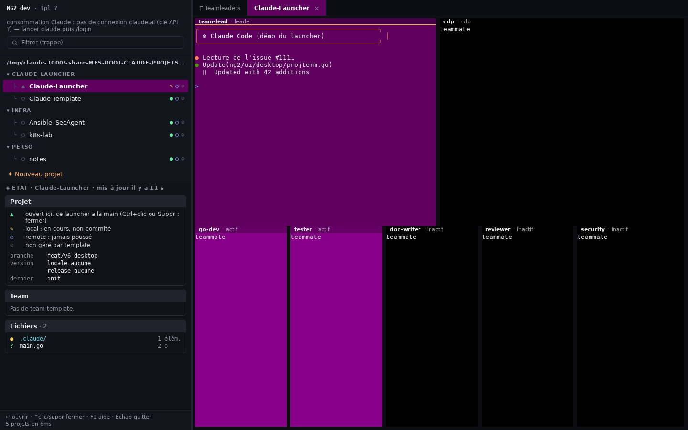

# Launcher Windows natif

> Autres guides : [Installation et lancement](installation.md) · [Configuration et projets en conteneur](configuration.md) · [Déploiement dans un cluster Kubernetes](kubernetes.md) · [Interface](interface.md) · [Versions, mises à jour et template](versions.md) · [Architecture](architecture.md) · [Dépannage](depannage.md) · [Tests](tests.md). Vue d'ensemble : [README](../README.md).

**Sommaire**

- [Windows (v6)](#windows-v6)
  - [Ce qui tourne où](#ce-qui-tourne-où)
  - [Interface native (`desktop`)](#interface-native-desktop)
  - [Correspondance de chemins : `hubs.<machine>.paths`](#correspondance-de-chemins--hubsmachinepaths)
  - [Config, cache et `config.conf`](#config-cache-et-configconf)
  - [Configuration partagée entre un hub Linux (WSL) et Windows](#configuration-partagée-entre-un-hub-linux-wsl-et-windows)
    - [Adresse publique derrière un proxy inverse (v6.3.0, #171)](#adresse-publique-derrière-un-proxy-inverse-v630-171)
  - [Prérequis : outils externes](#prérequis--outils-externes)
  - [Surveillance des projets](#surveillance-des-projets)
  - [Mise à jour automatique](#mise-à-jour-automatique)

---

## Windows (v6)

La v6 porte le launcher en application Windows native (epic #114) : un seul `.exe`, qui ouvre
l'**interface native** (Wails + xterm.js, #111) lancé sans argument. En ligne de commande,
`backends`, `configure` (Bloc-notes), `help` et `version` fonctionnent comme sous Linux ; les
sous-commandes de la coque tmux (`shell`, `nav`…) répondent par un message.

**Installation** : pas à pas dans le [README du repo — Windows](../../README.md#windows) (exe de la
release, WebView2, outils `winget`, `backends.yaml` partagé). En résumé : le runtime **WebView2**
(présent sur Windows 10 à jour et Windows 11 ; sinon `winget install --id
Microsoft.EdgeWebView2Runtime -e`), les [outils externes](#prérequis--outils-externes) des
backends déclarés (l'écran « Premier lancement » liste ceux qui manquent, avec leur commande
`winget`), le partage visible du poste et sa [correspondance de chemins](#correspondance-de-chemins--hubsmachinepaths).
L'exécutable est une application graphique : en ligne de commande, sa sortie va dans la console de
l'invite ; les outils qu'il lance (`git`, `docker`, `kubectl`, `ssh`) n'ouvrent pas de fenêtre.

### Ce qui tourne où

Les projets tournent **toujours dans un conteneur distant** : docker/podman en `tcp://` ou
`ssh://` (ou contexte docker), backend `ssh`, `k8s`. `host` et les moteurs locaux (socket par
défaut, `unix://`, `npipe://` de Docker Desktop) sont **refusés**, avec un message explicite dans
`claude-launcher-ng2 backends` et à l'ouverture d'un projet.

Le stockage partagé doit être visible du poste (par exemple `\\wsl.localhost\Ubuntu\share\MFS\…`) :
c'est à l'utilisateur de le rendre accessible avant de lancer le launcher, qui ne démarre pas WSL.


### Interface native (`desktop`)



*Capture du mode web sous Linux (`desktop --web`, faux claude) : même interface que la fenêtre Windows.*

**Lancement**

| Système | Commande | Interface |
|---|---|---|
| Windows | `claude-launcher-ng2.exe` (double-clic, ou sans argument) | fenêtre native (WebView2) |
| Windows | `claude-launcher-ng2.exe desktop --web` | la même interface dans le navigateur |
| Linux | `claude-launcher-ng2 desktop` | dans le navigateur (binaire de la release, sans cgo) ; fenêtre native si compilé avec `-tags wails,desktop,production` (WebKitGTK) |
| Linux | `claude-launcher-ng2` | la coque tmux, **inchangée** (défaut) |

`desktop --web` sert l'interface sur `127.0.0.1` (port libre, `--addr HÔTE:PORT` pour le
fixer), protégée par un jeton aléatoire dans l'URL affichée (puis un cookie de session) ; `--no-open`
n'ouvre pas le navigateur. Fermer la fenêtre ou arrêter le serveur **détache** l'interface :
les sessions des projets continuent dans leur tmux (conteneur, ou tmux local de l'hôte), et sont
retrouvées au lancement suivant (comme la coque après un arrêt du hub).

**Sécurité du mode `--web`** (v6.1.0, #149) : le jeton de l'URL n'est accepté que par la page d'amorçage, qui pose
ensuite un cookie ; `/api/call` et `/api/events` n'acceptent que le cookie. Quand le serveur écoute sur la boucle
locale, l'en-tête `Host` doit désigner la boucle locale et le port d'écoute. `/api/call` exige du JSON
(`Content-Type: application/json`) et une origine égale à `http://<Host>` : une autre page ouverte sur la machine,
même via `127.0.0.1`, ne peut pas émettre d'appel avec le cookie. Les réponses portent `Referrer-Policy: no-referrer`,
`X-Content-Type-Options`, `X-Frame-Options` et `Content-Security-Policy: frame-ancestors 'none'`.

**Interface web dans la fenêtre native** (v6.2.0, #163) : la fenêtre Windows peut aussi servir son interface dans un
navigateur. Réglage `desktop_web` (Réglages › Ce poste › Navigateur, ou `backends.yaml`), **désactivé par défaut**,
appliqué sans relance. Un port seul (`8770`) écoute sur la boucle locale. Une adresse hors boucle locale
(`0.0.0.0:8770`) est **refusée sans `allow_lan: true`** (case « Autoriser l'accès depuis le réseau »), puis signalée par
une bannière orange tant qu'elle est active. Le même port que le serveur des fichiers (`browser_server`, 8765 par défaut)
est refusé. Le bouton « Ouvrir dans le navigateur » ouvre l'URL d'amorçage (fenêtre native seulement).

- **Accès** : `127.0.0.1` ou `localhost` sur le port ; hors boucle locale, le **nom de la machine**. L'adresse IP brute
  est refusée sur une écoute `0.0.0.0` / `::` (contrôle de `Host`). En HTTP, le jeton circule en clair : préférer un
  tunnel SSH ou TLS.
- **Sessions** : le jeton d'URL n'est accepté que par la page d'amorçage, qui l'échange contre une session (cookie
  `cl_session_<port>`, jamais le jeton). 64 sessions au plus ; une session expire après 8 h sans appel, donc un onglet
  resté ouvert sans appel repasse par l'URL d'amorçage. Le jeton est conservé par poste ; il est renouvelé quand
  l'adresse d'écoute change. « Régénérer le jeton » (fenêtre native seulement) révoque les sessions et les flux SSE.
- **Client web** : il n'a pas le presse-papiers du poste, `quit`, le thème du poste, l'ouverture du navigateur, la
  régénération du jeton, ni la modification de `desktop_web` et `browser_server`. Le reste (terminaux, autres réglages,
  mise à jour) lui est permis : **le jeton donne accès aux terminaux, il faut le garder secret**.
- **Taille des terminaux** : fixée par le client qui a le focus ; un client sans clavier ne renvoie pas la sienne.
- `desktop --web` sans `--addr` prend `desktop_web.listen` s'il est fixé ; `--addr` vers le réseau sans `allow_lan`
  affiche un avertissement sur stderr.

**Ce qu'on y retrouve de la coque** (mêmes sources dans `core`) :

- à gauche, l'en-tête (versions, annonces de mise à jour orange/jaune/vert, consommation,
  alerte de connexion claude.ai), le filtre, l'**arbre des projets** par racine et catégorie, avec
  la pastille et tous les badges de la ligne (`core/legend.go` : même icône, même couleur, même
  signification au survol), la release GitHub, le bandeau à la couleur du projet ouvert, puis
  `✦ Nouveau projet` et les **cartes ◈ État** du projet sélectionné (Projet et légende, Milestone,
  Team, Fichiers) ;
- **carte Team** : mêmes lignes, surbrillance et règles que la coque Linux (voir [Interface](interface.md#interface)) :
  double-clic sur un inactif = visible ↔ caché, refus en pied de volet pour un teammate actif ou un projet en
  lecture seule ; même état sous Linux et Windows (option tmux `@cl_panevis`) : ce qui est caché d'un côté l'est
  de l'autre ; même état du template (`●` vert à jour, `○` non démarré, `⚠` orange sur un écart de version, `+` devant le nom
  si compagnon) ; son titre porte « TEAM · N · TPL vX · CLAUDE Y » (versions une seule fois), les lignes n'ont plus de
  colonne de version, la carte est plus étroite (#151) ; **infobulle** de la ligne : actif / inactif, version du template,
  version cible (ou « version cible inconnue »), écart tpl / claude, compagnon (oui, avec son fichier, ou non) ;
- à droite, l'onglet **⌗ Teamleaders** (une vignette interactive du leader de chaque projet
  ouvert, plus petit `%id`) et **un onglet par projet ouvert**, allumé tant qu'un agent travaille. L'onglet Teamleaders
  est isolé : épinglé à gauche, séparé des onglets de projets (qui défilent sans lui), sans `×`. Quand les onglets de
  projets débordent, il se réduit à son icône (infobulle « Teamleaders ») ; `Ctrl+Tab` est inchangé (#162). La barre
  d'état du hub Linux n'est pas modifiée ;
- dans l'onglet d'un projet, **un terminal par pane** de sa session tmux (leader, teammates),
  avec un en-tête « nom · état » (bandeau vert si actif, gris si inactif, neutre pour le leader, suit l'état sans relance ; #152) :
  la mise en page est celle de la coque (`core/layout.go`, organisation `top` par défaut, ou `left` :
  voir [Organisation des panes](configuration.md#organisation-des-panes--top-ou-left-v620-153)) :
  leader et `cdp` en haut ; jusqu'à 5 teammates, le haut sur 50 % et les teammates sur une ligne ;
  au-delà, 3 lignes 3/7, 2/7 et le reste, la ligne du milieu recevant ⌈n/2⌉ ; actifs en ordre MRU
  puis inactifs par nom ; actifs éclaircis, inactifs assombris sur la couleur du projet) ;
- **Ctrl+molette** : trois tailles de texte indépendantes, chacune bornée à 8–28 et mémorisée **par poste** (clé
  `desktop-ui.json`, défauts : terminaux `termFontSize` 13, arbre `treeFontSize` 13, cartes `cardsFontSize` 12). Un cran
  par encoche de molette, le pavé tactile cumule ses petits déplacements ; la page ne zoome pas.
  - sur la **zone des terminaux** : taille de tous les terminaux (projets, ouverture, vignettes Teamleaders) ; la taille
    est renvoyée à tmux (`refresh-client -C`). Aucune touche n'est retirée aux terminaux ;
  - sur l'**arbre** des projets, ou sur les **cartes** ◈ État : taille de cette zone seule, l'autre garde la sienne.
    Le message bref « Taille de l'arbre : N » / « Taille des cartes : N » confirme le cran.
  - les mêmes réglages sont dans **Réglages › Ce poste › Affichage** (une ligne −/champ/+ par zone).
- l'**ouverture** passe par le même code que `ctr-attach` (`core.OpenCtr`) : sa sortie (conteneur,
  bootstrap) et ses questions (serveur d'un groupe, autre launcher propriétaire) s'affichent dans
  un terminal d'ouverture où l'on répond ; les questions `/init-project` (template en retard ou
  absent, versions projet → disponible) et de **reprise** sont posées par le script de démarrage
  **dans le pane du leader**, comme sous Linux ;
- fermeture (Ctrl+clic, Suppr : même plan et même question o/N, `/exit`, arrêt du conteneur),
  reprise abandonnée, création de projet (géré / brut, remote, exécution), choix de l'exécution
  (F2), lecture seule et prise de main (#48), diagnostic des backends, aide et légende.

**Raccourcis**

| Touche | Effet |
|---|---|
| `↑` `↓` `PgUp` `PgDn`, clic | sélectionner (clic sur un projet ouvert : son onglet) |
| `Entrée`, double-clic | ouvrir / rejoindre le projet |
| `Ctrl`+clic, `Suppr` | fermer le projet (question o/N) ; sur un projet sans conteneur, pod ni session, `Suppr` propose la fermeture forcée ([détail](configuration.md#rafraîchir-et-forcer-la-fermeture-v620-158)) |
| frappe, `Retour arrière` | filtrer ; `Échap` efface le filtre |
| clic hors projet | onglet ⌗ Teamleaders |
| double-clic sur une catégorie ou une racine, `✦ Nouveau projet` | créer un projet |
| `F1` / `F2` / `F5` | aide et légende / exécution du projet / mises à jour, conso, arbre maintenant ; `F5` relit aussi le projet sélectionné ([Rafraîchir](configuration.md#rafraîchir-et-forcer-la-fermeture-v620-158)) |
| `Ctrl+R` / `Ctrl+U` / `Ctrl+D` / `Ctrl+,` | rescanner / masquer les annonces / diagnostic des backends / fenêtre Réglages (`⚙ config`) |
| `Ctrl`+molette sur l'arbre, les cartes ou les terminaux | taille du texte de la zone, 8–28, mémorisée par poste (`Réglages › Ce poste › Affichage`) |
| `Ctrl+←` `Ctrl+→`, bordure | largeur du navigateur (mémorisée) |
| `←` `→`, clic sur le chevron ou la ligne d'une racine / catégorie | replier / déplier (mémorisé) ; `←` sur un projet : sa catégorie |
| séparateur arbre / cartes ; clic sur le bandeau d'une carte ou sur « ◈ ÉTAT » | hauteur de l'arbre ; replier une carte ou toute la zone (mémorisé) |
| `Tab` (navigateur) ; `Alt+←` (terminal) | aller aux terminaux ; revenir au navigateur |
| `Ctrl+Tab`, `Ctrl+Maj+Tab` | onglet suivant / précédent |
| clic sur un pane ; double-clic sur son en-tête | focus clavier ; plein écran (aller-retour) |
| souris dans un pane ; molette | transmise à l'agent s'il la suit (panneau de Claude Code redimensionnable) ; sinon la molette fait défiler l'historique de tmux |
| glisser une bordure (colonne entre panes, en-tête du pane du dessous) | redimensionner le pane (`resize-pane`) |
| glisser dans un pane (`Maj`+glisser si l'agent suit la souris) | sélectionner du texte ; au relâcher, il est copié dans le presse-papiers (#155) |
| `Ctrl+Maj+C` | recopier la sélection (`Ctrl+C` reste l'interruption de l'agent) |
| `Ctrl+V`, `Ctrl+Maj+V`, `Maj+Inser`, clic droit (`Maj`+clic droit si l'agent suit la souris) | coller dans le pane actif ; refusé en lecture seule, avec un message |
| `Ctrl+B` puis `Ctrl+V` | envoyer `^V` brut au programme du pane (collage d'image de Claude Code, vim, nano) |
| `Ctrl+B z` / `Ctrl+B R` / `Ctrl+B Ctrl+B` | plein écran / remettre en ordre la team / envoyer `Ctrl+B` à l'agent |
| `Ctrl+Maj+W`, `×` de l'onglet | détacher l'onglet (la session continue) |
| `Échap` | quitter : `l` l'interface seule (projets gardés), `t` puis `o` tout fermer |

**Copier / coller dans les terminaux** (#155) :

- la sélection reste dans un pane ; elle est copiée au relâchement de la souris, même hors du terminal, et
  `Ctrl+Maj+C` la recopie. `Ctrl+C` n'est pas une copie : il envoie l'interruption à l'agent ;
- coller se fait par `Ctrl+V`, `Ctrl+Maj+V`, `Maj+Inser` ou clic droit, dans le pane actif. Le texte arrive en un
  bloc (plusieurs lignes d'un coup, sans perte) ;
- **`Ctrl+V` colle le presse-papiers du poste, il n'est pas envoyé au programme du pane.** Pour envoyer un `^V` brut
  (collage d'image de Claude Code, vim, nano), taper **`Ctrl+B` puis `Ctrl+V`** : le programme du pane reçoit `^V`
  (`Ctrl+B Ctrl+B` n'envoie que `Ctrl+B`) ;
- lecture seule (projet piloté par un autre launcher) et vignettes Teamleaders : **copier reste permis**, **coller
  est refusé** avec un message en pied de volet ; le presse-papiers n'est pas lu dans ce cas ;
- texte seulement ; un collage est limité à **4 Mo** et une copie à **8 Mo** (au-delà, refus avec message) ;
- fenêtre Windows (Wails) : le presse-papiers du poste est lu et écrit côté Go, sans invite de WebView2 ;
- mode `--web` : le presse-papiers du **navigateur** est utilisé, dans un contexte sécurisé (`localhost` convient ;
  en `http` sur une autre adresse, il est indisponible et le message le dit). Le presse-papiers de la machine qui
  héberge le serveur n'est **jamais** lu ni écrit pour un client web.

**Apparence et disposition** (#122, #123, #124) : l'arbre reprend le rendu d'un arbre natif de
Windows 11 (Explorateur) : hauteur de ligne et indentation, chevrons, survol et sélection Fluent
(barre d'accent), Segoe UI Variable, badges alignés en colonnes (local, remote, template,
conteneur, milestone, PR, reprise) avec les icônes et couleurs de la coque ; thème clair si le
système est en clair. Racines et catégories se replient ; largeur du navigateur, hauteur de
l'arbre, cartes repliées et zone des cartes masquée sont gardées dans `desktop-ui.json` du cache
du launcher. L'arbre est compact, à la densité de la coque (#132) : lignes de 17 px, décalage de 9 px par
niveau, la pastille d'un projet à la place du chevron.

**Projets lus par `\\wsl.localhost` (9P)** (#125) : chaque appel de fichier traverse WSL, et un
`git status` par projet coûte cher. L'arbre et les badges du lancement précédent
(`desktop-tree.json`, `desktop-git.json` et le cache d'état) s'affichent tout de suite et sont
complétés en tâche de fond ; git ne tourne que pour les projets sans état en cache (ouverts et
sélectionné d'abord, 4 à la fois sur un disque réseau). Le cache d'état du hub Linux peut être lu
sans y écrire, s'il est plus frais : déclarer son dossier vu du poste ; c'est un chemin Windows,
sa place est la surcharge `windows` de la machine (config partagée avec le hub Linux du même
poste, #127) :

```yaml
hubs:
  MON-PC:
    windows:
      hub_cache: '\\wsl.localhost\Ubuntu\home\moi\.cache\claude-launcher-ng2'
```

Les clés inconnues de `hubs:` (faute de frappe) sont ignorées et annoncées au démarrage par un
bandeau jaune (un clic ouvre le diagnostic, qui les liste toutes) ; le serveur web du navigateur
prend le réglage de son système (`hubs.<machine>.windows.browser_server`, 127.0.0.1:8766 par
défaut sous Windows, #121).

Les durées de chaque étape (parcours, caches, git, conso, milestones, conteneurs) sont résumées au
survol du pied et ajoutées à `desktop-perf.log` du cache (à joindre à un signalement de lenteur) :
une ligne par lecture de plus de 20 ms, « heure étape durée chemin · détail » (démarrage, git
d'un projet, calcul d'état, team, cache du hub, sessions de `~/.claude`, conso, `gh`, conteneurs,
cartes au clic). Rien de ce qui peut passer par 9P n'est lu avant l'affichage ni au clic (#130) :
le cache du hub est lu en tâche de fond et gardé en mémoire, les réglages de `CLAUDE_CONFIG_DIR`
aussi ; sur un disque réseau, les projets ni ouverts ni sélectionnés sont relus toutes les 30 min
et les sessions en suspens toutes les 30 s.

**Redimensionnement** (#126) : la taille de la zone des terminaux est transmise au tmux du projet
(`refresh-client -C L,H`) ; après la dernière taille d'une rafale (fenêtre glissée, maximiser /
restaurer), chaque pane est recapturé et la team est remise en page à la nouvelle taille.

**Différences avec la coque tmux**

- pas de tmux local sous Windows : les projets tournent dans un conteneur distant (voir
  ci-dessous) ; sous Linux, un projet sur l'hôte ouvert par `desktop` vit dans un tmux dédié
  (`tmux -L claude-desk-ng2`, une session par projet), distinct du hub de la coque ;
- les terminaux sont des widgets : le préfixe `Ctrl+B` du tmux du conteneur n'existe pas, ses
  commandes utiles ont un équivalent (tableau ci-dessus) ;
- la vignette ⌗ Teamleaders est le terminal du leader réduit à la taille de la tuile ;
- notifications (agents passés en attente, nouvelle version prête) par l'API Notification du
  web, seulement quand la fenêtre est en arrière-plan ; dans la fenêtre WebView2, leur affichage
  dépend de l'autorisation accordée par WebView2 ;
- connexion claude.ai : l'alerte ouvre un onglet `login` qui lance `claude /login` **sur ce
  poste** (claude doit y être installé) ; sinon, `/login` se tape dans le leader d'un projet ouvert.

**Fichiers de configuration** (#117) : « Éditer en YAML » (pied de la fenêtre Réglages, #118) et `⚙ env.yaml` dans les cartes d'un projet ouvrent un éditeur en **texte brut** (commentaires et mise en forme gardés) ; sa liste donne les fichiers du launcher, `config.conf` compris ;
« ← Réglages » y ramène à la fenêtre Réglages, sur la rubrique d'origine, avec une proposition d'enregistrer si le
texte a changé :

| Fichier | Emplacement | Validé par |
|---|---|---|
| `config.conf` | dossier de config (`Ng2ConfigDir`) | Linux/macOS : `bash -n`, puis le fichier sourcé comme au chargement (ses messages : avertissements) ; Windows : le lecteur Go (guillemets, parenthèses) ; puis le chargement lui-même (racine introuvable, chemin Linux sans correspondance : avertissements) |
| `backends.yaml` | dossier de config | le contrôle de `LoadBackends` (YAML, types, `hosts`, pools, `pod`), plus en avertissement les backends refusés sous Windows et les `hubs.<machine>.paths` ignorés ; `browser_server` invalide : erreur |
| `env.yaml` (outillage) | dossier de config | le lecteur de `env.yaml` (`local`, `watch` dans le projet…) |
| `env.yaml` du projet | `<projet>/.claude-launcher/` | le lecteur de `env.yaml` et la fusion avec `env-template.yaml` (`image` requise au total) ; l'environnement fusionné et le `env-template.yaml` du template s'affichent en lecture seule |

La liste donne le chemin complet, la présence et la date de chaque fichier ; un fichier absent
s'ouvre sur un modèle commenté (celui de `configure` pour `config.conf`), créé à l'enregistrement.
La validation tourne à la frappe : les erreurs s'affichent avec leur ligne (un clic y mène) et
**bloquent l'enregistrement** (le brouillon reste dans l'éditeur) ; les avertissements, non.
L'enregistrement (`Ctrl+S`) garde la version précédente en `.bak`, écrit un fichier temporaire puis
le renomme ; si le fichier a changé sur le disque depuis son ouverture, l'éditeur propose de
**recharger** ou d'**écraser**. Ensuite, `config.conf` est relu sans redémarrer (options de claude,
couleurs, mise en page, consommation, reprise ; racines et `CLAUDE_CONFIG_DIR` au prochain
lancement) et `backends.yaml` aussi (backends, pools, correspondance de chemins, outils requis) ;
un `env.yaml` sert à la prochaine ouverture du projet. `projects.json` et les caches sont des
états : pas dans la liste. API de `core` (reprise par l'interface structurée, v6.1.0) :
`ConfigFiles(projet)`, `ValidateConfig(type, contenu)`, `SaveConfig(type, chemin, contenu,
date d'ouverture)`. Sous Linux, `claude-launcher-ng2 configure` ouvre toujours `config.conf`
dans `$EDITOR`.

**Comment ça marche** : l'interface parle à `core` par un seul point d'entrée (`Dispatch`), lié à
Wails (`window.go.desktop.Bridge.Call`) ou servi en HTTP (`/api/call`), et reçoit l'état par
événements (Wails, ou flux SSE `/api/events`). Les terminaux passent par **tmux en mode
contrôle** : un client `tmux -C attach-session` dans le conteneur (`docker`/`podman`/`kubectl
exec -i`, `ssh`), de simples tuyaux sans pseudo-terminal ; il reçoit la sortie de chaque pane
(`%output`, décodée de l'octal), les changements de mise en page (`%layout-change`, géométrie lue
dans `window_visible_layout`) et envoie la frappe (`send-keys -H`) et la taille de la zone
(`refresh-client -C`). Un pane qui apparaît, change de taille ou est recapturé est amorcé
depuis la grille de tmux : écran par `capture-pane -e -N` (les fins de ligne colorées comprises,
comme le panneau latéral de Claude Code), historique au-dessus (molette), position du curseur et
modes de l'application (suivi de la souris, curseur, clavier, écran alternatif ; collage entre crochets, que tmux ne publie pas : suivi dans la sortie du pane, actif pour `claude` à défaut). Plein écran (double-clic sur l'en-tête, `Ctrl+B z`) : bascule immédiate dans l'interface, puis seul le pane concerné est recapturé (écran seul, sans l'historique) ; la team n'est relue que par le tour lent (toutes les secondes), jamais sur le chemin d'un plein écran. La mise en page est appliquée au tmux du projet par `core.ArrangeTeam`, comme le
`layout-watch` de la coque, et l'interface place chaque terminal à la géométrie de tmux.

**Construire l'exécutable** (depuis Linux ou Windows, sans cgo ni npm : xterm.js est embarqué) :

```bash
cd ng2
GOOS=windows GOARCH=amd64 CGO_ENABLED=0 go build -tags desktop,production -trimpath \
  -ldflags "-s -w -H windowsgui -X claude-launcher-ng2/core.NgVersion=v6.0.0" \
  -o claude-launcher-ng2.exe .
```

Les balises `desktop,production` sont celles qu'exige Wails (sans elles, l'exe ne s'ouvre pas et
le dit) ; la CLI `wails` n'est pas nécessaire. Versions embarquées : Wails v2.17.0, xterm.js 6.0.0,
`@xterm/addon-unicode11` 0.9.0 (`ui/desktop/frontend/vendor/VERSIONS.txt`).

**Terminaux réduits** : xterm.js 6 ignore le `transform: scale()` d'un ancêtre pour passer de la souris à la
cellule. L'interface réduit un terminal par `scale` (fenêtre tmux plus grande que la zone, vignettes Teamleaders,
bandeaux qui rétrécissent la zone) : `fixScaledMouse()` (`frontend/app.js`) rejoue donc les évènements souris à l'échelle 1,
et un `ResizeObserver` sur `#views` recalcule la réduction quand la hauteur change (#242). Test de reproduction :
`tests/integration/ui-web/clic-bandeau-242/run.sh` (`chrome-headless-shell`, interface réelle sur réponses factices).

### Correspondance de chemins : `hubs.<machine>.paths`

Le launcher lit les projets à leur chemin Windows et transmet **toujours** aux backends le chemin
Linux : montages, workdir, labels `cl.project`, nom `<catégorie>-<projet>`, `CLAUDE_CONFIG_DIR`,
`HOME`, clés de `projects.json`, contrôle du stockage partagé. Un projet a donc les mêmes nom et
labels, qu'il soit ouvert de Windows ou d'un hub Linux : pas de doublon. Déclaration par machine
dans `backends.yaml` (commun à tous les hubs en mode portable) :

```yaml
hubs:
  MON-PC:                                  # nom de la machine Windows (hostname)
    paths:
      - { local: '\\wsl.localhost\Ubuntu\share\MFS', remote: /share/MFS }
    remote_user: { uid: 1000, gid: 1000, name: moi }   # facultatif, voir plus bas
```

- `local` : préfixe Windows (`\\serveur\…`, `C:\…`), comparé sans tenir compte de la casse ni du
  séparateur ; `remote` : préfixe Linux absolu. Le préfixe le plus long l'emporte.
- **Chaque entrée vaut pour un système, d'après la forme de `local`** : forme Windows (`\\…`,
  `C:\…`) → seulement sous Windows ; forme Linux (`/…`) → seulement hors Windows. Une
  configuration portable peut ainsi être partagée par un hub Linux sous WSL et l'exe Windows du
  même poste, qui portent **le même nom de machine** (WSL reprend le hostname Windows) : l'entrée
  `\\wsl.localhost\…` ne change rien pour le hub Linux.
- `claude-launcher-ng2 backends` affiche la correspondance ; un projet ou un `CLAUDE_CONFIG_DIR`
  hors correspondance est signalé (`aucune correspondance Linux`).
- **Identité dans les conteneurs** : Windows n'a pas d'uid. Par défaut `1000:1000`,
  `HOME=/home/<nom Windows en minuscules>` ; `remote_user` (`uid`, `gid`, `name`, `home`) les fixe
  pour qu'ils correspondent au propriétaire des fichiers sur le partage.
- Sous Linux sans déclaration, rien ne change. Un hub Linux peut aussi déclarer
  `hubs.<machine>.paths` (partage monté ailleurs qu'aux chemins des conteneurs).
- Le serveur web du navigateur sert les fichiers via cette correspondance (URL = chemin Linux,
  fichier lu à son chemin Windows) ; avec `browser_server: { listen: off }`, les `browser_paths`
  par défaut en sont déduits.

### Config, cache et `config.conf`

| | Linux | Windows |
|---|---|---|
| config (`config.conf`, `backends.yaml`, `projects.json`) | `~/.config/claude-launcher-ng2/` | `%AppData%\claude-launcher-ng2\` |
| cache | `~/.cache/claude-launcher-ng2/` | `%LocalAppData%\claude-launcher-ng2\` |

Le mode portable (`<dossier du binaire>\.config\claude-launcher-ng2\config.conf`) et
`CL_CONFIG_DIR` restent prioritaires. Sous Windows, `config.conf` n'est pas lu par bash (celui de
`System32` démarrerait WSL) mais par un lecteur intégré du même format (`NOM=valeur`, tableaux
`( … )`, `declare -A`, guillemets, `$HOME`). Comme en bash, écrire les chemins UNC entre
**guillemets simples** : `GITHUB_DIRS=('\\wsl.localhost\Ubuntu\share\MFS\ROOT\CLAUDE_PROJETS')`.
`CL_ROOTS` sépare les racines par `;`.

**Fenêtre Réglages : rubriques Launcher, Conteneurs, Ce poste** (v6.1.0, #149). `⚙ config` dans l'en-tête (ou
`Ctrl+,`) ouvre les réglages en formulaires, avec les rubriques Backends, Pools et Défauts décrites plus haut
([Réglages](configuration.md#réglages--fenêtre--config-v610-118)) et :

- **Launcher** : `config.conf`, réglages groupés, avec aide et valeur par défaut (dont l'organisation des panes,
  `LAYOUT_MODE` et `LAYOUT_LEFT_LEADER_PCT`) ; « ↺ défaut » retire la clé. Le
  jeton GitHub est un champ masqué : il n'est jamais affiché ni renvoyé à l'interface (« Retirer » le supprime).
- **Conteneurs** : l'`env.yaml` du launcher (paquets par gestionnaire, `setup`, `on_start`), ajouté à tous les
  conteneurs.
- **Ce poste** : `hubs.<machine>` de `backends.yaml` (chemins « local => distant », chemins navigateur « conteneur
  => hôte [| os] », serveur web, appariement du navigateur, utilisateur distant, cache du hub) et les tailles de texte
  de l'arbre, des cartes et des terminaux (Affichage). Les surcharges propres à un autre système sont signalées (bandeau ⚠) et restent en
  lecture seule.

Ce qui n'a pas de formulaire (une clé d'une forme bash non reconnue, une clé inconnue, `unrecognized`) reste dans
« Éditer en YAML ».

**Enregistrement** : même validation que le chargement réel ; une erreur bloque l'enregistrement. Un fichier modifié
sur le disque depuis son ouverture ouvre le conflit (recharger ou écraser). La version précédente est gardée en
`.bak`. `config.conf` et son `.bak` sont écrits en `0600` : un `config.conf.bak` préexistant plus ouvert est resserré,
et un `.bak` qui est un lien est remplacé. Dans `config.conf`, seule la ligne de la clé change : commentaires et
autres lignes sont conservés ; une clé absente est ajoutée sous son exemple commenté, sinon en fin de fichier.
**`env.yaml` et `backends.yaml` sont en revanche reformatés** à l'enregistrement (commentaires et ordre conservés,
lignes vides entre entrées retirées, alignement et guillemets normalisés) : ne pas attendre un diff minimal.

**Jeton GitHub dans « Éditer en YAML »** : il est masqué (`GITHUB_TOKEN="__GARDER__"`, y compris dans un commentaire
ou un tableau). À l'enregistrement, le marqueur conserve le jeton actuel, une autre valeur le remplace, et `""` le
retire. Le marqueur n'a de sens que dans `GITHUB_TOKEN` : ailleurs, l'enregistrement est refusé. Sans jeton actuel,
le marqueur n'est jamais écrit. Les messages d'erreur ne contiennent jamais le jeton.

**`EXTRA_ENVS` en saisie structurée** : les variables qui font charger du code au lancement, ou qui modifient
l'outillage ou la sortie, sont refusées : `LD_*`, `DYLD_*`, `PATH`, `BASH_ENV`, `IFS`, `PROMPT_COMMAND`,
`NODE_OPTIONS`, `PYTHONPATH`, `GIT_SSH*`, `GIT_CONFIG*`, `GIT_PROXY*`, `*_ASKPASS`, les proxys (`*_PROXY`), les
éditeurs, pagers, shells et `HOME`, `ANTHROPIC_*`, et d'autres encore (liste dans le code). Une variable déjà écrite
telle quelle dans le fichier reste et peut être retirée ; un ajout passe par « Éditer en YAML ». Cette liste n'est pas
une barrière complète : l'éditeur de texte accepte toutes les variables, `ANTHROPIC_API_KEY` comprise.

**Substitution dans `config.conf`** : `$NOM` et `${NOM}` ne développent que `HOME`, `USER`, `LOGNAME`, `PWD`, `XDG_*`,
`GITHUB_DIR` et `CLAUDE_CONFIG_DIR` ; un secret n'entre jamais par là. Une valeur ne peut contenir ni `"`, ni `\`, ni
guillemet inverse, ni `$(`, ni retour à la ligne.

### Configuration partagée entre un hub Linux (WSL) et Windows

Avec le mode portable, le hub Linux sous WSL et l'exe Windows peuvent lire **le même**
dossier de config (`/share/…/.config/claude-launcher-ng2/` vu de Linux,
`\\wsl.localhost\Ubuntu\share\…\.config\claude-launcher-ng2\` vu de Windows). Elle reste écrite
en chemins Linux :

```bash
PROJECT_BASE="/share/MFS/ROOT/CLAUDE_PROJETS/PROJETS/"
GITHUB_DIRS=("$PROJECT_BASE")
CLAUDE_CONFIG_DIR="$PROJECT_BASE/../.claude"
```

- Sous Windows, un réglage-chemin de `config.conf` qui commence par `/` (`GITHUB_DIR(S)`,
  `CLAUDE_CONFIG_DIR`) est un **chemin vu des backends** : variables développées, `.`/`..`
  résolus en style Linux, puis converti par `hubs.<machine>.paths` pour tout accès local
  (parcours des projets, lecture de la config de claude) ; les backends reçoivent le chemin Linux
  d'origine. Il en va de même des chemins de `backends.yaml` (`shared`, clés de `volumes`,
  `browser_server.allow`).
- Il suffit donc d'ajouter **une ligne** au `backends.yaml` partagé, sans rien changer pour le hub
  Linux :

  ```yaml
  hubs:
    MSI:                                   # nom commun au poste Windows et à WSL
      paths:
        - { local: '\\wsl.localhost\Ubuntu\share\MFS', remote: /share/MFS }
  ```

- Sans cette correspondance, `backends` le dit **une fois** (section « Chemins poste →
  backends »), avec la liste des chemins Linux concernés et l'entrée à déclarer.
- `host` n'est pas affiché sous Windows s'il n'est pas déclaré (il y serait refusé) ; déclaré
  explicitement, il reste affiché avec son refus.
- **kubectl** : sous Windows il lit `%USERPROFILE%\.kube\config`, pas le `~/.kube/config` du hub.
  `context "k8s" does not exist` → copier le fichier du hub (depuis WSL :
  `cp ~/.kube/config /mnt/c/Users/<vous>/.kube/config`) ou définir `KUBECONFIG` vers lui.
- **Serveur web du navigateur : un port par système**. WSL partage le localhost de Windows : le
  hub Linux et l'exe Windows ne peuvent pas écouter sur le même port.
  - **Sans réglage**, ils cohabitent : le hub Linux écoute sur `127.0.0.1:8765` (inchangé), l'exe
    Windows sur `127.0.0.1:8766`.
  - **Surcharge par système** : `hubs.<machine>.windows`, `.linux` et `.darwin` reprennent les
    réglages de `hubs.<machine>` pour ce système seulement, clé par clé : `browser_server` (champ
    par champ : `listen`, `url`, `allow`), `browser_paths`, `browser_device`, `paths` et
    `remote_user`. Un `listen` fixé dans `hubs.MSI.browser_server` vaut pour les deux systèmes :
    il faut alors donner son port à Windows.
  - **Fautes de frappe : avertissement, jamais d'erreur** (le fichier est partagé avec le hub de
    production). Une clé inconnue sous `hubs.<machine>` ou dans un bloc de système est ignorée, le
    reste du bloc et du fichier s'applique. `backends` la signale avec sa ligne, et une suggestion
    si elle ressemble à une clé connue :
    `hubs.MSI : ligne 4 : clé "window" inconnue, ignorée — vouliez-vous dire windows ?`. Le
    menu du hub (pane de navigation) affiche le premier avertissement au démarrage.

    ```yaml
    hubs:
      MSI:
        browser_server: { listen: 127.0.0.1:8080 }      # hub Linux (WSL)
        windows:
          browser_server: { listen: 127.0.0.1:8081 }    # exe Windows
        paths:
          - { local: '\\wsl.localhost\Ubuntu\share\MFS', remote: /share/MFS }
    ```

  - Chaque launcher donne à ses sessions l'URL de **son** serveur (`CL_BROWSER_PATH_MAP` =
    `http://localhost:8081` pour une session lancée depuis l'exe Windows, `http://localhost:8080`
    depuis le hub Linux) et son propre jeton d'appariement : la page
    `/__claude-launcher__/pair` de l'autre launcher refuse ce jeton (« autre launcher »).
  - `backends` affiche, sous Windows ou avec une surcharge, l'origine du port
    (« réglage pour windows : listen de hubs.MSI.windows.browser_server.listen », ou
    « défaut Windows »).
  - Le serveur indique son système (en-tête `X-Claude-Launcher-OS`). Si le port est malgré tout tenu
    par le launcher de l'autre système (même `listen` pour les deux), `backends` l'affiche (« port
    tenu par le hub linux ») avec la clé à déclarer, et le launcher Windows ne cherche pas à le lui
    disputer.
- **Interface web de la fenêtre native (`desktop_web`)** (v6.2.0, #163) : désactivée par défaut. Comme `browser_server`,
  elle se déclare dans `defaults`, `hubs.<machine>` et se surcharge par système (`.windows`, `.linux`, `.darwin`), champ par
  champ. Une écoute hors boucle locale exige `allow_lan: true` ; le même port que `browser_server` du même système est refusé.

  Le commutateur `enabled` (v6.3.0, #183) allume ou éteint l'interface sans toucher à `listen` : `enabled: false` garde
  l'adresse, `enabled: true` exige une adresse d'écoute (sinon erreur « interface web activée sans adresse d'écoute »).
  Absent, l'interface est allumée si `listen` est renseigné, comme en v6.2.0. Le changement s'applique à l'enregistrement,
  sans relance, et n'affecte pas le serveur des maquettes. Dans Réglages › Ce poste, la rubrique « Interface web » affiche
  la valeur effective pour ce poste et ce système, avec sa provenance comme pour le serveur de maquettes ; le commutateur
  propose `127.0.0.1:8787` quand on l'allume sans adresse saisie. En mode serveur (`desktop --web`), `enabled` est
  ignoré. Depuis un client web, `desktop_web` et `browser_server` sont en lecture seule.

  ```yaml
  defaults:
    desktop_web: { enabled: true, listen: "8770" }  # port seul = boucle locale (127.0.0.1:8770)
  hubs:
    MSI:
      desktop_web: { listen: "0.0.0.0:8770", allow_lan: true }   # réseau : accès par le nom de la machine
      windows:
        desktop_web: { listen: "127.0.0.1:8771" }   # ce système seulement
  ```

  Une écoute `":8770"` (sans hôte) n'est pas reconnue comme boucle locale : elle est refusée sans `allow_lan: true`.

#### Adresse publique derrière un proxy inverse (v6.3.0, #171)

Quand l'interface web est servie derrière un proxy HTTPS (Ingress, Traefik, nginx, Caddy), le navigateur ne voit pas
l'adresse d'écoute. Le réglage `url` donne l'adresse publique :

```yaml
defaults:
  desktop_web: { enabled: true, listen: "0.0.0.0:8770", allow_lan: true, url: "https://launcher.exemple" }
```

- **Forme** : `http://hôte[:port]` ou `https://hôte[:port]`, sans chemin, sans paramètres, sans identifiants. Toute
  autre forme éteint l'interface et affiche la raison dans l'état (`webUI.msg`).
- **Sources**, par priorité : option `--url` > variable `CL_WEB_URL` > `desktop_web.url`.
- **Hôte** : un nom RFC 1123 (lettres, chiffres, `-`, `.`) ou une adresse IP. Un nom internationalisé est converti en
  punycode. `%`, `_`, espaces et autre ponctuation sont refusés.
- **Port** : le port par défaut du schéma est retiré (`https://h:443` ≡ `https://h`), comme le font `Host` et `Origin`
  du navigateur.
- L'interface est toujours servie à la racine du nom : pas de préfixe de chemin.
- **En-têtes** : aucun `X-Forwarded-*`, `Forwarded` ni `X-Real-IP` n'est lu. Le schéma et l'hôte publics viennent
  seulement de `url`.

Effets : le `Host` admis est celui de `url` (sur son port) en plus de la boucle locale et de la machine. L'origine admise
est exactement celle de `url`. Le cookie de session prend `Secure` quand `url` est en `https`, et son nom devient
`__Host-cl_session_<port>` (ou `__Host-cl_session`). Un accès direct au port d'écoute en HTTP ne garde donc pas de session.

**Amorçage** : `GET /?t=<jeton>` ne sert jamais la page. Un jeton valide pose le cookie et répond `303` vers `/`, sans
`t`. Un jeton invalide sans session répond `403` ; avec une session valide, `303` sans nouveau cookie. Le jeton
reste réutilisable jusqu'à sa régénération : il apparaît donc dans les journaux du proxy à la première requête, à
masquer côté proxy.

**Refus `403`** : l'en-tête `X-Launcher-Refusal` indique la cause. `host` : hôte non admis. `origin` : origine non admise.
`session` : cookie absent, expiré ou révoqué. `method` : méthode non permise sur `/api/call`. Seul `session` signifie
« session perdue » ; l'interface n'affiche la bannière d'expiration que dans ce cas.

**Sondes** : `GET /healthz` répond `200 ok` dès que le serveur vit. `GET /readyz` répond `200 ok` quand le chargement
initial est fini, `503` avant. Les deux sont sans session et hors contrôle de `Host`, et ne révèlent rien (ni version,
ni état des projets). Elles servent aux sondes de Kubernetes.

**Exemples de proxy** (à valider en QUALIF) :

```nginx
# nginx : le Host public est transmis ; le flux SSE n'est pas tamponné
location / {
    proxy_pass http://127.0.0.1:8770;
    proxy_set_header Host $http_host;          # port public inclus
    proxy_http_version 1.1;
    proxy_set_header Connection "";
}
location /api/events {
    proxy_pass http://127.0.0.1:8770;
    proxy_set_header Host $http_host;
    proxy_buffering off;
    proxy_read_timeout 300s;                   # > battement de 20 s
}
```

```caddyfile
# Caddy : Host transmis par défaut ; flush immédiat pour le flux SSE
launcher.exemple {
    reverse_proxy 127.0.0.1:8770 {
        flush_interval -1
    }
}
```

```yaml
# Traefik : pas de middleware buffering sur la route ; le délai de lecture de l'entrypoint doit dépasser 20 s
entryPoints:
  websecure:
    transport:
      respondingTimeouts:
        readTimeout: 300s
```

**Rappel** : derrière le proxy, ne publiez pas le port d'écoute autrement (Service, `hostPort`, pare-feu ouvert) : le
jeton est alors la seule barrière. Sur Kubernetes, gardez un `ClusterIP` et le proxy de l'Ingress.

### Prérequis : outils externes

Ils ne sont pas embarqués ; `claude-launcher-ng2 backends` liste ceux qu'exigent **les backends
déclarés**, et pour chaque outil manquant la commande à lancer :

| Outil | Requis par | Installation (Windows) |
|---|---|---|
| `ssh` | backend `ssh`, docker en `ssh://` | intégré à Windows 10/11 ; sinon `Add-WindowsCapability -Online -Name OpenSSH.Client~~~~0.0.1.0` |
| `git` | le launcher (badges, template) | `winget install --id Git.Git -e` |
| `docker` | backends docker distants (client seul, sans Docker Desktop) | `winget install --id Docker.DockerCLI -e` |
| `podman` | backends podman distants | `winget install --id RedHat.Podman -e` |
| `kubectl` | backend `k8s` | `winget install --id Kubernetes.kubectl -e` |
| `gh` | facultatif (repli par l'API GitHub) | `winget install --id GitHub.cli -e` |

### Surveillance des projets

Sous `\\wsl.localhost\…` (9P) et sur tout chemin UNC ou lecteur réseau, les notifications de
Windows ne remontent pas : les projets y sont **relus périodiquement**, comme sous Linux sur
9p/FUSE/NFS (voir [Détection des changements](architecture.md#détection-des-changements-dun-projet)).

### Mise à jour automatique

La release publie le binaire Windows sous le nom `claude-launcher-ng2.exe` (windows/amd64,
interface native comprise), avec les binaires Linux et macOS (noms inchangés) et un seul
`SHA256SUMS` (#112) ; chaque système y prend son fichier. Un `.exe` en cours
d'exécution ne peut pas être remplacé : il est renommé `claude-launcher-ng2.exe.old`, le nouveau
est posé à sa place et lancé, puis l'ancien processus se termine ; le `.old` est supprimé au
démarrage suivant. Linux et macOS : inchangé (rename atomique, puis `execve`).
